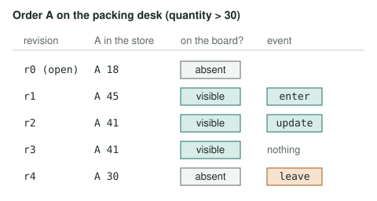

# 02 · Keep the right orders on the board

B is visible at 42 units. A supervisor corrects it to 52. If the desk only reports arrivals and departures, a picker still counts out 42. The subscriber needs to hear about changes to rows that remain visible.

Start with a working `openView`. This chapter builds `classify` in `work/runtime.mjs`. Allow about four minutes to read and fifteen to implement and probe the cases.

<details>
<summary>Optional AI coach prompt</summary>

> Look at classify in my work/runtime.mjs. Use the dispatch desk, which sees every open order. Give me two before-and-after pairs from the dispatch desk’s point of view, covering an unknown quantity and a deletion. Ask me to predict each event before we run either example.

</details>

## Work from the subscriber’s two pictures

Our query returns the row’s ID and quantity. Immediately before a commit, the desk has either a visible row for an ID or nothing. Immediately after, the same two possibilities apply. The poll you write in lesson 03 calls `classify` and turns “doesn’t match the query” and “deleted from the store” into the same input, `null`. The subscriber will take the same action in both cases.

Suppose the store changes A from 18 to 45. Its history contains an update to an existing order. The desk has never displayed A. The classifier therefore receives `null` and `{id:'A', quantity:45}` and emits an **enter** event carrying A’s complete row. A second correction to 41 becomes an **update**.

Before reading the table, predict what a second write of 41 should do while A is already visible at 41. What state would a picker have to change? Save your prediction even if the classifier is still unfinished.

```sh
node lab.mjs check 02 --predict 'replace this with the event for two visible versions with equal fields'
```

| Before the commit | After the commit | Subscriber receives |
| --- | --- | --- |
| Absent | Visible | `{type:'enter', id, row:after}` |
| Visible | Visible, changed quantity | `{type:'update', id, row:after}` |
| Visible | Absent | `{type:'leave', id, row:null}` |
| Visible | Visible, same quantity | Nothing |
| Absent | Absent | Nothing |



For the last two cases the classifier returns `null`. The enclosing poll still reports the revision even if no order changed on the desk. Use the stable ID on every event. With it the desk can remove B after a cancellation even though the new row is absent.

## See a transaction end

A transaction is a group of writes that the store **commits**, or accepts, all together. In this lab the same ID can occur twice in one transaction. Consider B at 42. A transaction writes B at 3, then B at 42. The desk should never take B off the board. It compares B before the commit with B after it, and both are 42. Emitting on each intermediate write could tell a picker to abandon an order only to pick it up again.

Run this from the course directory.

```sh
node --input-type=module <<'JS'
import { createStore } from './lib/store.mjs';
const s = createStore([{ id: 'B', quantity: 42 }]);
s.commit([{ id: 'B', quantity: 3 }, { id: 'B', quantity: 42 }]);
console.log(JSON.stringify(s.changesAfter(0)));
JS
```

The feed has one revision with one change containing the final row for B. It lists touched IDs in the order of their first write, even if their final value equals the old value. Because every touched ID is listed, your poll can work out the visible effect for any matcher that judges a row by its own quantity.

## Write the classifier

Replace the throw in `work/runtime.mjs`’s `classify(before, after)`. Its inputs are projected rows for the same ID, each of which may be absent. A present row object can itself have a null quantity if a different matcher selected unknown quantities. Test row presence before looking at quantity.

Use the table for your return values. A stored row is immutable, so sending the final row as the event payload is safe. Compare the old and new field values to identify a no-op. Comparing object identities would turn a fresh copy of B at 42 into an invented correction.

```sh
node lab.mjs check 02 --help-used 'describe your route'
```

If the check flags a visible correction, inspect which row your payload carries. If it flags a no-op, compare `before.quantity` and `after.quantity` with distinct objects in the Node console. Run the check again after your repair.

## Use the same classifier for a different desk

A dispatcher wants to see all open orders, including orders with unknown quantities. Work out what the dispatcher receives as one order goes through four commits: create the order with an unknown quantity, correct it to 40, reset it to unknown, then cancel it. Write the four before/after row pairs the dispatcher sees, then run them through your classifier in a small script or the Node REPL. Compare this dispatcher with the packing desk on the same writes. Both desks follow the same event table. Their matchers produce different visible versions. Lesson 03 lets you watch those desks side by side.

Materialize, a streaming SQL database, offers `SUBSCRIBE` for results that change over time. Each output row carries a signed count of copies added or removed, so an update arrives as the old row removed and the new row added, and it can also report progress. The enter, update and leave messages in this exercise are a design choice for a desk keyed by order ID. [Materialize SUBSCRIBE](https://materialize.com/docs/sql/subscribe/)
