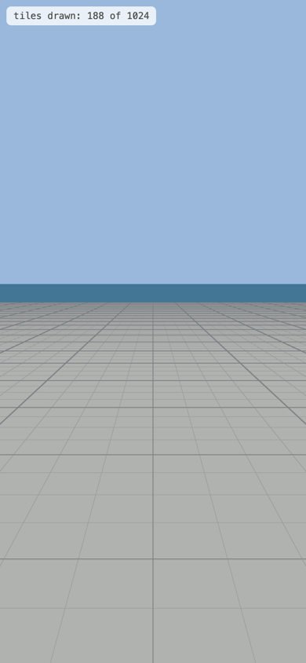
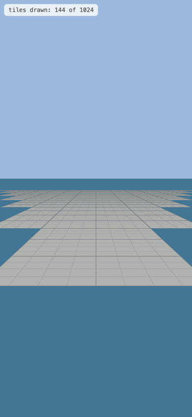
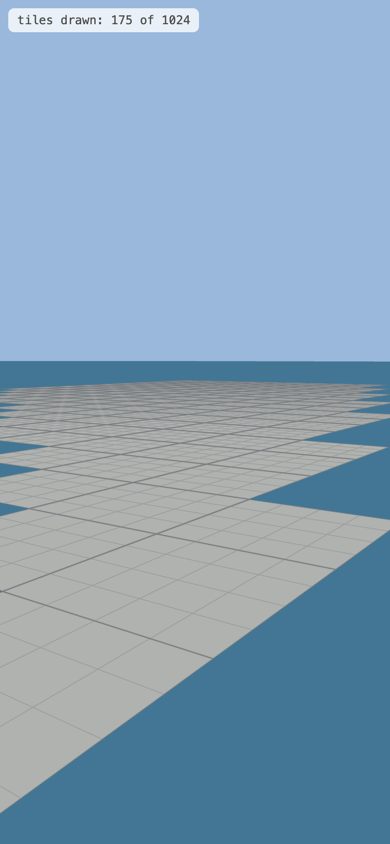

# 1 · Camera over a plane

This course builds one HTML file that grows an island from a number in its link, and each lesson adds one layer to it. This lesson adds the camera: you fly over a grey plane, laid in square tiles, in a flat blue sea.

You will type two functions. `aim` turns the camera toward a point; the page uses it to choose where you start looking. `boxHidden` says whether a box can be seen at all; the page asks it about every tile and skips drawing the ones it rules out.



**Before you start:** Node 22 or newer, and a browser with WebGL2. Run every command from this course's folder.
**Code scope:** you type 12 lines, the bodies of `aim` and `boxHidden`, and the lesson walks through 43 supplied lines, `viewMatrix` and `frustumPlanes`. The rest of `project/world.html` is supplied. The new application is about 10 lines of your own.
**Time:** about 7 minutes to read and 30 to 60 minutes to build; neither is measured with learners yet.

## Make your project and open it

Each command makes a new folder, and refuses one that exists:

- **Type it:** `node lab.mjs start project write`. In `project/world.html` the bodies of `aim` and `boxHidden` are one line each, `throw new Error('aim: not written yet')`, for you to replace.
- **Start from working code:** `node lab.mjs start project supplied`. Both are written; read the listings instead.
- **Brief an agent:** `node lab.mjs start project ai`. The write route's holes, for an agent to fill from your brief (last section).

Every route also gets `project/map.js`, for the new application.

On a computer, double-click `project/world.html` to open it in a browser. For a phone, run `node lab.mjs serve project --lan` and type the address it prints, such as `http://192.168.1.20:8080/world.html`, into the phone's browser on the same Wi-Fi; Ctrl+C stops the server. On the write route the page names the first function not yet written, such as `aim: not written yet`.

| | Look | Fly |
| --- | --- | --- |
| Phone | drag one finger | hold two fingers, or the arrow button |
| Computer | drag | W A S D; E to rise, Q to sink, Shift for speed |

You start 60 m above the sea, 420 m back from the plane's centre.

## From a point to a pixel

A **matrix** here is a grid of 4 by 4 numbers that moves a point: give the point a fourth number, w, equal to 1, and each row, multiplied with x, y, z, w and summed, gives one new number. The file keeps a matrix as 16 numbers in a **typed array**, a fixed-length array of one kind of number; `Float32Array` holds the 32-bit numbers WebGL, the browser's drawing interface, reads.

The **view** matrix moves the world so the camera sits at the origin, looking down −z. The **projection** matrix then squeezes what the camera can see into a box; its output, four numbers x, y, z and w, is **clip space**. `examples/trace-point.mjs` follows one point where two ruled lines cross:

<!-- code-example {"file":"examples/trace-point.mjs","region":"trace","language":"js","title":"examples/trace-point.mjs: one point, from the world to a pixel","change":"Study; run it with node examples/trace-point.mjs."} -->
```js {"file":"examples/trace-point.mjs","region":"trace","title":"examples/trace-point.mjs: one point, from the world to a pixel","change":"Study; run it with node examples/trace-point.mjs."}
const width = 390;
const height = 844;
const aspect = width / height;
const tanY = (0.52 / Math.sqrt(aspect)) * 0.88; // the frame region's lens, upright
const eye = [0, 60, -420]; // the start pose: yaw 0, pitch -0.1
const view = viewMatrix(new Float32Array(16), eye, 0, -0.1, [], [], []);
const proj = perspective(new Float32Array(16), tanY, aspect, 0.6, 20000);

// m times [x, y, z, w], for 16 numbers stored column by column
const times = (m, [x, y, z, w]) =>
  [0, 1, 2, 3].map(
    (r) => m[r] * x + m[4 + r] * y + m[8 + r] * z + m[12 + r] * w,
  );

const point = [20, 1, 0]; // where two ruled lines cross
const seen = times(view, [...point, 1]); // camera at 0, looking down -z
const clip = times(proj, seen); // inside the view: -w <= x, y, z <= w
const ndc = clip.slice(0, 3).map((v) => v / clip[3]); // each -1..1
const pixel = [((ndc[0] + 1) / 2) * width, ((1 - ndc[1]) / 2) * height];
const once = times(mul4(new Float32Array(16), proj, view), [...point, 1]);
```
<!-- /code-example -->

<!-- code-example {"file":"examples/trace-point.txt","language":"text","title":"What it prints"} -->
```text {"file":"examples/trace-point.txt","title":"What it prints"}
world point   20.00, 1.00, 0.00
view space    -20.00, -16.78, -423.79, 1.00
clip space    -64.30, -24.92, 422.62, 423.79
divided by w  -0.15, -0.06, 1.00
pixel         165.42, 446.81
mul4 at once  -64.30, -24.92, 422.62, 423.79
```
<!-- /code-example -->

In clip space the point is on screen because x, y and z each lie between −w and w. Divided by w, x and y give the place on the screen from −1 to 1, and z the depth. The point is at x 20, yet it lands left of centre, at pixel 165 of 390: facing +z, the camera's right is −x. `mul4` multiplies two matrices, so one combined matrix, projection times view, does both steps; every shader receives it. The view matrix comes from the eye and two angles:

<!-- code-example {"file":"examples/camera.txt","region":"viewMatrix","language":"js","title":"viewMatrix, in the 1-camera (pure) region","change":"Study: supplied."} -->
```js {"file":"examples/camera.txt","region":"viewMatrix","title":"viewMatrix, in the 1-camera (pure) region","change":"Study: supplied."}
// The view matrix: it moves the world so that the camera sits at the origin
// and looks along -z. Yaw turns around the up axis, pitch tilts up and down.
// It also fills R, U and Fw with the camera's right, up and forward axes.
function viewMatrix(m, eye, yaw, pitch, R, U, Fw) {
  // Forward (fx, fy, fz): the way the camera faces.
  const level = Math.cos(pitch);
  const fx = Math.sin(yaw) * level;
  const fy = Math.sin(pitch);
  const fz = Math.cos(yaw) * level;
  // Right (rx, 0, rz): level, and square to forward.
  const toUnit = 1 / Math.sqrt(fx * fx + fz * fz);
  const rx = -fz * toUnit;
  const rz = fx * toUnit;
  // Up (ux, uy, uz): square to both.
  const ux = -rz * fy;
  const uy = rz * fx - rx * fz;
  const uz = rx * fy;
  // The matrix is stored column by column. Each row measures a point along
  // one axis: right, up, then backward, because the camera looks along -z.
  // Column 1: what each axis takes from the world's x.
  m[0] = rx;
  m[1] = ux;
  m[2] = -fx;
  m[3] = 0;
  // Column 2: what each axis takes from the world's y. Right is level.
  m[4] = 0;
  m[5] = uy;
  m[6] = -fy;
  m[7] = 0;
  // Column 3: what each axis takes from the world's z.
  m[8] = rz;
  m[9] = uz;
  m[10] = -fz;
  m[11] = 0;
  // Column 4 brings the eye to the origin: minus the eye, measured along
  // each axis.
  m[12] = -(rx * eye[0] + rz * eye[2]);
  m[13] = -(ux * eye[0] + uy * eye[1] + uz * eye[2]);
  m[14] = fx * eye[0] + fy * eye[1] + fz * eye[2];
  m[15] = 1;
  R[0] = rx;
  R[1] = 0;
  R[2] = rz;
  U[0] = ux;
  U[1] = uy;
  U[2] = uz;
  Fw[0] = fx;
  Fw[1] = fy;
  Fw[2] = fz;
  return m;
}
```
<!-- /code-example -->

**Yaw** turns the camera about the up axis, from +z toward +x; **pitch** tilts it up (positive) or down.

## aim: turn the camera toward a point

The camera faces (sin yaw · cos pitch, sin pitch, cos yaw · cos pitch). So yaw is the angle whose sine goes with the x difference and cosine with the z difference, and pitch is the angle of the climb over the level distance. `Math.atan2(a, b)` gives such an angle for every sign of a and b, and 0 when both are 0. Replace the body of `aim`:

<!-- code-example {"file":"examples/camera.txt","region":"aim","language":"js","title":"aim, in the 1-camera (pure) region","change":"Write route: type the body in place of the throw line."} -->
```js {"file":"examples/camera.txt","region":"aim","title":"aim, in the 1-camera (pure) region","change":"Write route: type the body in place of the throw line."}
// Yaw and pitch that look from eye to target.
function aim(eye, target) {
  const dx = target[0] - eye[0];
  const dy = target[1] - eye[1];
  const dz = target[2] - eye[2];
  // How far away the target is over the ground, leaving height out.
  const level = Math.sqrt(dx * dx + dz * dz);
  return [Math.atan2(dx, dz), Math.atan2(dy, level)];
}
```
<!-- /code-example -->

Angles are in radians and positions in metres throughout. Pitch stays between −π/2 and π/2, so the camera is never upside down. A target equal to the eye gives 0 and 0, not NaN ("not a number"), which in a view matrix would blank the picture.

## Which boxes can be seen

The camera sees a **frustum**: a pyramid with its top cut off by the near plane, 0.6 m in front of the eye, its base at the far plane, 20 km away, and four sides through the screen's edges. `frustumPlanes` reads the six planes from the combined matrix. Each is four numbers a, b, c, d, and a point is on the inner side when a·x + b·y + c·z + d is 0 or more. The left plane, for example, is clip space's x ≥ −w written as w + x ≥ 0: row 4 of the matrix plus row 1.

<!-- code-example {"file":"examples/camera.txt","region":"frustumPlanes","language":"js","title":"frustumPlanes, in the 1-camera (pure) region","change":"Study: supplied."} -->
```js {"file":"examples/camera.txt","region":"frustumPlanes","title":"frustumPlanes, in the 1-camera (pure) region","change":"Study: supplied."}
// The six planes of the view volume, from the combined matrix: left, right,
// bottom, top, near, far. Each is four numbers a, b, c, d, and a point is on
// the inner side when a*x + b*y + c*z + d is 0 or more.
function frustumPlanes(out, m) {
  for (let i = 0; i < 6; i++) {
    // Planes come in pairs, one pair for each of x, y and z.
    const axis = i >> 1;
    const sign = i & 1 ? -1 : 1;
    // Row 4 of the matrix, plus or minus the row of that axis.
    for (let k = 0; k < 4; k++)
      out[i * 4 + k] = m[k * 4 + 3] + sign * m[k * 4 + axis];
  }
  return out;
}
```
<!-- /code-example -->

A box can be skipped when it lies wholly outside one plane. For each plane, test only the corner reaching furthest to the inner side: `x1`, the larger x, where the plane's x factor is positive, `x0` where it is negative, and the same for y and z. If that corner is below 0, so is all of the box.


Replace the body of `boxHidden`:

<!-- code-example {"file":"examples/camera.txt","region":"boxHidden","language":"js","title":"boxHidden, in the 1-camera (pure) region","change":"Write route: type the body in place of the throw line."} -->
```js {"file":"examples/camera.txt","region":"boxHidden","title":"boxHidden, in the 1-camera (pure) region","change":"Write route: type the body in place of the throw line."}
// True when a box lies wholly outside one of the planes, so nothing in it can
// be seen. The box runs from (x0, y0, z0) to (x1, y1, z1).
function boxHidden(pl, x0, y0, z0, x1, y1, z1) {
  for (let i = 0; i < 24; i += 4) {
    // The corner of the box that reaches furthest to this plane's inner side.
    const x = pl[i] > 0 ? x1 : x0;
    const y = pl[i + 1] > 0 ? y1 : y0;
    const z = pl[i + 2] > 0 ? z1 : z0;
    // If even that corner is outside, the whole box is.
    if (pl[i] * x + pl[i + 1] * y + pl[i + 2] * z + pl[i + 3] < 0) return true;
  }
  return false;
}
```
<!-- /code-example -->

This never hides a box with a point in view; it may keep one just outside a corner of the frustum, which costs only drawing time.

Question 1a. From the start pose, on a phone held upright, which of these flat boxes of ground does `boxHidden` report as hidden? (a) x −10 to 10, z −10 to 10, the square at the plane's centre; (b) x −10 to 10, z −430 to −410, straight below the camera; (c) x −1,000 to 200, z −10 to 10, a strip 1,200 m long; (d) x 590 to 610, z −10 to 10, 600 m to the camera's left. Commit before reading on:

```sh
node lab.mjs predict project 1a YOUR_ANSWER
```

Then see your `boxHidden` from above: `view` tests a 64 m square of ground in each cell of a 32 by 32 map, the page's tiles, with +z at the top and −x on the right.

```sh
node lab.mjs view project --boxes 1a
```

<!-- code-example {"file":"examples/view-start.txt","region":"near","language":"text","title":"node lab.mjs view project: the rows nearest the camera, @"} -->
```text {"file":"examples/view-start.txt","region":"near","title":"node lab.mjs view project: the rows nearest the camera, @"}
. . . . . . . . . . . . # # # # # # # # . . . . . . . . . . . .
. . . . . . . . . . . . . # # # # # # . . . . . . . . . . . . .
. . . . . . . . . . . . . # # # # # # . . . . . . . . . . . . .
. . . . . . . . . . . . . # # # # # # . . . . . . . . . . . . .
. . . . . . . . . . . . . # # # # # # . . . . . . . . . . . . .
. . . . . . . . . . . . . . # # # # . . . . . . . . . . . . . .
. . . . . . . . . . . . . . # # # # . . . . . . . . . . . . . .
. . . . . . . . . . . . . . # # # # . . . . . . . . . . . . . .
. . . . . . . . . . . . . . . # # . . . . . . . . . . . . . . .
. . . . . . . . . . . . . . . # # . . . . . . . . . . . . . . .
. . . . . . . . . . . . . . . @ . . . . . . . . . . . . . . . .
. . . . . . . . . . . . . . . . . . . . . . . . . . . . . . . .
. . . . . . . . . . . . . . . . . . . . . . . . . . . . . . . .
```
<!-- /code-example -->

It keeps 188 of 1,024 squares, the count in the page's corner; the ground below the camera is out of view. Now run the checks:

```sh
node lab.mjs check project 1
```

The six contract checks test what any correct version does: `aim` puts the target on the centre line for 307 eye and target pairs, and across 9,000 boxes from six cameras `boxHidden` never hides one with a point in view and always hides one wholly outside a plane. The map checks wait for the new application, and a closing note compares your answers with the stage file's.

## Break it, see it, repair it

In your `boxHidden`, swap `x1` and `x0` in the line that picks `x`, so each plane tests the box's nearest x. Reload the page and turn slowly.





Tiles drop out at the edges of the screen: the count falls from 188 to 144, and turned to the left it reads 175 where it read 209. A tile crossing a side plane, which has a large x factor, is now tested on its outer side, so which tiles go depends on which way you face. `node lab.mjs view project` gives the exact picture:

<!-- code-example {"file":"examples/view-break.txt","region":"near","language":"text","title":"With the swap: the start pose"} -->
```text {"file":"examples/view-break.txt","region":"near","title":"With the swap: the start pose"}
. . . . . . . . . . . . . # # # # # # . . . . . . . . . . . . .
. . . . . . . . . . . . . . # # # # . . . . . . . . . . . . . .
. . . . . . . . . . . . . . # # # # . . . . . . . . . . . . . .
. . . . . . . . . . . . . . # # # # . . . . . . . . . . . . . .
. . . . . . . . . . . . . . # # # # . . . . . . . . . . . . . .
. . . . . . . . . . . . . . . # # . . . . . . . . . . . . . . .
. . . . . . . . . . . . . . . # # . . . . . . . . . . . . . . .
. . . . . . . . . . . . . . . # # . . . . . . . . . . . . . . .
. . . . . . . . . . . . . . . . . . . . . . . . . . . . . . . .
. . . . . . . . . . . . . . . . . . . . . . . . . . . . . . . .
. . . . . . . . . . . . . . . @ . . . . . . . . . . . . . . . .
. . . . . . . . . . . . . . . . . . . . . . . . . . . . . . . .
. . . . . . . . . . . . . . . . . . . . . . . . . . . . . . . .
```
<!-- /code-example -->

Then `node lab.mjs check project 1` names the fault:

<!-- code-example {"file":"examples/check-break.txt","language":"text","title":"node lab.mjs check project 1, the box checks, with the swap"} -->
```text {"file":"examples/check-break.txt","title":"node lab.mjs check project 1, the box checks, with the swap"}
  FAIL 1.box-keeps-visible: boxHidden hid 111 of 617 boxes that are partly in view. First, from the camera the start pose on a phone: the box x -325.192..169.777, y 1..1, z -63.131..-45.506; it crosses the left and right planes with its centre in view, and its point [-77.707, 1, -63.131] is inside all six planes. For each plane, test the corner furthest along its normal: x1 where the plane's x factor is positive, x0 where it is negative, and the same for y and z. A test of the nearest corner hides boxes that cross a plane.
  PASS 1.box-hides-outside
  PASS 1.box-steady
```
<!-- /code-example -->

Swap them back and check again until the six contract checks pass. Each run is saved with your file under `project/attempts/`.

## Use it on a new case: a map camera

A map looks straight down with no perspective. In `project/map.js`, write `mapCamera(m, cx, cz, half, aspect)`, filling `m` with the combined matrix of a map centred on (cx, cz); `half` is the distance in metres from (cx, cz) to the nearer edge of the screen, `aspect` the screen's width over its height. Its projection is **orthographic**: x and y are scaled so the map fills −1 to 1, and w stays 1, so nothing shrinks with distance. The map must:

- put +z up the screen and −x to the right, as the start view does;
- keep every height from −100 m to 900 m between its near and far planes, a higher point getting the smaller depth. Leave a little room beyond both endpoints so rounding a matrix entry to a 32-bit float cannot clip a point on the boundary;
- give planes from which your `boxHidden` keeps the squares on the map and hides those off it.

`map.js` is a plain script (no `import` or `export`) that sees your world's pure functions. Write it yourself on every route; the map checks test it, and `node lab.mjs view project --map --half 300` draws it.

## Brief an agent

The finished island was built from briefs like this. A brief has six parts:

1. **The goal, as something on screen:** "the target sits at the centre of the screen", not "a good camera".
2. **Fixed constraints:** one HTML file; no libraries; no images or other assets; the determinism rule: whatever shapes the island uses only `+ − * /`, `Math.sqrt`, `Math.floor`, `Math.ceil`, `Math.imul`, `Math.abs`, `Math.min` and `Math.max`, never `Math.random` (the camera shapes nothing and may use trigonometry).
3. **The interface:** each function's name, arguments, units and result, such as "`frustumPlanes(out, m)` fills `out` with six planes a, b, c, d from `m`, the combined matrix as 16 numbers column by column; a point in metres is inside when a·x + b·y + c·z + d ≥ 0."
4. **The command to run and pass:** `node lab.mjs check project 1`.
5. **References by their properties:** "+z up and −x right, like the start view", not "like a normal map".
6. **What to hand back:** the check's output, what it opened and looked at, and the faults it knows of.

On the AI route, write `project/briefs/01.md` with these six parts for `aim` and `boxHidden`, and run `node lab.mjs brief project 1`, which checks that it names the interface, the constraints and the check command; it does not grade the writing. Give the brief and `project/world.html` to your agent, run `node lab.mjs check project 1 --help-used "agent: NAME"`, read its code, and do the break and repair on it.

## Keep the working world

`node lab.mjs status project` lists your route, checks, predictions and briefs in order. `node lab.mjs recover project 1` writes stage 1 to `project/recovery/world-01.html` without touching your file. Lesson 2 starts a new file, `project/world-02.html`, that carries your camera into an island grown from the seed in the link.
