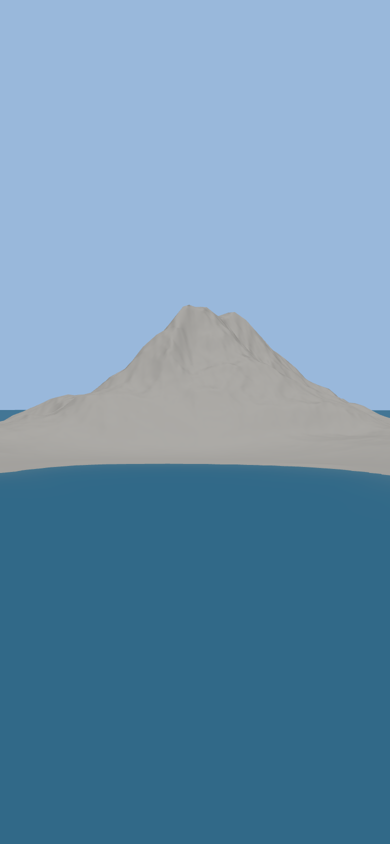
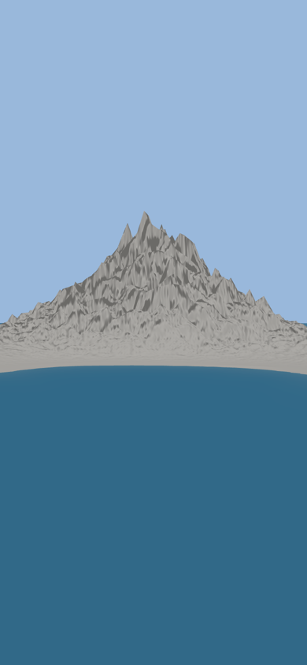
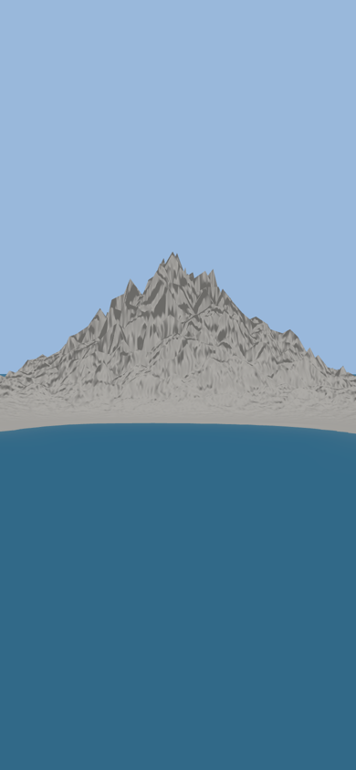
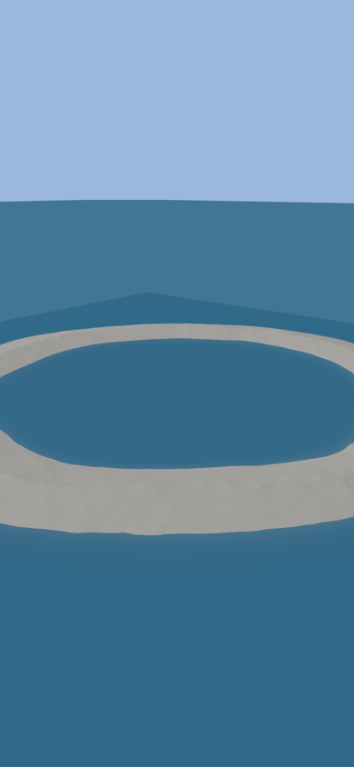

# 2 · Land from a seed

The flat plane becomes an island: a coast, a bay facing the sunset, hills and a mountain. All of it comes from one whole number in the link, the **seed**, and the same seed must give the same island on every phone and every computer.

You will type `ridged`, the function that gives the hills their crests. `landHeight`, which combines it with the island's outline, comes with the file, and you will tour it.



**Before you start:** lesson 1's `project/world.html`, with its contract passing. Run every command from this course's folder.
**Code scope:** you type 18 lines, the body of `ridged`, and the lesson tours 54 supplied lines, `landHeight`. The rest of the land layer is supplied. The new application is about 10 lines of your own.
**Time:** about 6 minutes to read and 30 to 60 minutes to build; neither is measured with learners yet.

## Make the lesson 2 file

Each lesson works in a new file, so your lesson 1 file stays as it is. Choose a route:

- **Type it:** `node lab.mjs next project 2 write`
- **Start from working code:** `node lab.mjs next project 2 supplied`
- **Brief an agent:** `node lab.mjs next project 2 ai`

Each writes `project/world-02.html` from stage 2 and refuses if that file exists. It carries in every region of your `world.html`, so the functions you typed come along, and lists them. If `world.html` fails lesson 1's contract, it carries it anyway and names the failing checks and the commands to see and fix them. Every route also gets `project/atoll.js`, for the new application.

Open `project/world-02.html?seed=7` in a browser, or run `node lab.mjs serve project --lan` for a phone. On the write route the page says `ridged: not written yet`.

## Noise, and octaves of it

Nothing here uses `Math.random`. The file's randomness starts at `hash2(x, y, s)`, which mixes three whole numbers into one with multiplications and bit shifts: the same three numbers always give the same result. **Noise** is built on it. `noiseD(x, y, s, D)` gives each corner of a grid of unit cells a slope from `hash2`, and blends them, so its value, about −1 to 1, changes smoothly from point to point. It also writes its own slope into `D`, an array of two numbers.

One noise has one size of bump. An **octave** is one more noise added at twice the frequency and half the amplitude, so finer detail sits on the large shapes. Ridged noise also folds each noise: `r = 1 − |n| × 2.1`, clipped at 0 and squared, peaks sharply where `n` crosses 0. `examples/profile.mjs` prints both along one line:

<!-- code-example {"file":"examples/profile.mjs","region":"profile","language":"js","title":"examples/profile.mjs: one noise against ridged","change":"Study; run it with node examples/profile.mjs."} -->
```js {"file":"examples/profile.mjs","region":"profile","title":"examples/profile.mjs: one noise against ridged","change":"Study; run it with node examples/profile.mjs."}
const D = [0, 0];
const bar = (v, width) => '#'.repeat(Math.round(v * width));
console.log('   x   noise (one octave)        ridged (six octaves)');
for (let i = 0; i <= 24; i++) {
  const x = i / 8; // three noise cells, eight samples each
  const n = noiseD(x, 0.5, 10, D); // about -1 to 1
  const r = ridged(x, 0.5, 10, D); // 0 to 1
  const left = `${n.toFixed(2).padStart(5)} ${bar((n + 1) / 2, 16)}`;
  console.log(
    `${x.toFixed(3)} ${left.padEnd(24)} ${r.toFixed(2)} ${bar(r, 20)}`,
  );
}
```
<!-- /code-example -->

<!-- code-example {"file":"examples/profile.txt","language":"text","title":"What it prints"} -->
```text {"file":"examples/profile.txt","title":"What it prints"}
   x   noise (one octave)        ridged (six octaves)
0.000 -0.32 #####              0.21 ####
0.125 -0.41 #####              0.27 #####
0.250 -0.44 ####               0.36 #######
0.375 -0.38 #####              0.17 ###
0.500 -0.27 ######             0.22 ####
0.625 -0.14 #######            0.43 #########
0.750 -0.05 ########           0.68 ##############
0.875 -0.03 ########           0.78 ################
1.000 -0.09 #######            0.56 ###########
1.125 -0.16 #######            0.40 ########
1.250 -0.24 ######             0.35 #######
1.375 -0.29 ######             0.34 #######
1.500 -0.29 ######             0.22 ####
1.625 -0.23 ######             0.27 #####
1.750 -0.15 #######            0.39 ########
1.875 -0.07 #######            0.62 ############
2.000 -0.02 ########           0.75 ###############
2.125  0.03 ########           0.55 ###########
2.250  0.07 #########          0.48 ##########
2.375  0.09 #########          0.46 #########
2.500  0.08 #########          0.54 ###########
2.625  0.05 ########           0.61 ############
2.750  0.00 ########           0.72 ##############
2.875 -0.03 ########           0.59 ############
3.000 -0.05 ########           0.51 ##########
```
<!-- /code-example -->

Where the noise passes close to 0, at x 0.875, 2.000 and 2.750, ridged reaches its crests. In `project/world-02.html`, replace the body of `ridged`:

<!-- code-example {"file":"examples/land.txt","region":"ridged","language":"js","title":"ridged, in the 2-land (pure) region","change":"Write route: type the body in place of the throw line."} -->
```js {"file":"examples/land.txt","region":"ridged","title":"ridged, in the 2-land (pure) region","change":"Write route: type the body in place of the throw line."}
// Ridged noise: sharp crests, with fine detail damped on slopes that are
// already steep.
function ridged(x, y, s, D) {
  let sum = 0;
  let amp = 0.5;
  let norm = 0;
  let dx = 0;
  let dy = 0;
  for (let o = 0; o < 6; o++) {
    const n = noiseD(x, y, s + o, D);
    const r = 1 - Math.min(1, Math.abs(n) * 2.1);
    dx += D[0] * amp;
    dy += D[1] * amp;
    sum += (amp * r * r) / (1 + 1.6 * (dx * dx + dy * dy));
    norm += amp;
    amp *= 0.5;
    // Turn and double the frequency.
    const t = x * 1.6 - y * 1.2;
    y = x * 1.2 + y * 1.6;
    x = t;
  }
  return sum / norm;
}
```
<!-- /code-example -->

Each pass adds one octave. `amp` halves every time and `norm` adds up the amplitudes, so `sum / norm` stays from 0 to 1. `dx` and `dy` add up the slopes of the octaves so far; dividing by 1 plus 1.6 times their square damps fine detail where the ground is already steep, which gives the worn look of real hills. The last three lines turn the point and double its distance from the origin: (1.6, 1.2) has length 2, so the next octave's noise is twice as fine, and turned about 37°, so the octaves' grids do not line up.

## The island's shape

`islandParams(seed)` draws the island's layout from `rng(hash2(seed, 17, 3))`, a stream of numbers that depends only on the seed: the sunset direction, the radius `P.R`, the bay, two or three peaks and the sea stacks. `landHeight` turns that layout into a height in metres at any point:

<!-- code-example {"file":"examples/land.txt","region":"landHeight","language":"js","title":"landHeight, in the 2-land (pure) region","change":"Study: supplied."} -->
```js {"file":"examples/land.txt","region":"landHeight","title":"landHeight, in the 2-land (pure) region","change":"Study: supplied."}
// Height in metres at a point (x, z) in metres. Sea level is 0.
function landHeight(x, z, P, D) {
  const s = P.seed;
  // Bend the map a little so no coastline is a clean curve.
  const wx = x + 90 * noiseD(x / 480, z / 480, s + 1, D);
  const wz = z + 90 * noiseD(x / 480 + 7.3, z / 480 - 2.1, s + 2, D);
  // "coast" is about 1 at the island's heart, 0 on the shoreline and negative
  // out at sea.
  const al = wx * P.axis[0] + wz * P.axis[1];
  const ac = wz * P.axis[0] - wx * P.axis[1];
  let coast = 1 - Math.sqrt((al * al) / (P.long * P.long) + ac * ac) / P.R;
  coast +=
    0.17 * noiseD(wx / 300, wz / 300, s + 3, D) +
    0.05 * noiseD(wx / 85, wz / 85, s + 4, D);
  const bxd = wx - P.bay[0];
  const bzd = wz - P.bay[1];
  // The bay bites into the west side.
  coast = smin(
    coast,
    (Math.sqrt(bxd * bxd + bzd * bzd) / P.bayR - 1) * 0.3,
    0.12,
  );
  // Sea stacks: small steep rocks off the coast.
  let stack = -9;
  for (const it of P.islets) {
    const ix = wx - it[0];
    const iz = wz - it[1];
    stack = Math.max(stack, 1 - Math.sqrt(ix * ix + iz * iz) / it[2]);
  }
  // Steep sides: a wide shallow shelf would show as a pale slab.
  coast = Math.max(coast, (stack - 0.45) * 1.1);
  // Bed ripples fade out at the shore, or they would surface as sandbars.
  if (coast < 0)
    return Math.max(
      -45,
      coast * 120 +
        3 * smooth(0, 0.08, -coast) * noiseD(x / 60, z / 60, s + 5, D),
    );
  // Land: a beach, rolling lowland, then mountains where the peaks are.
  let peak = 0;
  for (const p of P.peaks) {
    const px = (wx - p[0]) / p[2];
    const pz = (wz - p[1]) / p[2];
    const q = 1 / (1 + px * px + pz * pz);
    peak += p[3] * q * q;
  }
  const ridge = ridged(wx / 400, wz / 400, s + 10, D);
  const cliff = smooth(0.0, 0.3, noiseD(wx / 240, wz / 240, s + 6, D));
  let h =
    2.5 * smooth(0, 0.05, coast) +
    22 * smooth(0.02, 0.4, coast) * (0.6 + 0.8 * ridge);
  h += cliff * 30 * smooth(0.012, 0.045, coast);
  h +=
    P.high *
    Math.min(peak, 1.2) *
    (0.25 + 0.75 * ridge) *
    smooth(0.03, 0.42, coast);
  // High ground breaks into knuckles and notches.
  h += smooth(70, 190, h) * 11 * (ridged(wx / 46, wz / 46, s + 30, D) - 0.45);
  // Craggy, not a cone.
  return (
    h +
    smooth(0.5, 0.9, stack) *
      (14 + 46 * ridge) *
      (1 + 0.35 * noiseD(x / 11, z / 11, s + 7, D))
  );
}
```
<!-- /code-example -->

Tour it from the top. Noise bends the map, so no coast is a clean curve. `coast` is about 1 at the island's heart, 0 on the shore and negative at sea; it is an oval stretched along `P.axis`, with noise on it. `smin`, a smooth minimum, cuts the bay in with the term `(distance / bayR − 1) × 0.3`, which is −0.3 at the bay's centre. Where `coast` is below 0, the function returns early with a sea floor no deeper than −45 m. On land it adds a beach, rolling lowland shaped by `ridged`, cliffs, and the peaks, also shaped by `ridged`.

Question 2a. For seed 7 the bay's centre, `P.bay`, is at about (330, 399). Which band does `landHeight(330, 399, P, D)` fall in: (a) below −40 m, (b) −40 m to 0 m, (c) 0 m to 25 m, (d) above 25 m? Commit before reading on:

```sh
node lab.mjs predict project 2a YOUR_ANSWER
```

Then look at seed 7 from above, with the same directions as lesson 1's view:

```sh
node lab.mjs island project --seed 7
```

<!-- code-example {"file":"examples/island-7.txt","region":"land","language":"text","title":"node lab.mjs island project --seed 7, the rows with land"} -->
```text {"file":"examples/island-7.txt","region":"land","title":"node lab.mjs island project --seed 7, the rows with land"}
~~~~~~~~~~~~~~~~~~~~~~~~~~~~~~~~~~----~~~~~~~~~~~~~~~~~~~~~~~~~~
~~~~~~~~~~~~~~~~~~~~~~~~~~~---------------~~~~~~~~~~~~~~~~~~~~~~
~~~~~~~~~~~~~~~~~~~~~~~~-----...::::::.------~~~~~~~~~~~~~~~~~~~
~~~~~~~~~~~~~~~---~~~~~~~----..::::+::::...----~~~~~~~~~~~~~~~~~
~~~~~~~~~~~~~------~~~~~~----..:::::+:::::...-----~~~~~~~~~~~~~~
~~~~~~~~~~~~----------------..::::+++++:::::...------~~~~~~~~~~~
~~~~~~~~~~:----...-------..::::+++++++++:::::::....----~~~~~~~~~
~~~~~~~~~~.----..........:::+++++++++++++++::::::::.---~~~~~~~~~
~~~~~~~~~~---...::::::::::+++++^^^++++++++++:::::...----~~~~~~~~
~~~~~~~~~----...:::::::::+++++^^^^^++++++++++::::...----~~~~~~~~
~~~~~~~~~---:.::::::::::+++++^^^^^^^++++++++++::::...---~~~~~~~~
~~~~~~~~~--.:.::::+++::+++++++^^^^^^+++++++++++::::----~~~~~~~~~
~~~~~~~~~----..:::+++::+++++++^^^^^^^^^++++++::::..---~~~~~~~~~~
~~~~~~~~~~---..:::++++++++++++^^^^^^^^^^^+++::::.----~~~~~~~~~~~
~~~~~~~~~~~---..:::+::::++++++++^^^^^^^^^++:::::---~~~~~~~~~~~~~
~~~~~~~~~~~~----.::::::::::+++++++++^+++++::..----~~~~~~~~~~~~~~
~~~~~~~~~~~~~-------...::::::::::::::::::-------~~~~~~~~~~~~~~~~
~~~~~~~~~~~~~~~~~-------.............------~~~~~~~~~~~~~~~~~~~~~
~~~~~~~~~~~~~~~~~~~~~~------------------~~~~~~~~~~~~~~~~~~~~~~~~
~~~~~~~~~~~~~~~~~~~~-~~~------------~~~~~~~~~~~~~~~~~~~~~~~~~~~~
~~~~~~~~~~~~~~~~~~~~-~~~~~~~~~~~~~~~~~~~~~~~~~~~~~~~~~~~~~~~~~~~
~~~~~~~~~~~~~~~~~~~~~~~~~~~~~~~~~~~~~~~~~~~~~~~~~~~~~~~~~~~~~~~~
```
<!-- /code-example -->

Now run the checks:

```sh
node lab.mjs check project 2
```

The contract checks test what any correct `ridged` does. Everything that shapes the land, helpers you add included, keeps the determinism rule. `ridged` returns a number from 0 to 1, and each octave adds finer detail. Two runs in Node, each in a fresh sandbox, give the same `ridged` at 4,096 points and the same island for seed 7, and seed 8 gives another island. On a Mac the check also runs your code in JavaScriptCore, the JavaScript **engine** (the program that runs JavaScript) inside Safari; Node and Chrome use another, V8. Elsewhere that check does not run, and its line starts with `SKIP 2.ridged-engines: JavaScriptCore is not on this computer (it ships with macOS)`. That is not a failure, and not a pass: the last line counts it apart, as in `6 of 7 checks pass in lesson 2, 1 skipped`. `2.ridged-runs` has compared Node with itself.

## Break it, see it, repair it

Question 2b. Suppose `ridged` picks each octave's noise with `Math.floor(Math.random() * 1000)` added to its seed, to make the octaves differ. Grow seed 7 twice. Which of the 262,144 heights differ: (a) none, (b) some on land and none at sea, (c) every height? Commit:

```sh
node lab.mjs predict project 2b YOUR_ANSWER
```

Now make that change: in your `ridged`, write `s + o + Math.floor(Math.random() * 1000)` in place of `s + o`. Load `world-02.html?seed=7` twice:





Each point of the land picks its own noise, so the hills turn to spikes, and the next load gives other spikes: the seed no longer decides the island. Run `node lab.mjs check project 2`. The runs check reports that two runs disagree on about 56,000 of 262,144 heights, the land that `ridged` shapes, on a Mac the engines check fails too, and the rule check names the cause:

<!-- code-example {"file":"examples/check-break-2.txt","language":"text","title":"node lab.mjs check project 2, the rule check, with the break"} -->
```text {"file":"examples/check-break-2.txt","title":"node lab.mjs check project 2, the rule check, with the break"}
  FAIL 2.ridged-rule: ridged (region 2-land) uses Math.random. Math.random gives different numbers on every run, so the same seed would not give the same island. Anything that shapes the island may use only + - * /, Math.sqrt, Math.floor, Math.ceil, Math.imul, Math.abs, Math.min and Math.max.
```
<!-- /code-example -->

Put `s + o` back and check again until the contract passes. A quieter break: damp the slopes with `Math.exp` instead of dividing. Node agrees with itself, but on a Mac the engines check finds JavaScriptCore disagreeing with Node in the last bit on 324 of the 4,096 points. Stored as 32-bit heights, seed 7's island happens to match; lesson 5's erosion would make such differences grow, so the rule check refuses `Math.exp` everywhere.

## Use it on a new case: an atoll

An atoll is a ring of low land around a shallow lagoon. In `project/atoll.js`, write `atollHeight(x, z, P, D)`, a height in metres like `landHeight`'s, from the same functions and the same layout `P`. For seeds 7, 8 and 2026 it must give:

- a lagoon at the centre, between −15 m and 0 m;
- land above the sea on at least 75% of the circle of radius `P.R`, and nothing higher than 40 m;
- sea deeper than −20 m on the circle of radius 1.6 `P.R`;
- the determinism rule kept, and `ridged` used for the ring's rough top.

`atoll.js` is a plain script that sees your world's pure functions. Write it yourself on every route; the atoll checks test it, and `node lab.mjs island project --atoll` draws it. Then fly over it: open `project/world-02.html?seed=7&shape=atoll`. With `shape=atoll` in the address, one line the lab put in your file loads `atoll.js`, and `fillLand` calls your `atollHeight` in place of `landHeight`.



Yours will differ: the checks fix the ring, the lagoon and the sea around it, not the shape of the shore.

## Brief an agent

Your lesson 2 brief keeps lesson 1's six parts, and three of them change. The interface: `ridged(x, y, s, D)`, with x and y in noise cells, `s` the seed, `D` an array of two numbers that the noise writes its slope into, returning a number from 0 to 1 built from octaves. The constraints now carry the lesson: name `Math.random` as forbidden, and list what is allowed, `+ − * /`, `Math.sqrt`, `Math.floor`, `Math.ceil`, `Math.imul`, `Math.abs`, `Math.min` and `Math.max`. The command is `node lab.mjs check project 2`, and the agent hands back its whole output, including whether the engines check ran.

On the AI route, write `project/briefs/02.md`, run `node lab.mjs brief project 2`, give the brief and `project/world-02.html` to your agent, then run `node lab.mjs check project 2 --help-used "agent: NAME"`, read its code, and do the break and repair on it.

## Keep the working world

`node lab.mjs status project` lists your routes, checks, predictions and briefs. `node lab.mjs recover project 2` writes stage 2 to `project/recovery/world-02.html` without touching your file. Lesson 3 lights the island: a sun that moves through the day, a sky, and haze toward the horizon.
