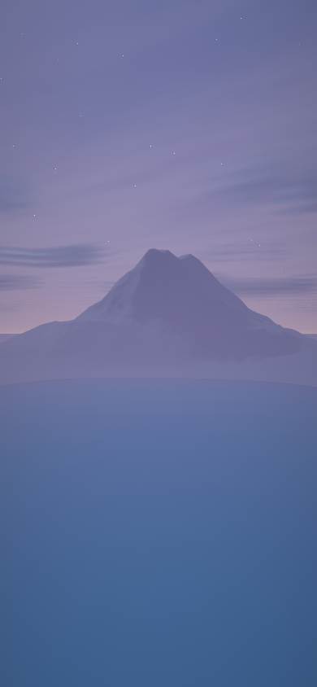
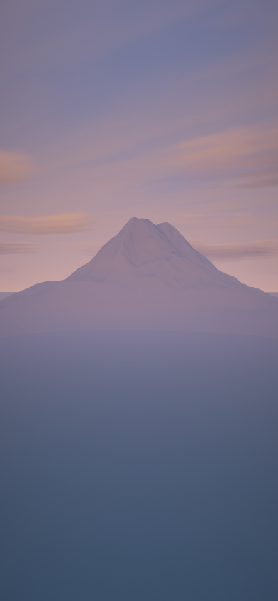
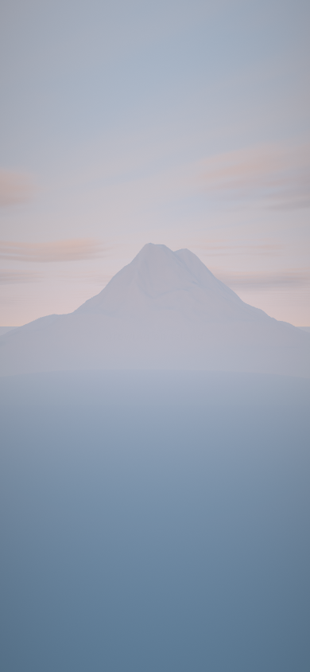
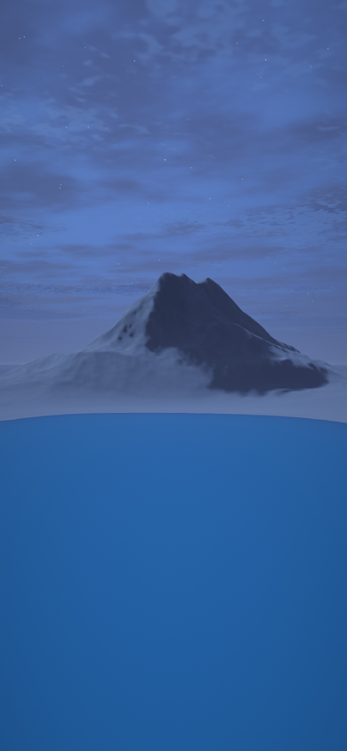
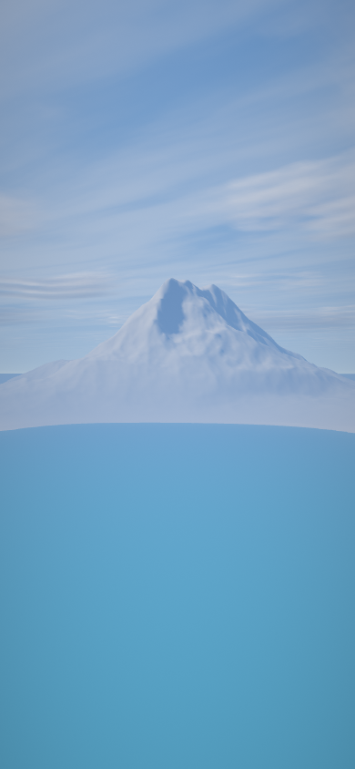

# 3 · Light and distance

The grey island gets a sun that moves through the day, a sky whose colours follow it, shadows, and haze that fades far things into the sky. You will type the two functions that decide the time of day: `dayAngle`, where the sun is, and `skyKeys`, what colour the sky is. `skyState`, which calls both, comes with the file, and you will tour it.



**Before you start:** lesson 2's `project/world-02.html`, with its contract passing. Run every command from this course's folder.
**Code scope:** you type 13 lines, the bodies of `dayAngle` and `skyKeys`, and the lesson tours 35 supplied lines, `skyState`, and a short shader function, `haze`. The rest of the light layer is supplied. The new application is about 15 lines of your own.
**Time:** about 6 minutes to read and 30 to 60 minutes to build; neither is measured with learners yet.

Make the file with `node lab.mjs next project 3 write` (or `supplied`, or `ai`), then open `project/world-03.html?seed=7`. Add `&day=0.25` for another time of day, from 0 to 1. On the write route the page says `dayAngle: not written yet`.

## The day as an angle

The sun goes round once a day, so its place is one **angle**, in radians. The sine of the angle says how high it is, and the cosine how far it is along the line from sunrise to sunset. A day that turned evenly would spend as long on noon as on sunset. This one lingers where the light is good, by a table of **keys**: each is a time of day from 0 to 1 and the angle the sun has then. Between two keys the angle is blended.

<!-- code-example {"file":"examples/light.txt","region":"DAY_KEYS","language":"js","title":"DAY_KEYS, in the 3-light (pure) region","change":"Study: supplied."} -->
```js {"file":"examples/light.txt","region":"DAY_KEYS","title":"DAY_KEYS, in the 3-light (pure) region","change":"Study: supplied."}
const DAY_KEYS = [
  // The golden hour, where the day starts.
  0, 3.01,
  // Sunset.
  0.25, 3.13,
  // Dusk is over.
  0.36, 3.74,
  // Midnight.
  0.46, 4.71,
  // First light.
  0.55, 5.9,
  // Sunrise.
  0.62, 6.27,
  // Morning.
  0.78, 6.56,
  // Noon.
  0.9, 7.85,
  // The golden hour again, one turn later.
  1, 9.293,
];
```
<!-- /code-example -->

Two things need care. The time of day grows past 1 as days pass, so only its fraction counts, and `u - Math.floor(u)` is that fraction below 0 too. And a blend needs two numbers: which pair of keys, and how far between them. Replace the body of `dayAngle`:

<!-- code-example {"file":"examples/light.txt","region":"dayAngle","language":"js","title":"dayAngle, in the 3-light (pure) region","change":"Write route: type the body in place of the throw line."} -->
```js {"file":"examples/light.txt","region":"dayAngle","title":"dayAngle, in the 3-light (pure) region","change":"Write route: type the body in place of the throw line."}
// The day runs 0..1 and starts in the golden hour. It lingers at sunset and
// dawn and hurries through noon and night.
function dayAngle(u) {
  u -= Math.floor(u);
  let k = 0;
  while (u > DAY_KEYS[k + 2]) k += 2;
  // How far u has come from this key toward the next, 0 to 1.
  const part = (u - DAY_KEYS[k]) / (DAY_KEYS[k + 2] - DAY_KEYS[k]);
  return mix(DAY_KEYS[k + 1], DAY_KEYS[k + 3], part);
}
```
<!-- /code-example -->

The last key, 9.293, is the first, 3.01, plus a whole turn of 6.283, so the sun does not jump from one day to the next. `mix(a, b, t)` is `a` when t is 0, `b` when it is 1, and straight between.

Question 3a. The key at 0.25 has the angle 3.13, and `skyState` multiplies the sine of the angle by 44 for the sun's height in degrees. How high is the sun at day 0.25: (a) about 0.5 degrees, (b) about 11, (c) about 22, (d) about 44? Commit before reading on:

```sh
node lab.mjs predict project 3a YOUR_ANSWER
```

## The sky between its keys

The sky's colour depends on the sun's height, not the hour, so dawn and dusk share a table. Each row of `SKY_KEYS` is a height in degrees, then red, green and blue overhead, then red, green and blue at the horizon.

<!-- code-example {"file":"examples/light.txt","region":"SKY_KEYS","language":"js","title":"SKY_KEYS, in the 3-light (pure) region","change":"Study: supplied."} -->
```js {"file":"examples/light.txt","region":"SKY_KEYS","title":"SKY_KEYS, in the 3-light (pure) region","change":"Study: supplied."}
// Sky colours at five sun heights (degrees): zenith rgb, horizon rgb.
const SKY_KEYS = [
  // Night.
  -14, 0.008, 0.014, 0.042, 0.022, 0.034, 0.075,
  // Dusk.
  -5, 0.022, 0.05, 0.15, 0.21, 0.14, 0.17,
  // The sun on the horizon.
  1, 0.034, 0.11, 0.29, 0.46, 0.28, 0.19,
  // A low sun.
  8, 0.04, 0.15, 0.36, 0.46, 0.35, 0.27,
  // Full day.
  30, 0.05, 0.18, 0.52, 0.38, 0.54, 0.74,
];
```
<!-- /code-example -->

These numbers are **linear** light: twice the number is twice the light. A screen is not linear, so the last step of every shader puts each colour through a **display curve**, `finish` in this file, which brightens the dark end. A **shader** is a small program the graphics card runs for every pixel, written in a language called GLSL. The rule that follows: blend in linear light, then apply the curve, once. Replace the body of `skyKeys`:

<!-- code-example {"file":"examples/light.txt","region":"skyKeys","language":"js","title":"skyKeys, in the 3-light (pure) region","change":"Write route: type the body in place of the throw line."} -->
```js {"file":"examples/light.txt","region":"skyKeys","title":"skyKeys, in the 3-light (pure) region","change":"Write route: type the body in place of the throw line."}
// The sky overhead (S[8..10]) and at the horizon (S[12..14]) for a sun height
// in degrees: find the two rows of SKY_KEYS the height lies between, and how
// far between, then blend them. The blend is of linear colour, before the
// display curve.
function skyKeys(S, height) {
  let k = 0;
  while (k < 21 && height > SKY_KEYS[k + 7]) k += 7;
  const t = smooth(SKY_KEYS[k], SKY_KEYS[k + 7], height);
  // Three numbers overhead, three at the horizon.
  for (let c = 0; c < 3; c++) {
    S[8 + c] = mix(SKY_KEYS[k + 1 + c], SKY_KEYS[k + 8 + c], t);
    S[12 + c] = mix(SKY_KEYS[k + 4 + c], SKY_KEYS[k + 11 + c], t);
  }
  return S;
}
```
<!-- /code-example -->

The search stops at `k < 21`, the start of the fourth row, because the last pair is the fourth row and the fifth. `smooth` eases from 0 to 1 and stays there outside its two heights, so beyond the table the nearest row holds.

Question 3b. At day 0.25 the sun is between the rows at −5 and 1 degrees, close to the second. Which of the three colours is the largest at the horizon: (a) red, (b) green, (c) blue? Commit, then look at the whole day:

```sh
node lab.mjs predict project 3b YOUR_ANSWER
node lab.mjs sky project
```

<!-- code-example {"file":"examples/sky.txt","language":"text","title":"node lab.mjs sky project"} -->
```text {"file":"examples/sky.txt","title":"node lab.mjs sky project"}
The day by your dayAngle and skyKeys. Colours are linear red, green, blue.
  day  sun height  overhead             at the horizon
 0.00      5.8°    0.039 0.140 0.343    0.460 0.333 0.251
 0.25      0.5°    0.034 0.109 0.287    0.455 0.277 0.190
 0.30     -4.2°    0.023 0.053 0.157    0.222 0.147 0.171
 0.36     -9.0°    0.016 0.035 0.105    0.131 0.096 0.130
 0.46    -16.0°    0.008 0.014 0.042    0.022 0.034 0.075
 0.55     -6.0°    0.022 0.049 0.146    0.204 0.136 0.167
 0.62     -0.2°    0.033 0.104 0.275    0.434 0.265 0.188
 0.78     12.0°    0.041 0.153 0.374    0.453 0.367 0.311
 0.90     44.0°    0.050 0.180 0.520    0.380 0.540 0.740
```
<!-- /code-example -->

## From the sun to every pixel

`skyState` turns the time of day into the numbers the shaders read:

<!-- code-example {"file":"examples/light.txt","region":"skyState","language":"js","title":"skyState, in the 3-light (pure) region","change":"Study: supplied."} -->
```js {"file":"examples/light.txt","region":"skyState","title":"skyState, in the 3-light (pure) region","change":"Study: supplied."}
// Fills S (20 numbers) for a time of day u (0..1). "west" is the compass
// direction of sunset. S[0..2] is the direction to the light, S[3] how far
// into night it is (0..1), S[4..6] the light's colour, S[8..10] the sky
// overhead, S[12..14] the sky at the horizon and S[16] the exposure.
function skyState(S, u, west) {
  const angle = dayAngle(u);
  const sine = Math.sin(angle);
  // The sun's height in degrees: up to 44 by day, down to -16 at night.
  const height = sine * (sine > 0 ? 44 : 16);
  const rise = (height * Math.PI) / 180;
  // Its compass direction, hx along the sunset line and hz across it, scaled
  // so that the whole direction has length 1.
  const hx = -Math.cos(angle);
  const hz = 0.55 * Math.abs(sine) + 0.1;
  const scale = Math.cos(rise) / Math.sqrt(hx * hx + hz * hz);
  let dx = (west[0] * hx - west[1] * hz) * scale;
  let dy = Math.sin(rise);
  let dz = (west[1] * hx + west[0] * hz) * scale;
  // Sunlight reddens as it crosses more air: blue is scattered away first.
  const air = 1 / (Math.max(dy, 0) + 0.06);
  const up = smooth(-2.5, 2, height) * 3.2;
  let r = Math.exp(-0.03 * air) * up;
  let g = Math.exp(-0.1 * air) * up;
  let b = Math.exp(-0.25 * air) * up;
  const night = 1 - smooth(-9, -3, height);
  // After dusk the moon is the light.
  if (height < -3) {
    const moon = 1 / Math.sqrt(0.25 + 0.3 + 0.36);
    dx = (-west[0] * 0.5 - west[1] * 0.55) * moon;
    dy = 0.6 * moon;
    dz = (-west[1] * 0.5 + west[0] * 0.55) * moon;
    r = 0.1 * night;
    g = 0.15 * night;
    b = 0.26 * night;
  }
  S[0] = dx;
  S[1] = dy;
  S[2] = dz;
  S[3] = night;
  S[4] = r;
  S[5] = g;
  S[6] = b;
  skyKeys(S, height);
  // Exposure: open up at night.
  S[16] = mix(1.0, 2.4, night);
  return S;
}
```
<!-- /code-example -->

Tour it in four steps. The sine of the angle becomes a height, 44 degrees at the most and −16 at the least, so night is short and never black. The height and the cosine become a direction of length 1. The sunlight's colour falls off with the air it crosses, blue fastest, which is why a low sun is red. And after the sun is 3 degrees down, the one light becomes the moon.

The haze shader measures the light path through air. Near the sea, spray washes out distant ridges. Its colour depends on where you look. Trace the distance term and the sun direction separately in this function.

<!-- code-example {"file":"examples/light.txt","region":"haze","language":"js","title":"haze, in the 3-light (glsl) region","change":"Study: supplied."} -->
```js {"file":"examples/light.txt","region":"haze","title":"haze, in the 3-light (glsl) region","change":"Study: supplied."}
// Haze: air thickens with distance and gathers near the sea. Far things fade
// into the sky colour behind them.
vec3 haze(vec3 col, vec3 p) {
  vec3 v = p - uCam.xyz;
  // For the sea bed, only the part of the path above water is air.
  if (p.y < 0.0) v *= uCam.y / (uCam.y - p.y);
  float d = length(v);
  v /= d;
  float k = v.y * 0.012;
  float low = exp(-max(uCam.y, 0.0) * 0.012)
      * (abs(k) < 1e-5 ? d : (1.0 - exp(-d * k)) / k);
  // Sea spray flattens distant contrast near the water. Backlit mist
  // takes its colour from the sunward horizon; shaded air stays blue-grey.
  float a = 1.0 - exp(-uZen.w * (d * 0.62 + low * 1.8));
  vec3 skyDir = normalize(vec3(v.x, abs(v.y) * 0.25 + 0.035, v.z));
  float sunward = pow(max(dot(skyDir, uSun.xyz), 0.0), 5.0);
  vec3 mist = mix(
      uZen.rgb * 0.65 + uHor.rgb * 0.20,
      skyBase(skyDir),
      0.22 + 0.62 * sunward
  );
  return mix(col, mist, a);
}
```
<!-- /code-example -->

`a` is the share of the light that the air has replaced: 0 close by, near 1 far off. `sunward` measures how closely the view follows the sunlight. Turning toward the sun makes the haze pick up more of the horizon colour. Turn back toward the mountain and the same amount of haze looks cooler.

Run the checks.

```sh
node lab.mjs check project 3
```

They test what any correct pair does: at each key the value is the key's, halfway between two keys it is halfway, nothing jumps, days repeat, and outside the table the nearest row holds. The land's determinism rule is checked again; the day may use sines, because it does not shape the island.

### Why do the cloud banks have dark undersides?

Open the sky shader and find `skyFull`. Follow the camera ray upward from `foot`, the point where it enters the cloud bank. The shader samples the bank low down, near its middle and near its top. At each depth, `cloudAt(sampleAt)` gives a density. The shader also samples toward the sun. A thick neighbour in that direction leaves this piece of cloud in shadow. A thin edge facing the sun stays bright.

Watch what `airLeft` does inside the loop. Each sample adds light in proportion to its opacity and how much of the ray is still clear. The sample then reduces `airLeft`. A cloud near the camera can hide a more distant one, and clear gaps still show the sky behind them. A thin, high veil is drawn separately.

Try the cheaper view in a copy of your world. In the **sky pass**, replace `skyFull(d, true)` with `skyFull(d, false)`. Hold the camera and time of day fixed. Will the high streaks or the low banks lose definition first? Compare the same patch of sky, then restore the argument. The cheaper path samples only the middle of the bank, the same shortcut the water uses for its reflected sky.

## Break it, see it, repair it

In `skyKeys`, blend what the screen would show instead of the light: write each `mix(a, b, t)` as `mix(a ** (1 / 2.2), b ** (1 / 2.2), t)`, the usual stand-in for the display curve. Open `world-03.html?seed=7&shot=1&t=6&day=0.25` before and after:





The sunset goes dull, because the curve is applied twice: once in your blend and once in `finish`. Four checks fail, and one of them, the blend check, says so:

<!-- code-example {"file":"examples/check-break-3.txt","region":"pale","language":"text","title":"node lab.mjs check project 3, the blend check, with the break"} -->
```text {"file":"examples/check-break-3.txt","region":"pale","title":"node lab.mjs check project 3, the blend check, with the break"}
  FAIL 3.sky-blend: skyKeys(S, -9.5), halfway between the rows at -14 and -5 degrees: red overhead is 0.14391, not halfway between 0.008 and 0.022, 0.015. That is the blend of the display values, left unconverted: the colours must be blended as linear light, and the shader applies the display curve afterwards, once.
```
<!-- /code-example -->

Now convert back, by putting `** 2.2` after each `mix(...)`. The page looks repaired, and the keys are right again, but the blend check, alone now, still fails:

<!-- code-example {"file":"examples/check-break-3.txt","region":"dull","language":"text","title":"The same check, half repaired"} -->
```text {"file":"examples/check-break-3.txt","region":"dull","title":"The same check, half repaired"}
  FAIL 3.sky-blend: skyKeys(S, -9.5), halfway between the rows at -14 and -5 degrees: red overhead is 0.014054, not halfway between 0.008 and 0.022, 0.015. That is the blend of the display values, converted back: too dark between keys, which shows as a dull band at dusk. Blend the linear numbers themselves.
```
<!-- /code-example -->

Between keys the blend is too dark, most of all at dusk, where one of the six numbers loses 28%. By eye it is easy to miss; the check finds it. Put the plain `mix` back.

## Use it on a new case: a moonlit night

Below −14 degrees the sky is one flat night. In `project/moon.js`, write `moonKeys(S, height)`, which does what `skyKeys` does with one more key: a moonlit sky at −16 degrees, the sun's lowest. It must:

- at −16 degrees, and below, be blue most of all, at least 1.5 times as bright as the night row, overhead and at the horizon, and darker than the dusk row;
- from −14 degrees up, be the sky as before, up to full day;
- blend in linear light, and write the same six numbers of `S` and no others.

Write it yourself on every route; the moon checks test it, and `node lab.mjs sky project --moon` prints it. Then see it at midnight: `world-03.html?seed=7&shot=1&t=6&day=0.46&sky=moon`.



## Brief an agent, then judge the picture

Your brief, `briefs/03.md`, has lesson 1's six parts. The interface is `dayAngle(u)`, the angle in radians, and `skyKeys(S, height)`, the height in degrees, with which numbers of `S` it fills and that the colours are linear. The command is `node lab.mjs check project 3`. Check it with `node lab.mjs brief project 3`.

Checks cannot see whether a picture is good. For that, a **critique round** judges fixed pictures: the same seed, view and moment every time, so two versions can be compared. `shot=1` freezes the page and `t=6` fixes the moment; here the day changes. Open `world-03.html?seed=7&shot=1&t=6&day=` with 0, 0.25, 0.46, 0.62 and 0.9.



Write each fault as what is wrong on screen, with its picture, and no guess at the cause: "1. `day=0.9`: the mountain's sunlit side is one pale patch; its ridges do not show." Not "the light is too strong", which is a cause, and perhaps the wrong one. Then the follow-up asks for causes before fixes: for each fault, the line or number that makes it, and how the agent knows, before it changes anything. A fix without its cause often hides one fault under another.

On every route, write `briefs/03-critique.md`: at least three numbered faults of your own, each with its `day=`, then that follow-up, then the check command the next version must still pass. Run:

```sh
node lab.mjs brief project 3 --critique
```

It checks the structure only: it cannot tell whether you opened the pictures, or judge what you saw. On the AI route, send the follow-up, and compare the same five pictures again.

## Keep the working world

`node lab.mjs recover project 3` writes stage 3 to `project/recovery/world-03.html` without touching your file. Lesson 4 gives the sea its waves.
