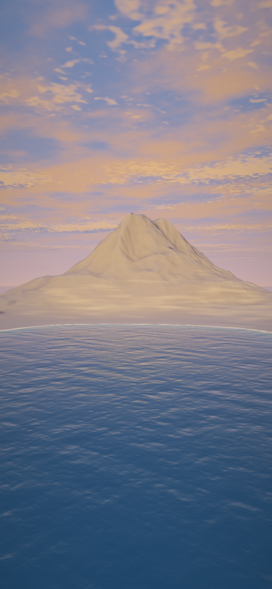
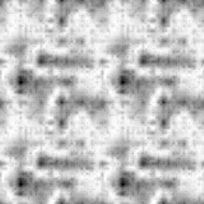
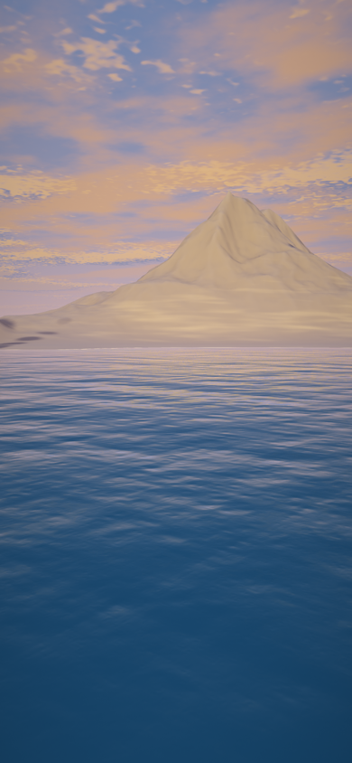
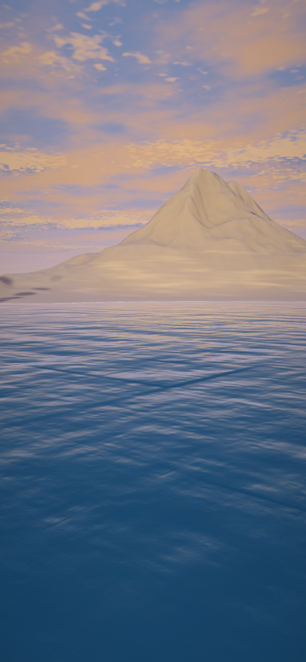
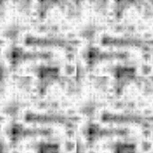
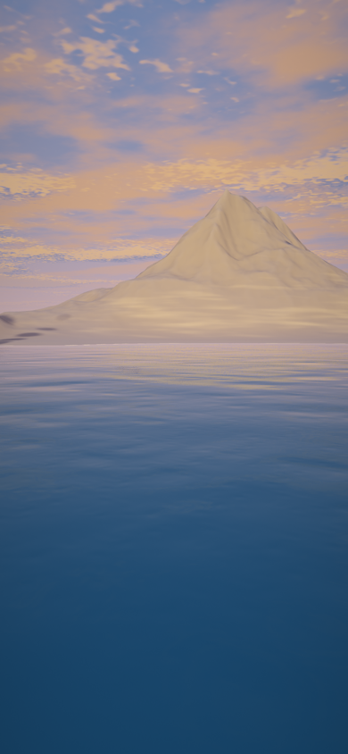

# 4 · Water

The sea becomes water: waves, a mirror of the sky, glitter toward the sun, shallows you can see into, and foam on the shore. All of it starts from one small image of waves, repeated across the sea. You will type `waveTile`, which makes that image.



**Before you start:** lesson 3's `project/world-03.html`, with its contract passing. Run every command from this course's folder.
**Code scope:** you type 38 lines, the body of `waveTile`, and the lesson tours `halve`, 10 lines. The shader that draws the sea is supplied, and you will see where it reads your image. The new application is about 40 lines, most of them adapted from `waveTile`.
**Time:** about 6 minutes to read and 30 to 60 minutes to build; neither is measured with learners yet.

Make the file with `node lab.mjs next project 4 write` (or `supplied`, or `ai`), then open `project/world-04.html?seed=7`. On the write route the page says `waveTile: not written yet`.

## One image, repeated

The sea reaches the horizon, far more than an image can hold. So the shader draws one square image, a **tile**, again and again. For the waves it reads your tile at three sizes, sliding in different directions, so the repetition is hard to see: each tile covers 127 m, 41 m or 9.3 m of sea.

Each pixel of the tile holds four numbers, its **channels**, named R, G, B and A after red, green, blue and alpha (opacity), though here none is a colour. R and G are the **slope** of the water across and down the tile; light and reflections depend on the slope far more than on the height. B is the height, and A is a pattern that breaks foam into patches.

An image usually stores each channel in 8 bits, 256 levels. Water is a mirror, and a mirror shows every step, so `waveTile` returns a `Float32Array`, and the page stores it on the graphics card as `RGBA16F`: four numbers of 16 bits each, with a decimal point. Three facts about that format matter, and an agent that does not know them writes code that works on one machine:

- WebGL2 can smooth between the pixels of an `RGBA16F` image on every device. The 32-bit kind, `RGBA32F`, needs an extension for that, `OES_texture_float_linear`, which not every device has.
- Far away, a pixel of the screen covers many pixels of the tile, so the card reads **mipmaps**: smaller copies, each half the size of the one before. `gl.generateMipmap` refuses an `RGBA16F` image unless an extension is switched on.
- So the file builds the copies itself:

<!-- code-example {"file":"examples/water.txt","region":"halve","language":"js","title":"halve, in the 4-water (pure) region","change":"Study: supplied."} -->
```js {"file":"examples/water.txt","region":"halve","title":"halve, in the 4-water (pure) region","change":"Study: supplied."}
// The same image at half the size, each pixel the mean of four. Smaller copies
// are what the GPU reads far away, where they calm the water into a smooth
// mirror. (Built here because phones cannot build them for float images.)
function halve(src, n) {
  const m = n / 2;
  const out = new Float32Array(m * m * 4);
  for (let y = 0; y < m; y++)
    for (let x = 0; x < m; x++)
      for (let c = 0; c < 4; c++) {
        const i = (y * 2 * n + x * 2) * 4 + c;
        out[(y * m + x) * 4 + c] =
          (src[i] + src[i + 4] + src[i + n * 4] + src[i + n * 4 + 4]) / 4;
      }
  return out;
}
```
<!-- /code-example -->

Each pixel of a copy is the mean of four. Slopes that point opposite ways cancel, which is why distant water turns into a smooth mirror.

## Waves that meet themselves

The heights are noise, as in lesson 2, added up in four octaves. But a tile's right edge touches the left edge of the next copy, so the noise has to match there. `waveTile` does it by counting in **cells**: `cells` squares of noise cross the tile, and the corner after the last is the first again, by `% cells`, the remainder of a division. That works when a whole number of cells fits.

Question 4a. Four versions of `waveTile` start with these counts of cells, and every octave doubles the count. Which show a seam: (a) 5, (b) 5.5, (c) 7, (d) 6.25? Commit before reading on:

```sh
node lab.mjs predict project 4a YOUR_ANSWER
```

Replace the body of `waveTile`:

<!-- code-example {"file":"examples/water.txt","region":"waveTile","language":"js","title":"waveTile, in the 4-water (pure) region","change":"Write route: type the body in place of the throw line."} -->
```js {"file":"examples/water.txt","region":"waveTile","title":"waveTile, in the 4-water (pure) region","change":"Write route: type the body in place of the throw line."}
// A tiling image of small waves for the sea shader: R and G hold the surface
// slope, B the height, A foam breakup. It is stored as floats: with only 256
// levels the mirror-like water would show the steps.
function waveTile(n, seed) {
  const h = new Float32Array(n * n);
  const out = new Float32Array(n * n * 4);
  const layer = (x, y, cells, s) => {
    const gx = (x * cells) / n;
    const gy = (y * cells) / n;
    const ix = Math.floor(gx);
    const iy = Math.floor(gy);
    const fx = gx - ix;
    const fy = gy - iy;
    const u = fx * fx * (3 - 2 * fx);
    const v = fy * fy * (3 - 2 * fy);
    const w = (i, j) =>
      hash2((ix + i) % cells, (iy + j) % cells, s) / 4294967296;
    return mix(mix(w(0, 0), w(1, 0), u), mix(w(0, 1), w(1, 1), u), v);
  };
  for (let y = 0, i = 0; y < n; y++)
    for (let x = 0; x < n; x++, i++) {
      let sum = 0;
      let amp = 0.5;
      // How many cells of noise cross the tile. A whole number, so that the
      // right edge meets the left with no seam.
      let cells = 5;
      for (let o = 0; o < 4; o++) {
        // Broad, rounded crests and narrow troughs.
        const d = 2 * layer(x, y, cells, seed + o) - 1;
        sum += amp * (1 - d * d);
        cells *= 2;
        amp *= 0.55;
      }
      h[i] = sum;
    }
  const at = (x, y) => h[((y + n) % n) * n + ((x + n) % n)];
  for (let y = 0, i = 0; y < n; y++)
    for (let x = 0; x < n; x++, i += 4) {
      out[i] = (at(x + 1, y) - at(x - 1, y)) * 4;
      out[i + 1] = (at(x, y + 1) - at(x, y - 1)) * 4;
      out[i + 2] = at(x, y);
      out[i + 3] =
        layer(x, y, 24, seed + 9) * 0.6 + layer(x, y, 64, seed + 10) * 0.4;
    }
  return out;
}
```
<!-- /code-example -->

Read it in three parts.

- `layer` is one octave: which cell the pixel is in (`ix`, `iy`), how far into it (`fx`, `fy`), and a smooth blend of the four corners. `w` looks the corners up with the wrap.
- The first loop adds the octaves. `d` runs from −1 to 1 and `1 - d * d` folds it, which rounds the tops of the waves. Each octave has twice the cells and 0.55 of the height.
- The second loop writes the channels. `at` reads a height with the same wrap, `(x + n) % n`, because the neighbour of a pixel on the left edge is on the right edge. The slope is the neighbour after minus the neighbour before.

See your tile laid two by two:

```sh
node lab.mjs tile project
```

It writes a picture to `project/pictures/`. The tile meets itself along the middle row and the middle column:



In this picture light is high. Notice that some blotches run along the rows and columns: the noise is a grid, and three sliding copies hide it in the sea. Now run the checks:

```sh
node lab.mjs check project 4
```

They test what any correct tile does: its shape and range, no seam at any edge, R and G the slope of B, octaves that get finer, the same tile for the same seed, and the determinism rule.

## Where the sea reads it

Three lines of the supplied shader read your image, at the three sizes:

<!-- code-example {"file":"examples/sea-reads.txt","language":"text","title":"The sea shader, in the 4-water (glsl) region: three sheets of the tile"} -->
```text {"file":"examples/sea-reads.txt","title":"The sea shader, in the 4-water (glsl) region: three sheets of the tile"}
  vec4 a = texture(tW, p / 127.0 + t * vec2(0.010, 0.004));
  vec4 b = texture(tW, p.yx / 41.0 + t * vec2(-0.012, 0.019));
  vec4 c = texture(tW, p / 9.3 + t * vec2(0.045, -0.03));
  vec2 swell = (a.rg * 0.55 + b.gr * 0.4) * calm;
```
<!-- /code-example -->

`t` is the time in seconds, so each sheet slides. The slopes are added into one, which tilts the surface. From that tilt come the mirror of the sky, the glitter, and how much of the sea bed shows through.

## Break it, see it, repair it

Question 4b. The count starts at 5.5 and doubles three times: 5.5, 11, 22, 44. Which octaves break at the tile's edge: (a) the first only, (b) the first two, (c) all four, (d) none? Commit:

```sh
node lab.mjs predict project 4b YOUR_ANSWER
```

In `waveTile`, change `let cells = 5` to `let cells = 5.5`. Fly low over the water, or open `world-04.html?seed=7&shot=1&t=6&cam=1.9,0.2,12,1.6,0.2,0`:





Faint straight lines cross the sea, along the edges of the tiles. They are hard to see from high up. `node lab.mjs tile project` shows the cause, a line through the middle:



<!-- code-example {"file":"examples/check-break-4.txt","language":"text","title":"node lab.mjs check project 4, the seam check, with the break"} -->
```text {"file":"examples/check-break-4.txt","title":"node lab.mjs check project 4, the seam check, with the break"}
  FAIL 4.tile-seam: waveTile(64, 11) has a seam at its right edge: B, the height, jumps by 0.4223 from the right edge to the opposite one, and no two neighbours inside differ by more than 0.2236. The tile repeats across the sea, so that jump is a line every tile. A whole number of noise cells must cross the tile in every octave.
```
<!-- /code-example -->

Put 5 back. The check can miss a count just under a whole number, such as 4.99: the gap it leaves is too small to make a visible line.

## Use it on a new case: a lagoon

Inside a lagoon the water is sheltered: lower waves, and broad ones, with the finest ripples gone. In `project/lagoon.js`, write `lagoonTile(n, seed)`, which returns the same kind of array as `waveTile`, for such water. It must:

- meet itself at every edge, with R and G the slope of its own B;
- have slopes between 0.1 and 0.5 of the open sea's, taken over the whole tile;
- be broader too, so the open sea's tile made lower does not pass: neighbouring heights differ by at most 0.6 as much as the sea's do, against their own spread;
- keep the determinism rule, and the ranges of `waveTile`.

Write it yourself on every route; the lagoon checks test it, and `node lab.mjs tile project --lagoon` draws it. Then fly over it: `world-04.html?seed=7&water=lagoon` uses your tile for the whole sea, and `&shape=atoll` adds your lesson 2 atoll.



## Brief an agent

Your brief, `briefs/04.md`, keeps lesson 1's six parts. The interface is `waveTile(n, seed)`, returning a `Float32Array` of n by n pixels, with what each of the four channels holds and that the tile wraps without a seam. The constraints add the determinism rule and the facts about float images: `RGBA16F`, not `RGBA32F` with `OES_texture_float_linear`, and mipmaps built in code by `halve`. The command is `node lab.mjs check project 4`. As a reference, do not write "realistic water"; write what you see: "long low crests, no straight lines, smooth toward the horizon".

On the AI route, run `node lab.mjs brief project 4`, give the brief and `project/world-04.html` to your agent, run `node lab.mjs check project 4 --help-used "agent: NAME"`, read its code, and do the break and repair on it.

## Keep the working world

`node lab.mjs recover project 4` writes stage 4 to `project/recovery/world-04.html` without touching your file. Lesson 5 lets rain cut the hills.
