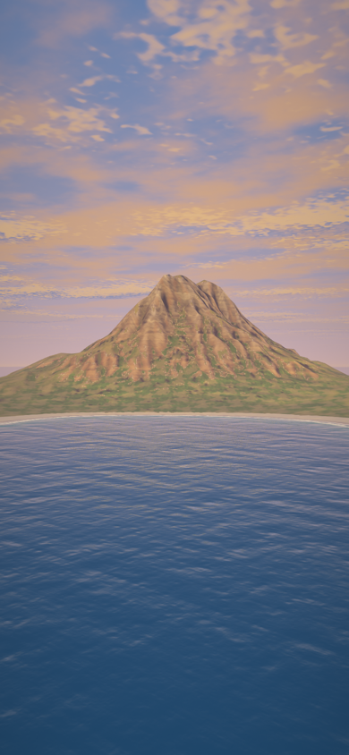
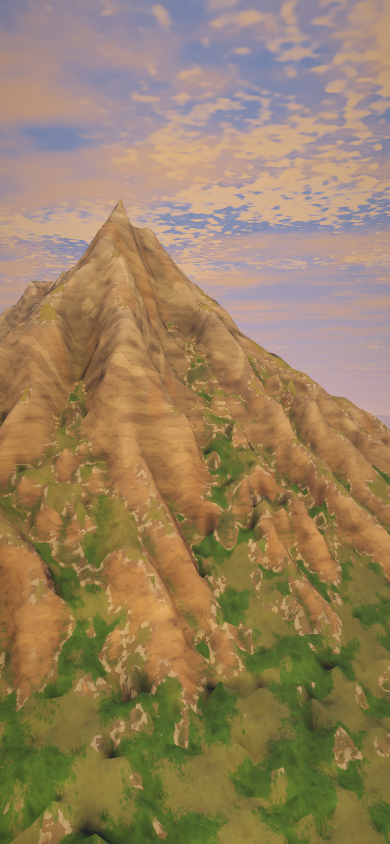
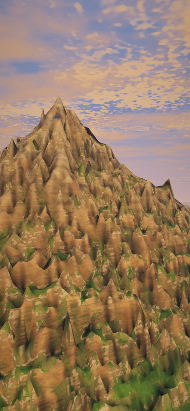
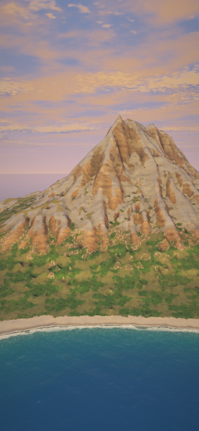

# 5 · Erosion and ground

Rain cuts the smooth hills into gullies, lays the soil down again where the ground flattens, and decides where rock, grass and sand show. You will type `depositOrCut`, what one drop does to the ground under it. `dropStep`, which moves the drop and calls it, comes with the file, and you will tour it.



**Before you start:** lesson 4's `project/world-04.html`, with its contract passing. Run every command from this course's folder.
**Code scope:** you type 17 lines, the body of `depositOrCut`, and the lesson tours 37 supplied lines, `dropStep`. The rest of the layer is supplied. The new application is about 5 lines of your own.
**Time:** about 6 minutes to read and 30 to 60 minutes to build; neither is measured with learners yet.

Make the file with `node lab.mjs next project 5 write` (or `supplied`, or `ai`), then open `project/world-05.html?seed=7`. On the write route the page says `depositOrCut: not written yet`.

## A drop and its soil

A drop is a small record: where it is, which way it runs, how fast, how much water it holds, and how much **soil** it carries. It starts at a random place and runs downhill, step by step. Two numbers decide what it does to the ground: how far the ground falls at the next step, and how much it is already carrying.

A drop can carry only so much. Its **capacity** is more when it is fast, when it is full of water and when the ground falls steeply:

`room = max(fall, 0.02) × speed × water × CARRY`

With less soil than that it picks some up and cuts the ground. With more, or when the way ahead leads uphill, it lays some down. The numbers never appear from nothing: what the ground loses, the drop gains, and back again. Replace the body of `depositOrCut`:

<!-- code-example {"file":"examples/erosion.txt","region":"depositOrCut","language":"js","title":"depositOrCut, in the 5-erosion (pure) region","change":"Write route: type the body in place of the throw line."} -->
```js {"file":"examples/erosion.txt","region":"depositOrCut","title":"depositOrCut, in the 5-erosion (pure) region","change":"Write route: type the body in place of the throw line."}
// What a drop does to the ground where it stands, and the soil it carries on.
// The drop sits in the cell that starts at H[i], u and v of the way across
// it; it is about to fall by "fall" (negative when the way leads uphill) with
// this speed and water, carrying "soil". Returns the soil it carries after.
function depositOrCut(H, E, i, u, v, fall, speed, water, soil) {
  // How much soil this water can carry: more when fast, full and steep.
  const room = Math.max(fall, 0.02) * speed * water * CARRY;
  if (fall < 0 || soil > room) {
    // Too much soil, or the way leads uphill: lay some down, shared among the
    // four corners of the cell by how near the drop is to each.
    const lay = fall < 0 ? Math.min(-fall, soil) : (soil - room) * SETTLE;
    soil -= lay;
    E[i * 3 + 1] += lay;
    H[i] += lay * (1 - u) * (1 - v);
    H[i + 1] += lay * u * (1 - v);
    H[i + N] += lay * (1 - u) * v;
    H[i + N + 1] += lay * u * v;
  } else {
    // Room to carry more: cut into the ground, spread over the brush.
    const take = Math.min((room - soil) * CUT, fall);
    soil += take;
    E[i * 3] += take;
    for (let k = 0; k < BRUSH.length; k += 2)
      H[i + BRUSH[k]] -= (take * BRUSH[k + 1]) / BRUSH.sum;
  }
  return soil;
}
```
<!-- /code-example -->

Three lines carry most of the idea.

- A drop going uphill (`fall < 0`) lays the smaller of the rise and its soil. More would build a mound in front of it, and the next drop would stop there.
- A drop over capacity lays only `SETTLE` of the excess, a quarter, so it spreads a little over many steps.
- Cutting takes no more than the fall, `Math.min(..., fall)`. A drop that dug below the next point would make a pit it cannot climb out of. And the cut is spread over a **brush**, the cells within 2.4 of the drop, so it is a trough and not a slot. The soil laid down is shared among the four corners of the drop's cell, each by how near the drop is to it.

`E` keeps a record at the drop's cell: what was worn and what was laid. The ground cover reads it.

## Where the rock goes

`dropStep` moves the drop. It ends the drop's run when it reaches the sea, the edge of the map, or a hollow with nowhere to go:

<!-- code-example {"file":"examples/erosion.txt","region":"dropStep","language":"js","title":"dropStep, in the 5-erosion (pure) region","change":"Study: supplied."} -->
```js {"file":"examples/erosion.txt","region":"dropStep","title":"dropStep, in the 5-erosion (pure) region","change":"Study: supplied."}
// One step of one drop. d holds the drop: [x, y, direction x, direction y,
// speed, water, soil carried], in grid cells. Returns false when the drop is
// finished: it reached the sea, the edge, or a hollow with nowhere to go.
function dropStep(H, E, d) {
  const x = d[0];
  const y = d[1];
  const speed = d[4];
  const water = d[5];
  // The four cells round the drop, and how far it sits between them.
  const ix = x | 0;
  const iy = y | 0;
  const u = x - ix;
  const v = y - iy;
  const i = iy * N + ix;
  const a = H[i];
  const b = H[i + 1];
  const c = H[i + N];
  const e = H[i + N + 1];
  const h = mix(mix(a, b, u), mix(c, e, u), v);
  // It has reached the sea.
  if (h < -0.5) return false;
  // Keep some of the old direction, turn the rest downhill.
  const slopeX = (b - a) * (1 - v) + (e - c) * v;
  const slopeY = (c - a) * (1 - u) + (e - b) * u;
  let dx = d[2] * INERTIA - slopeX * (1 - INERTIA);
  let dy = d[3] * INERTIA - slopeY * (1 - INERTIA);
  const len = Math.sqrt(dx * dx + dy * dy);
  // A hollow with nowhere to go.
  if (len < 1e-5) return false;
  dx /= len;
  dy /= len;
  const nx = x + dx;
  const ny = y + dy;
  // The edge of the map.
  if (nx < 3 || ny < 3 || nx > N - 4 || ny > N - 4) return false;
  const fall = h - gridHeight(H, nx, ny);
  // Record the water that passed, then lay soil down or cut it.
  E[i * 3 + 2] += water;
  const soil = depositOrCut(H, E, i, u, v, fall, speed, water, d[6]);
  d[0] = nx;
  d[1] = ny;
  d[2] = dx;
  d[3] = dy;
  d[4] = Math.sqrt(Math.max(speed * speed + fall * 0.9, 0.01));
  d[5] = water * 0.985;
  d[6] = soil;
  return true;
}
```
<!-- /code-example -->

Tour it in three steps. It finds the four cells round the drop and the height under it. It turns the drop downhill, keeping `INERTIA`, a little of its old direction. Then it looks one cell ahead, calls your function with the fall it finds, and updates the drop's speed and water.

One thing is worth saying plainly: **rain does not conserve rock.** Inside one call nothing is made or lost, and the checks test that. But `erode` forgets each drop when its run is over, and with it the soil it still holds. That rock is gone. A run is over after 70 steps, and before that when the drop reaches the sea, the edge or a hollow; so a drop that reaches the sea loses its soil just as one that runs out of steps on a hillside does.

How much is that? Of 1,000 drops on seed 7, 241 begin on land; the others begin in the sea and carry next to nothing. This is the average of those 241, in units of rock for each drop, with a drop whose run is over counted as it was when it stopped:

| After | Cut so far | Still carried | Runs not over |
| --- | --- | --- | --- |
| 5 steps | 7.7 | 7.6 | 229 |
| 20 steps | 17.8 | 13.3 | 188 |
| 40 steps | 21.9 | 8.5 | 129 |

On the steep ground where it starts, a drop mostly cuts. Where the ground eases it lays its soil down again. Use the table to estimate where it ends, at 70 steps.

Question 5a. 1,000 drops fall on seed 7, each for at most 70 steps. Of every 100 units of rock worn away, how much is gone from the island: (a) none, (b) about 20, (c) about 50, (d) nearly all?

Question 5b. Of the rock that is gone, where was it when it went: (a) in the sea, in drops that reached it, (b) inland, in drops whose steps ran out, (c) at the edge of the map, (d) spread over every cell? Commit both before reading on:

```sh
node lab.mjs predict project 5a YOUR_ANSWER
node lab.mjs predict project 5b YOUR_ANSWER
```

Then see it with your own function:

```sh
node lab.mjs rain project
```

<!-- code-example {"file":"examples/rain.txt","language":"text","title":"node lab.mjs rain project"} -->
```text {"file":"examples/rain.txt","title":"node lab.mjs rain project"}
Rain on seed 7 with your depositOrCut: 1,000 drops of at most 70 steps.
Worn away 5788, laid down 4600, so 1187 is gone: 20.5 of every 100 worn away. (Each cell is 16 square metres.)
Where a finished drop stopped, with the soil it still held:
  sea            928 drops, 919 soil
  on land, when its 70 steps ran out    72 drops, 269 soil
```
<!-- /code-example -->

`worn` and `laid` add up the record in `E`. The missing rock is the difference, and the last lines say where the drops were when it was dropped. Of the 928 drops in the first line, 759 began in the sea and carry next to nothing. Now run the checks:

```sh
node lab.mjs check project 5
```

They test one call at a time: what the ground gives up the drop carries, it never lays more than it has or cuts deeper than the fall, the laid soil lies where the drop is, and faster, fuller, steeper water carries more. Then rain is run on the whole island, and the check counts pits.

## Break it, see it, repair it

In your `depositOrCut`, dig in one cell instead of the brush. Replace the two lines of the brush loop with `H[i] -= take;`. Reload the page:





The hills become spires and pits: each drop digs at one point, and the ground between two holes is left standing. Check:

<!-- code-example {"file":"examples/check-break-5.txt","language":"text","title":"node lab.mjs check project 5, two checks, with the break"} -->
```text {"file":"examples/check-break-5.txt","title":"node lab.mjs check project 5, two checks, with the break"}
  FAIL 5.drop-place: depositOrCut with u 0.3, v 0.6, fall 2.5, speed 3, water 1, soil 0 digs at 1 cell. Cutting only where the drop stands makes a narrow pit; the brush spreads it over the cells within 2.4, at least 9 of them.
  FAIL 5.rain: after 70,000 drops on seed 7 there are 2,504 pits (a cell lower than all eight round it); stage 5 leaves 236, and at most 450 is allowed. Pits instead of gullies come from digging in one place, or from laying too much where a drop turns uphill.
```
<!-- /code-example -->

Put the brush back. A second break is quieter: lay everything the drop has when the way leads uphill, `soil` in place of `Math.min(-fall, soil)`. The hills turn spiky again, and the check says which rule was broken.

## Use it on a new case: scree

Scree is loose stone that lies on slopes too steep for soil and not steep enough to be a cliff. In `project/scree.js`, write `screeAt(h, steep)`, which returns how much of the ground is scree, from 0 to 1, at a height in metres and a steepness (0 for level, towards 1 for a wall; the same number the ground cover uses). It must:

- be 0 on nearly level ground (steep 0.08 or less), on a cliff (0.6 or more), and at 20 m or lower;
- be at least 0.8 at a height of 120 m and a slope of 0.3, and never thin out as the height rises to there;
- ease in and out, with no jump;
- keep the determinism rule.

Write it yourself on every route; the scree checks test it. Then open `world-05.html?seed=7&cover=scree`: where your rule says stone, the grass gives way to pale ground. With this rule that is about a sixth of the island's land.



## Brief an agent

Your brief, `briefs/05.md`, keeps the six parts. The interface is the whole argument list of `depositOrCut(H, E, i, u, v, fall, speed, water, soil)`, what each is, and what it returns, with the rule that the ground and the drop keep the total in one call. The constraints add the determinism rule. The command is `node lab.mjs check project 5`. As a reference, name what you see: "rounded gullies with a ridge between them, not spikes". Run `node lab.mjs brief project 5`.

On the AI route, give the brief and `project/world-05.html` to your agent, run `node lab.mjs check project 5 --help-used "agent: NAME"`, read its code, and do the break and repair on it.

## Keep the working world

`node lab.mjs recover project 5` writes stage 5 to `project/recovery/world-05.html` without touching your file. Lesson 6 plants the ground.
