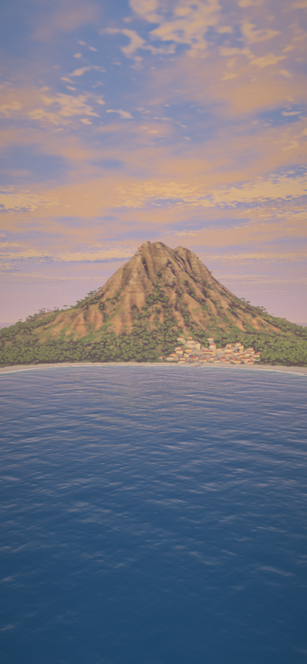
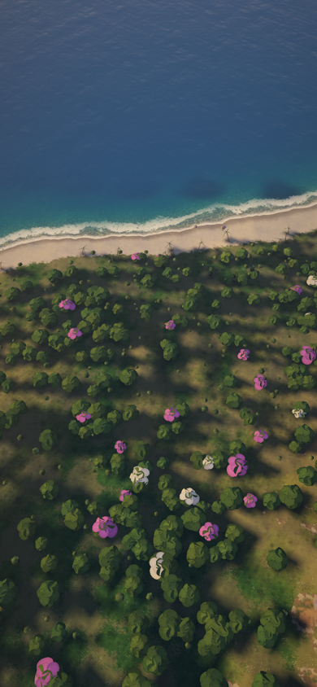
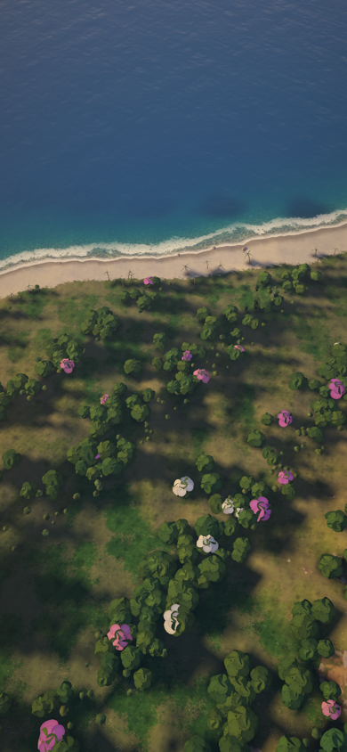
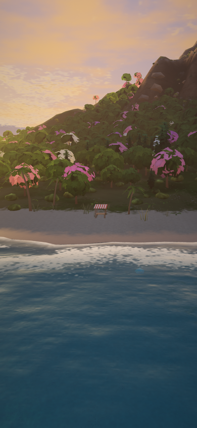

# 6 · Ten thousand things

The bare ground gets trees, bushes, ferns, rocks and a village: 46,656 things on seed 7, each put where a rule says. You will type `whichTree`, which tree grows at a spot, and `bucket`, the order a list of things is drawn in. The rest of the layer is the largest in the course, and you will look at where its parts are, not walk through them.



**Before you start:** lesson 5's `project/world-05.html`, with its contract passing. Run every command from this course's folder.
**Code scope:** you type 25 lines, the bodies of `whichTree` and `bucket`. The rest of the layer, about 2,350 lines, is supplied. The new application is about 5 lines of your own.
**Time:** about 6 minutes to read and 30 to 60 minutes to build; neither is measured with learners yet.

Make the file with `node lab.mjs next project 6 write` (or `supplied`, or `ai`), then open `project/world-06.html?seed=7`. On the write route the page says `whichTree: not written yet`.

## A rule for each spot

The forest is not drawn by hand. `placeThings` lays a grid over the island, one spot in each 5.2 m square, nudges each spot off its grid point, and asks a rule whether a tree grows there and which. The rule reads what earlier layers made: the height, the ground cover (grass, moisture and sand, from 0 to 1, and the steepness), a noise field called **grove** that is 0 in a clearing and 1 deep in a wood, and two **dice**, `chance` and `pick`, numbers from 0 to 1 that come from a hash of the spot. The same spot always has the same dice. Replace the body of `whichTree`:

<!-- code-example {"file":"examples/things.txt","region":"whichTree","language":"js","title":"whichTree, in the 6-things (pure) region","change":"Write route: type the body in place of the throw line."} -->
```js {"file":"examples/things.txt","region":"whichTree","title":"whichTree, in the 6-things (pure) region","change":"Write route: type the body in place of the throw line."}
// The rule for one candidate spot in the forest's grid: which tree grows here,
// if any. Returns a kind number (0 broadleaf, 1 pine, 2 cypress, 4 palm) or -1
// for none. h is height in metres; grass, moist, sand and steep are the cover
// masks, 0..1; grove is 0 in a clearing and 1 deep in a wood; tall is a second
// noise that gathers cypresses; chance and pick are this spot's two dice, 0..1.
function whichTree(h, grass, moist, sand, steep, grove, tall, chance, pick) {
  // Palms along the back of the beach.
  if (h > 1.6 && h < 7 && sand > 0.12 && sand < 0.8)
    return chance < 0.2 ? 4 : -1;
  // No soil, or too close to the sea.
  if (grass < 0.5 || h < 2.5) return -1;
  // Thick in wet groves, thin toward the heights.
  const want = grove * (0.2 + 0.8 * moist) * (1 - smooth(110, 210, h));
  if (chance > want * 0.8) return -1;
  if (tall > 0.25 && h < 110 && pick < 0.55) return 2;
  // Pines take the dry, steep ground.
  return 1 - moist + h / 260 + steep > 0.95 + 0.3 * pick ? 1 : 0;
}
```
<!-- /code-example -->

It returns -1 for nothing, or a kind: 0 broadleaf, 1 pine, 2 cypress, 4 palm. Four ideas are in it.

- Palms line the back of the beach, wherever the sand is, and nothing else does.
- No grass, no tree. A tree also stays clear of the sea.
- How likely a tree is grows with the grove and the moisture, `grove × (0.2 + 0.8 × moist)`, and falls off toward the heights.
- Dry, steep or high ground takes a pine; where a second noise gathers them, below 110 m, a cypress; the rest are broadleaf.

Run the checks:

```sh
node lab.mjs check project 6
```

They try the rule at thousands of spots, not only yours: where trees may stand, that more grove never grows fewer, and how thick the wood is when it is wet, dry, high or a clearing. They also grow the whole island and count.

## One rule, ten thousand trees

Every kind has a list, eight numbers a thing: where it stands, its size and turn, a tint, and its chance. The page draws each kind in one call per group of 64 m squares, called **plots**, so it needs the things of a plot side by side in memory. `bucket` sorts them into plots. But it also decides what a half-full picture looks like, because a phone draws only the first part of each plot. Replace the body of `bucket`:

<!-- code-example {"file":"examples/things.txt","region":"bucket","language":"js","title":"bucket, in the 6-things (pure) region","change":"Write route: type the body in place of the throw line."} -->
```js {"file":"examples/things.txt","region":"bucket","title":"bucket, in the 6-things (pure) region","change":"Write route: type the body in place of the throw line."}
function bucket(list) {
  const n = list.length / 8;
  const order = new Uint32Array(n);
  const key = new Float64Array(n);
  const start = new Uint32Array(PLOTS * PLOTS + 1);
  for (let i = 0; i < n; i++) {
    // The plot this thing stands in, from its x and its z.
    const across = Math.floor((list[i * 8] + HALF) / PLOT);
    const down = Math.floor((list[i * 8 + 2] + HALF) / PLOT);
    const c = clamp(down, 0, PLOTS - 1) * PLOTS + clamp(across, 0, PLOTS - 1);
    order[i] = i;
    // Sort by plot, and within a plot by the thing's chance number, which is
    // what shuffles it.
    key[i] = c + list[i * 8 + 7];
    start[c + 1]++;
  }
  // Turn the counts into where each plot starts.
  for (let c = 0; c < PLOTS * PLOTS; c++) start[c + 1] += start[c];
  order.sort((a, b) => key[a] - key[b] || a - b);
  // Copy the things out in their new order.
  const data = new Float32Array(n * 8);
  for (let i = 0; i < n; i++)
    data.set(list.slice(order[i] * 8, order[i] * 8 + 8), i * 8);
  return { data, start };
}
```
<!-- /code-example -->

The sort key is the plot number plus the thing's chance, a fraction, so things sort by plot first and by chance inside it. The chance numbers have nothing to do with where a thing stands, so sorting by them shuffles the plot: the first half of a shuffled plot is spread over all of it.

Question 6a. Seed 7 has 7,664 trees. The page draws the first half of every plot, rounding each plot's count up. How many is that: (a) exactly half, (b) a little more than half, (c) a little less than half, (d) about a quarter? Commit, then draw it:

```sh
node lab.mjs predict project 6a YOUR_ANSWER
node lab.mjs forest project --share 0.5
```

<!-- code-example {"file":"examples/forest.txt","region":"map","language":"text","title":"node lab.mjs forest project --share 0.5"} -->
```text {"file":"examples/forest.txt","region":"map","title":"node lab.mjs forest project --share 0.5"}
                                                                
                                                                
                                                                
                                                                
                                                                
                                                                
                                                                
                                  :-:                           
                              =-=%=*%@*                         
                             :%@@@%::@@%#::                     
                             =@@@@@+=:-=#%#*:                   
                           -*@@@===@@*:+@%@*@+=                 
          .     .        :=@@%:. :@@+%*@@%=@@@@@.:.             
               .=**:-::-.-*@@* :=%@@@%@@@***@@@: :=             
              :*@*@@@@**#==@%%:: :*@*+:=*---::.  =*             
             .%%**=@%@@@*: ::+=   +**: ..#*+=#@@@#=             
           :+#@@@*@@@#==::=:+:   .:%@%:-*@@+:=@@@@@-            
           -##@@@@*#@%+*%+@@#* :  .-*%@@@=..   =#@@:            
              =%@++:=@@=%@@@=..:.    :-@@*:=@@@%=+:             
              -#=.  :=#==*#-.   .      : .=@@@@@*               
              -@@%: *@@*#:*%-  .::     ...=%@@@#                
               .:%@%+-*:#@@@@*#**=:::::=+-*@:*.                 
                  :::..%@@@@@@@@@@@+@:=%:..                     
                        :**-*+ =%==:::                          
                                                                
                    .
```
<!-- /code-example -->

A denser mark is more trees in that patch. The picture is thinner than the whole forest, everywhere.

## Where the parts are

You have now met the two functions that decide where a thing goes and in what order it is drawn. The rest of the layer, in `project/world-06.html`, is mostly shapes. To find your way: search for `// region: 6-things (pure)`.

- `scout` finds places worth knowing: the summit, a level site by the bay for a village, a rise for a lighthouse.
- `layVillage` puts down houses, lanes and walls on that site, and levels the ground under them.
- `placeThings` is the function that calls yours, once for every spot in the grid, and then does the same for bushes, ferns, reeds, crags and rocks, each with a rule of its own.
- `thingMesh` builds each shape once, at three sizes of detail; the page draws each in one call, as many copies as there are.

Read `placeThings` from the line `// Trees.` down. Every rule there is the same kind of question you answered in `whichTree`.

## Break it, see it, repair it

Question 6b. A list is made row by row across the island, from low z to high z. If `bucket` sorts by plot only, and does not shuffle, what does the half-density picture show: (a) an even thinning, (b) a bare band along one side of every plot, (c) one side of the island bare, (d) no change at all? Commit:

```sh
node lab.mjs predict project 6b YOUR_ANSWER
```

In your `bucket`, make the key the plot alone, `key[i] = c`. The page draws whole plots of trees, so add `&share=0.5` to the address: the page then draws only the first half of each plot of every large list. Open `world-06.html?seed=7&shot=1&t=6&share=0.5&cam=-0.006,0.55,260,-0.006,0.86,13`:





The trees gather in clumps: in each 64 m plot the half with low z is full and the other is bare. The broadleaf trees that remain stand 0.18 of a plot further toward low z than the whole plot does. The check says it:

<!-- code-example {"file":"examples/check-break-6.txt","language":"text","title":"node lab.mjs check project 6, the order check, with the break"} -->
```text {"file":"examples/check-break-6.txt","title":"node lab.mjs check project 6, the order check, with the break"}
  FAIL 6.bucket-order: drawing the first half of every plot keeps things that stand 0.1826 of a plot to one side (north to south), not spread over it. The list was made row by row, so a plot left in that order is bare on one side when thinned: shuffle each plot, by its things' chance numbers, before drawing a prefix.
```
<!-- /code-example -->

Put `c + list[i * 8 + 7]` back.

## Use it on a new case: kiosks

Add a thing of your own to the beach. In `project/kiosk.js`, write `kioskAt(h, sand, steep, chance)`, which returns `true` where a market kiosk stands and `false` where not. It must:

- say yes only on dry level sand: height between 1.2 m and 4 m, sand above 0.5, steepness below 0.1;
- say yes at about one good spot in four, by `chance`;
- keep the determinism rule.

Write it yourself on every route; the kiosk checks test it. Then open `world-06.html?seed=7&beach=kiosks` and fly along the shore. The lab tries one spot in each 34 m square of the island and, where your rule says yes, puts the market stall the village has. Seed 7 gets 10 with one correct rule, and it is easy to fly past one: start at `&shot=1&t=6&cam=-0.69,-0.90,9,-0.595,-0.834,3`.



## Brief an agent, then judge the picture again

Your brief, `briefs/06.md`, has lesson 1's six parts. The interface is `whichTree(h, grass, moist, sand, steep, grove, tall, chance, pick)` and the kinds it returns, and `bucket(list)` with what a prefix of a plot must be. The command is `node lab.mjs check project 6`. Check it with `node lab.mjs brief project 6`.

The second critique round looks at the forest and the village. Look at two fixed pictures from each of two seeds, because a fault that shows on one seed and not the other is a fault of chance, and one that shows on both is a fault of the rule. Open these four addresses, with the world file's name before the question mark, and look closely:

- `seed=7&shot=1&t=6&cam=0.95,0.45,60,0.35,0.35,30`, the forest above a beach;
- `seed=7&shot=1&t=6&cam=0.7560,-0.1203,8.0,0.1410,-0.1474,70.0`, the bay from the water;
- the same two with `seed=8`.

Write each fault as what is wrong on screen, with its picture, and no guess at the cause. "1. seed=8, forest: the trees near the beach all have the same size." Then the follow-up asks for causes before fixes, as in lesson 3. On every route, write `briefs/06-critique.md`: at least three numbered faults, each naming its `seed=`, with at least one from each seed, then that follow-up, then the check command. Run:

```sh
node lab.mjs brief project 6 --critique
```

It checks the structure only: it cannot tell whether you opened the pictures, or judge what you saw. Compare the same pictures after the next version.

## Keep the working world

`node lab.mjs recover project 6` writes stage 6 to `project/recovery/world-06.html` without touching your file. Lesson 7 makes the grass move and the gulls fly.
