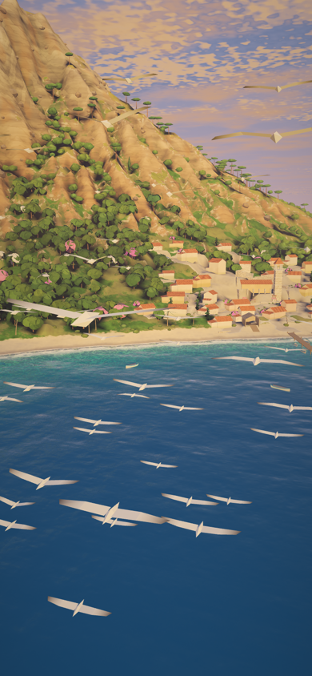
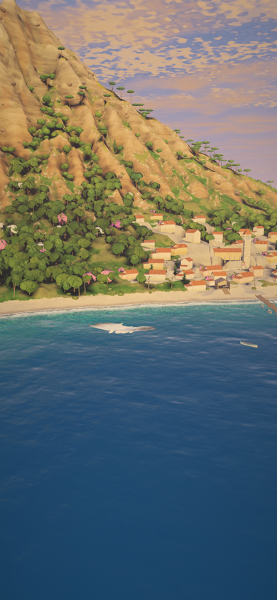
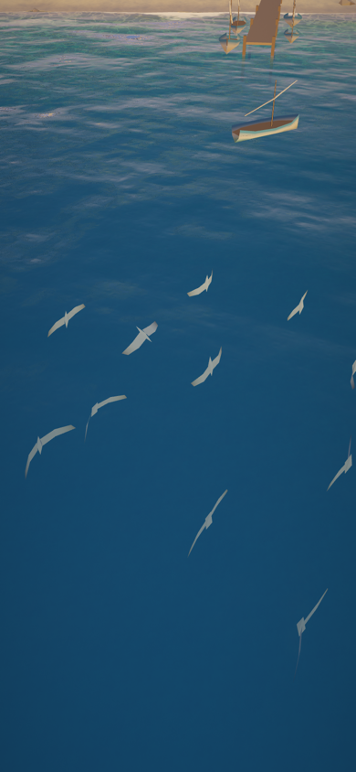

# 7 · Things that move

The gulls fly, and the grass and boats move with the wind. You will type `steerBird`, how one gull decides where to turn. `neighbours`, what it sees of the others, and `stepFlock`, which moves the whole flock, come with the file, and you will tour them.



**Before you start:** lesson 6's `project/world-06.html`, with its contract passing. Run every command from this course's folder.
**Code scope:** you type 21 lines, the body of `steerBird`, and the lesson tours 53 supplied lines, `neighbours` and `stepFlock`. The rest of the layer is supplied. The new application is about 20 lines of your own.
**Time:** about 5 minutes to read and 30 to 60 minutes to build; neither is measured with learners yet.

Make the file with `node lab.mjs next project 7 write` (or `supplied`, or `ai`), then open `project/world-07.html?seed=7`. On the write route the page says `steerBird: not written yet`.

## What a flock does

A flock is not steered from above. Each bird looks at the birds near it and at the ground ahead, and turns a little. The whole shape comes from three rules, and two more keep the birds in the picture:

1. **Cohesion:** turn toward the middle of the neighbours.
2. **Alignment:** match the neighbours' average velocity.
3. **Separation:** turn away from any that crowd you.
4. **Follow a goal,** a point that wanders over the bay, more firmly in height than across.
5. **Clear the ground:** climb if the ground three seconds ahead is close.

`neighbours` does the looking. For bird i it adds up, over the others within 40 m, the offset to each (`centre`), its velocity (`heading`) and a push away from any closer than 6 m, harder the closer (`push`), and counts them:

<!-- code-example {"file":"examples/motion.txt","region":"neighbours","language":"js","title":"neighbours, in the 7-motion (pure) region","change":"Study: supplied."} -->
```js {"file":"examples/motion.txt","region":"neighbours","title":"neighbours, in the 7-motion (pure) region","change":"Study: supplied."}
// What bird i sees of the others within 40 m: count, the sum of the offsets
// to them (centre), the sum of their velocities (heading), and a push away
// from any closer than 6 m, harder the closer (push).
function neighbours(B, n, i) {
  const a = i * 8;
  const near = {
    count: 0,
    centre: [0, 0, 0],
    heading: [0, 0, 0],
    push: [0, 0, 0],
  };
  for (let j = 0; j < n; j++) {
    if (j === i) continue;
    const b = j * 8;
    const dx = B[b] - B[a];
    const dy = B[b + 1] - B[a + 1];
    const dz = B[b + 2] - B[a + 2];
    const d2 = dx * dx + dy * dy + dz * dz;
    if (d2 > 1600) continue;
    near.count++;
    near.centre[0] += dx;
    near.centre[1] += dy;
    near.centre[2] += dz;
    near.heading[0] += B[b + 3];
    near.heading[1] += B[b + 4];
    near.heading[2] += B[b + 5];
    if (d2 < 36) {
      const k = 1 / (d2 + 0.5);
      near.push[0] -= dx * k;
      near.push[1] -= dy * k;
      near.push[2] -= dz * k;
    }
  }
  return near;
}
```
<!-- /code-example -->

The sums are over a changing number of neighbours, so cohesion and alignment divide by `count`; the push is already a sum of separate pushes, one from each bird that crowds. Replace the body of `steerBird`:

<!-- code-example {"file":"examples/motion.txt","region":"steerBird","language":"js","title":"steerBird, in the 7-motion (pure) region","change":"Write route: type the body in place of the throw line."} -->
```js {"file":"examples/motion.txt","region":"steerBird","title":"steerBird, in the 7-motion (pure) region","change":"Write route: type the body in place of the throw line."}
// How one bird steers: its acceleration [x, y, z]. The bird's position is
// B[a], B[a + 1], B[a + 2] and its velocity the next three; near is what
// neighbours() saw, goal the point the flock follows. Three rules come from
// the neighbours: cohesion, alignment, separation. Two keep the flock in the
// picture: follow the goal, and clear the ground.
function steerBird(B, a, near, goal, H) {
  const x = B[a];
  const y = B[a + 1];
  const z = B[a + 2];
  // Follow the goal, more firmly in height.
  const acc = [
    (goal[0] - x) * 0.012,
    (goal[1] - y) * 0.02,
    (goal[2] - z) * 0.012,
  ];
  if (near.count) {
    const k = 1 / near.count;
    for (let c = 0; c < 3; c++) {
      // Toward the middle of the neighbours.
      const cohesion = near.centre[c] * k * 0.035;
      // Toward their average velocity.
      const alignment = (near.heading[c] * k - B[a + 3 + c]) * 0.3;
      // Away from any that crowd.
      const separation = near.push[c] * 14;
      acc[c] += cohesion + alignment + separation;
    }
  }
  // Climb over the ground three seconds ahead.
  const ahead = heightAt(H, x + B[a + 3] * 3, z + B[a + 5] * 3);
  const floor = Math.max(ahead, 0) + 14;
  if (y < floor) acc[1] += (floor - y) * 0.9;
  return acc;
}
```
<!-- /code-example -->

It returns an acceleration, and `stepFlock` turns that into motion. Notice what is not there: no rule mentions the flock. What you see in the air is five small rules, sixty times.

Question 7a. 60 gulls start within about 110 m of the bay's centre and fly for 600 steps of 1/30 second with your `steerBird`. How far from the bay's centre is the farthest bird: (a) under 100 m, (b) 100 m to 400 m, (c) 400 m to 1,000 m, (d) over 1,000 m? Commit before reading on:

```sh
node lab.mjs predict project 7a YOUR_ANSWER
```

Then let them fly:

```sh
node lab.mjs flock project
```

<!-- code-example {"file":"examples/flock.txt","language":"text","title":"node lab.mjs flock project"} -->
```text {"file":"examples/flock.txt","title":"node lab.mjs flock project"}
The flock of seed 7 after 600 steps of 1/30 second (20 s), with your steerBird.
Farthest bird from the bay's centre: 329 m. Heights: 56 to 70 m. Mean distance to the nearest neighbour: 9.7 m.
```
<!-- /code-example -->

The numbers are the same every time: the flock starts from the seed, and nothing in `steerBird` is random. Two runs agree to the last bit, and seed 8 gives another flock.

## Moving all of them

<!-- code-example {"file":"examples/motion.txt","region":"stepFlock","language":"js","title":"stepFlock, in the 7-motion (pure) region","change":"Study: supplied."} -->
```js {"file":"examples/motion.txt","region":"stepFlock","title":"stepFlock, in the 7-motion (pure) region","change":"Study: supplied."}
// One step of flocking for all n birds, in turn: each sees the others as they
// are now (earlier birds have already moved), steers, then moves.
function stepFlock(B, n, dt, t, home, H) {
  // The point the flock follows wanders over the bay.
  const gx = home[0] + Math.cos(t * 0.09) * 230 + Math.cos(t * 0.031) * 120;
  const gz = home[1] + Math.sin(t * 0.073) * 230;
  const gy = 55 + 28 * Math.sin(t * 0.05);
  const goal = [gx, gy, gz];
  for (let i = 0; i < n; i++) {
    const a = i * 8;
    const acc = steerBird(B, a, neighbours(B, n, i), goal, H);
    B[a + 3] += acc[0] * dt;
    B[a + 4] += acc[1] * dt;
    B[a + 5] += acc[2] * dt;
    B[a + 4] *= 1 - 0.6 * dt;
    // Keep the speed between 9 and 15 metres a second.
    const vv = B[a + 3] * B[a + 3] + B[a + 4] * B[a + 4] + B[a + 5] * B[a + 5];
    const sp = Math.sqrt(vv) + 1e-6;
    const want = clamp(sp, 9, 15) / sp;
    B[a + 3] *= want;
    B[a + 4] *= want;
    B[a + 5] *= want;
    B[a] += B[a + 3] * dt;
    B[a + 1] += B[a + 4] * dt;
    B[a + 2] += B[a + 5] * dt;
    // Flap faster when climbing, hold the wings when sinking.
    B[a + 6] += dt * (9 + 4 * B[a + 7]) * (B[a + 4] > -0.5 ? 1 : 0.25);
  }
  return B;
}
```
<!-- /code-example -->

Each bird in turn sees the others as they are now, so the birds earlier in the list have already moved. Then its velocity changes by the acceleration times the time step, its speed is held between 9 and 15 metres a second, and it moves. Run the checks:

```sh
node lab.mjs check project 7
```

They test the rules one at a time: each is made to act alone, and its direction and its averaging are measured. Then the whole flock flies for 3,600 steps, two minutes, and the check asks whether it stayed in the bay, out of the ground, and apart.

## Break it, see it, repair it

Question 7b. Take the separation line out of `steerBird`, and let the flock fly for 3,600 steps. What is the average distance from a bird to its nearest neighbour: (a) about 6 m, as with the rule, (b) about 1 m, (c) close to 0, as if they all stood on one spot, (d) over 20 m? Commit:

```sh
node lab.mjs predict project 7b YOUR_ANSWER
```

Make that change: in `steerBird`, set `const separation = 0;`. Nothing happens at once. After a minute the birds have drawn in, and after two they are one lump. Open `world-07.html?seed=7&shot=1&t=100&cam=1.02,0.14,50,0.978,0.124,45`, which shows the flock 110 seconds in:



<!-- code-example {"file":"examples/check-break-7.txt","language":"text","title":"node lab.mjs check project 7, two checks, with the break"} -->
```text {"file":"examples/check-break-7.txt","title":"node lab.mjs check project 7, two checks, with the break"}
  FAIL 7.steer-separation: with a neighbour close on its left pushing it 0.4 to the right, the bird accelerates 0 along x: separation must turn the bird the way near.push points, and strongly enough to keep it clear.
  FAIL 7.flock: after 3,600 steps the birds are 0.02194 m from their nearest neighbour, on average: the flock has collapsed onto itself. Separation must turn a bird away from any that crowd it.
```
<!-- /code-example -->

The check catches the rule at once, by testing it alone, and the flock later, by what it becomes. Put the rule back.

## Use it on a new case: a school of fish

Fish in a school keep together by the same rules as birds, in water instead of air. In `project/fish.js`, write `schoolStep(B, n, dt, t, quay, H)`, which moves all n fish of `B` one step, like `stepFlock`. `B` has the same eight numbers a fish as a bird: position, velocity, and two more you may leave alone. `quay` is [x, z], a place in deep water off the end of the jetty. It must:

- steer each fish with `steerBird`, and replace the height it gives, because its ground rule lifts a bird 14 m;
- keep every fish below −0.3 m, at least 0.5 m above the bed, and within 60 m of the quay;
- keep the speed between 0.2 and 3 metres a second, and the fish at least 0.4 m from their nearest neighbour, on average;
- give the same school from the same start.

`heightAt(H, x, z)` gives the bed. Write it yourself on every route; the school checks test it. Then open `world-07.html?seed=7&fish=1` and look at the water off the jetty, where 12 fish swim. The page has no fish of its own, so they are drawn as gulls, and you will see their wings; what you wrote is the swimming.



## Brief an agent

Your brief, `briefs/07.md`, keeps the six parts. The interface is `steerBird(B, a, near, goal, H)`, with where in `B` the bird's position and velocity are, the four fields of `near` and whether each is a sum, and the acceleration it returns, three numbers. A good reference is a movement, not a picture: "spread birds, all turning together, none crowded, none over the land". The command is `node lab.mjs check project 7`. Run `node lab.mjs brief project 7`.

On the AI route, give the brief and `project/world-07.html` to your agent, run `node lab.mjs check project 7 --help-used "agent: NAME"`, read its code, and do the break and repair on it.

## Keep the working world

`node lab.mjs recover project 7` writes stage 7 to `project/recovery/world-07.html` without touching your file. Lesson 8 gives the world its sound.
