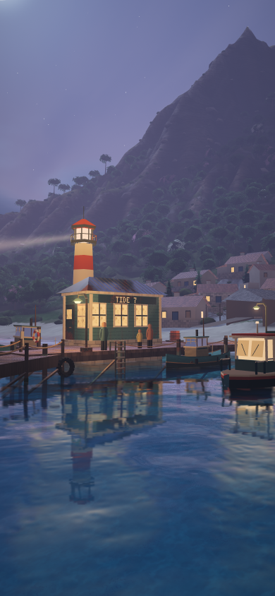
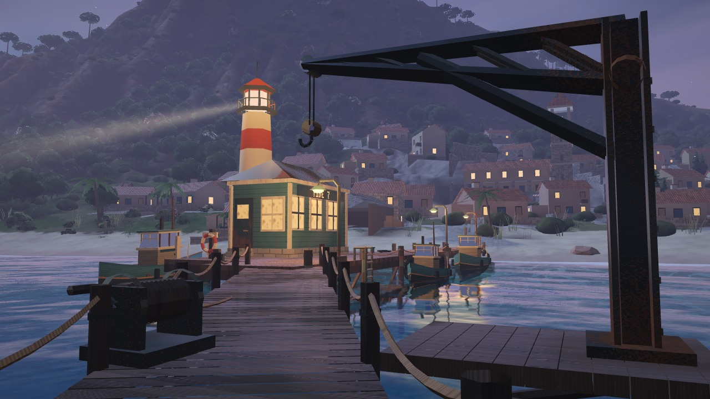
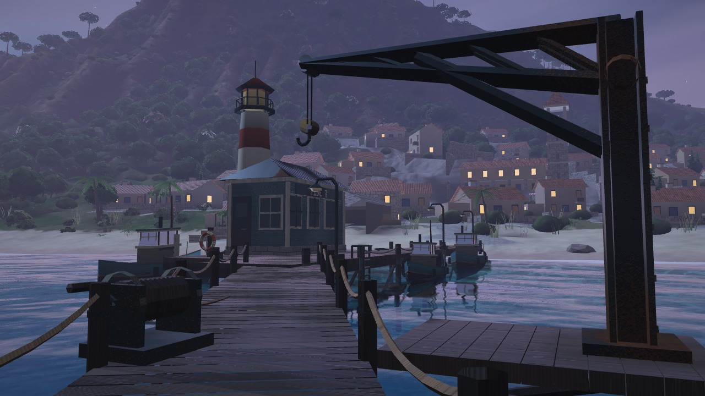
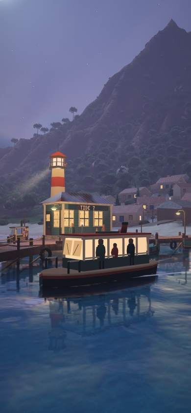
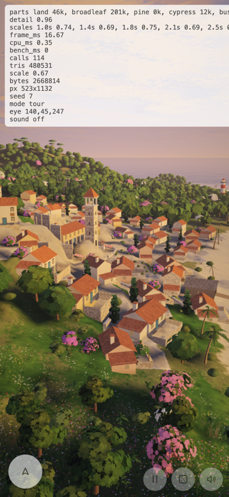

# 9 · Ship it

Your world runs on your computer. Now make it something you can send: a tour that plays by itself, a picture that keeps its frame rate by giving up sharpness, one clean file, and a second world built from your brief. You will type `nextScale`, which decides how sharp the picture is.



**Before you start:** lesson 8's `project/world-08.html`, with its contract passing, and the scripts you wrote for lessons 2 to 8 in `project/`. Run every command from this course's folder.
**Code scope:** you type 4 lines, the body of `nextScale`, and the lesson tours supplied code for the tour and the triangle budget. You also change a camera offset to frame the ferry. The second world is written by an agent from your brief.
**Time:** about 6 minutes to read and 30 to 60 minutes for the first half; the second world takes as long as your rounds do. Neither is measured with learners yet.

Make the file with `node lab.mjs next project 9 write` (or `supplied`, or `ai`), then open `project/world-09.html?seed=7&stats=1`. `stats=1` shows the numbers this lesson uses.

## Sharpness for smoothness

Every pixel costs time, and a phone's screen has millions. The page draws at `scale` times the screen's size, where 1 is full size, and stretches the result. Less is faster and softer. Every 0.7 s it asks `nextScale` for the next one, with the recent average frame time `ms` and `calm`, how many checks in a row had room to spare (a frame under 17.6 ms); `calm` starts again from 0 when the scale changes.

<!-- code-example {"file":"examples/ship.txt","region":"nextScale","language":"js","title":"nextScale, in the 9-shipping (pure) region","change":"Write route: type the body in place of the throw line."} -->
```js {"file":"examples/ship.txt","region":"nextScale","title":"nextScale, in the 9-shipping (pure) region","change":"Write route: type the body in place of the throw line."}
// Render resolution follows the frame time: drop it fast when frames run long,
// raise it slowly when there is room. ms is the recent average frame time; calm
// counts checks in a row that had room to spare.
function nextScale(scale, ms, calm) {
  // Under 30 frames a second: act now.
  if (ms > 36) return Math.max(0.45, scale * 0.82);
  // Missing 60: give up a little sharpness.
  if (ms > 21 && scale > 0.7) return scale * 0.93;
  if (ms < 17.6 && calm >= 4) return Math.min(1, scale * 1.08);
  return scale;
}
```
<!-- /code-example -->

Four lines, four cases. Over 36 ms, well under 30 frames a second, it cuts hard and at once, but never below 0.45. From 21 to 36 ms the picture misses 60 frames a second, and it gives up a little, but only while the scale is above 0.7; below that, about 30 is enough. Under 17.6 ms it waits for four calm checks and then rises a little, never above 1. Anything else it leaves alone. The gap from 17.6 to 21 is the **dead band**: nothing changes there.

The page's part is supplied. It averages the frame times, keeps the count, and applies the answer:

<!-- code-example {"file":"examples/ship.txt","region":"checks","language":"js","title":"The resolution check, in the 9-shipping (page) region","change":"Study: supplied."} -->
```js {"file":"examples/ship.txt","region":"checks","title":"The resolution check, in the 9-shipping (page) region","change":"Study: supplied."}
// Resolution follows the frame time. "?slow=MS&slowfor=SECONDS" pretends frames
// run longer for a while, to test it.
onTick((dt, real) => {
  if (SHOT || frames <= 30) return;
  let ms = real * 1000;
  if (Q.has('slow') && time < +(Q.get('slowfor') || 1e9)) ms += +Q.get('slow');
  ship.avg = ship.avg * 0.9 + ms * 0.1;
  ship.since += ms;
  ship.idle += ms;
  if (ship.idle > 4500) $('ui').classList.add('idle');
  if (ship.since < 700 || Q.has('scale')) return;
  ship.since = 0;
  ship.calm = ship.avg < 17.6 ? ship.calm + 1 : 0;
  const next = nextScale(stat.scale, ship.avg, ship.calm);
  if (next !== stat.scale) {
    stat.scale = next;
    ship.calm = 0;
    ship.avg = 17;
    (stat.log = stat.log || []).push(time.toFixed(1) + 's ' + next.toFixed(2));
  }
});
```
<!-- /code-example -->

Question 9a. From scale 1, ten checks in a row have frames of 50 ms. What is the scale then: (a) about 0.82, (b) about 0.14, (c) 0.45, (d) 0.7? Commit before reading on:

```sh
node lab.mjs predict project 9a YOUR_ANSWER
```

Question 9b. After those ten, ten checks in a row have frames of 12 ms. What is the scale: (a) 1, (b) about 0.97, (c) about 0.52, (d) still 0.45? Commit:

```sh
node lab.mjs predict project 9b YOUR_ANSWER
```

Then run your function through both, and through a model device whose frame time depends on the pixels it draws:

```sh
node lab.mjs scale project
```

<!-- code-example {"file":"examples/scale.txt","language":"text","title":"node lab.mjs scale project"} -->
```text {"file":"examples/scale.txt","title":"node lab.mjs scale project"}
Your nextScale, one check each 0.7 s (calm counts checks under 17.6 ms and starts again when the scale changes; the page gives it an average frame time, and here it is given).
From 1, ten checks with frames of 50 ms:      0.82 0.67 0.55 0.45 0.45 0.45 0.45 0.45 0.45 0.45
Then ten with frames of 12 ms:                0.45 0.45 0.45 0.49 0.49 0.49 0.49 0.52 0.52 0.52
A model device, 30 ms a frame at full size (a frame takes its pixels' time, and never under 16.7 ms): 1 pixel in scale squared.
Its first 20 checks:                          0.93 0.86 0.80 0.80 0.80 0.80 0.80 0.80 0.80 0.80 0.80 0.80 0.80 0.80 0.80 0.80 0.80 0.80 0.80 0.80
Checks 61 to 80:                              0.80 0.80 0.80 0.80 0.80 0.80 0.80 0.80 0.80 0.80 0.80 0.80 0.80 0.80 0.80 0.80 0.80 0.80 0.80 0.80
```
<!-- /code-example -->

Run the checks:

```sh
node lab.mjs check project 9
```

They use frame times given as numbers, and sixteen model devices. No check in this course measures a frame rate, and nobody has measured this world on a phone for it. Do that yourself: `node lab.mjs serve project --lan`, then open the address on your phone with `&stats=1` and read `frame_ms`.

## Fewer triangles

The scale saves pixels. Triangles are the other cost: more than the **budget** (600,000 on a phone, 2,200,000 elsewhere) and the device works too hard whatever the scale is. After each frame the page compares what it drew with the budget, and when it drew too many, the distances at which things turn simpler shrink a little; with room to spare they grow back:

<!-- code-example {"file":"examples/ship.txt","region":"budget","language":"js","title":"The triangle budget, in the 9-shipping (page) region","change":"Study: supplied."} -->
```js {"file":"examples/ship.txt","region":"budget","title":"The triangle budget, in the 9-shipping (page) region","change":"Study: supplied."}
// The triangle budget: when the last frame drew too many, every detail distance
// shrinks a little; with room to spare it grows back.
onDraw(90, () => {
  if (stat.tris > BUDGET * 0.94 || stat.tris < BUDGET * 0.8)
    W.detail = clamp(
      W.detail * clamp(Math.sqrt((BUDGET * 0.87) / stat.tris), 0.93, 1.03),
      0.4,
      1,
    );
});
```
<!-- /code-example -->

It is the same idea as `nextScale`, with a wide gap between too many (0.94 of the budget) and too few (0.8) where nothing changes.

## A tour that plays by itself

Nobody should need instructions to see your world. The tour is a list of shots, each a camera pose that glides to another; `tourPose` finds the shot for a time and eases along it:

<!-- code-example {"file":"examples/ship.txt","region":"tourPose","language":"js","title":"tourPose, in the 9-shipping (pure) region","change":"Study: supplied."} -->
```js {"file":"examples/ship.txt","region":"tourPose","title":"tourPose, in the 9-shipping (pure) region","change":"Study: supplied."}
// Camera pose at time t of the tour: fills eye and look, returns [shot number,
// how close to a cut 0..1].
function tourPose(shots, t, eye, look) {
  let total = 0;
  let k = 0;
  for (const s of shots) total += s[0];
  t -= Math.floor(t / total) * total;
  while (t >= shots[k][0]) t -= shots[k++][0];
  // Ease in and out, never quite stopping.
  const s = shots[k];
  const u = t / s[0];
  const e = u * u * (3 - 2 * u) * 0.7 + u * 0.3;
  if (s.length > 1)
    for (let c = 0; c < 3; c++) {
      eye[c] = mix(s[1][c], s[3][c], e);
      look[c] = mix(s[2][c], s[4][c], e);
    }
  return [k, Math.max(1 - t / 0.9, 1 - (s[0] - t) / 0.9, 0)];
}
```
<!-- /code-example -->

Between shots the picture fades for 0.9 s. A shot with no poses follows the flock. Where a visitor has asked for less motion, the tour waits.

### Frame the harbour at eye level

Open your `project/world-09.html` in a browser and add `?seed=7&shot=1&t=3&view=dock` to its address. This earlier dock study leaves the water open between the moored boats. Follow the rope toward the lit tide station.

Pick a wet board under a lamp. Predict where the light comes from, then append `&lamps=0` to the same fixed view. Some light stays on the board from the sky. The patch cast by the nearby lamp disappears. Look at the water too. How does the lamp's streak respond? What happens to the reflected sky? Remove the switch to bring the lamp back.





Trace this from JavaScript to the shader. The frame uniforms carry the jetty's origin and direction. `harbourLamp` uses them to turn a fixture position on the jetty into a world position. The surface shader subtracts the position of the board from that point, then uses the resulting direction, distance and surface normal to shade the board. The material's wetness controls its narrow highlight. To move the pool of light with the lamp, keep the fixture and the shading calculation in the same coordinates.

### Frame the last ferry

Coming from the film? In a fresh course checkout, save a copy of `stages/world-09.html` as `ferry-study.html` and open the copy in your browser. If you have been building along, open your own `project/world-09.html`. Add `?seed=7&shot=1&t=0` to its address. The camera is across the water. Find the ferry entering from the right, the bright windows on the quay and their reflection below. Trace the bow’s path with your finger. Which will the hull hide first, the windows or their reflection? Write down what you expect to remain lit.

Change `t=0` to `t=4` and reload. The hull hides a band of light on the water while the station windows still shine above it. Try `t=8` to see the light reappear. The boat has passed between your eye and the water. To watch it move, open the same file with just `?seed=7` and press the tour’s play button if it is paused.

<details>
<summary>See the crossing in a still frame</summary>



</details>

**Move the camera yourself.** In the file you opened, find `const ferryEye = by(B, 49, -24, 2.85)` inside `makeTour`. The three numbers place your eye offshore, along the shore and above the ground. Keep `stationTarget` fixed. Before editing, mark where the bow falls under the station sign at `t=4`. Predict which way it will move against the sign if you change `-24` to `-30`. Save the edit and reload the same frozen instant. The bow, the windows and the sign keep their places in the world. Your sideways step changes how they overlap in the frame.

On a second island, the viewer wants to know whether anyone is waiting to board. Open `?seed=8&shot=1&t=4`. Choose someone on the quay. Adjust the camera until their feet and the deck they stand on are visible above the passing hull. If a sideways step moves the person behind a cabin window, try a change of eye height. Check again at `t=8`. Save the two frames and your camera settings so someone else can follow the same person through the crossing.

## Break it, see it, repair it

Without the dead band the scale rises whenever the frames are not slow. Replace the last two lines of `nextScale` with `return Math.min(1, scale * 1.08);`. Open `world-09.html?seed=7&stats=1&slow=14`, where `slow=14` pretends that every frame takes 14 ms more. Watch `scales` and `px`:



The frames are too slow at the larger size, so it goes down; nothing keeps it there, so it goes up again, for as long as you watch. In the fixed version the same page settles after two changes. Four of the seven checks fail, and two of them name what you saw, the dead band and the picture that never settles:

<!-- code-example {"file":"examples/check-break-9.txt","language":"text","title":"node lab.mjs check project 9, the four failures, with the break"} -->
```text {"file":"examples/check-break-9.txt","title":"node lab.mjs check project 9, the four failures, with the break"}
  FAIL 9.missing: at scale 0.5 with frames of 28 ms, nextScale gives 0.54: at 0.7 or less the picture is already soft, and 30 frames a second is enough, so it stays.
  FAIL 9.dead-band: at scale 0.45 with frames of 17.7 ms, nextScale gives 0.486 (calm 0): between 17.6 and 21 ms it must leave the scale alone, whatever calm is. This is the dead band: without it the picture pulses.
  FAIL 9.fast: at scale 0.45 with frames of 12 ms and calm 0, nextScale gives 0.486: a frame that is fast once says little, so wait until calm is 4.
  FAIL 9.settles: on a device whose frames take 22 ms at full size, the scale still changes after 60 checks (42 seconds): 0.93, 1, 0.93, 1, 0.93, 1. The picture pulses between sizes. Leave a band of frame times where nothing changes, wide enough that one step up or down cannot jump over it.
```
<!-- /code-example -->

Put the two lines back. The band must be wide enough that one step up cannot jump over it: a step of 1.08 makes a frame 17 per cent slower, since it draws 1.08 squared as many pixels, and from 17.6 ms that is 20.5, still inside the band.

## Ship one clean file

Until now the lab has added lines to your world, marked `/* lab */`, that load your scripts when the address asks. A shipped world has none:

```sh
node lab.mjs ship project
```

It writes `project/ship/world.html`: your file without lab lines, without an extra script tag, reaching no other file. Send it, or put it anywhere that serves a web page. The address can carry the seed (`?seed=7`), so a link names one island. If you want your own work from the lessons in it, name it, and the lab writes the function into the file so that a reader finds it as code and not as a script:

```sh
node lab.mjs ship project --with moon,bell --as night.html
```

The names are `atoll`, `moon`, `lagoon`, `scree`, `kiosk` and `bell`. `--as` gives the file a name of its own, since nothing is ever overwritten. Open the file before you send it: the lab has looked at the text, not at the picture. Add a licence, in a comment at the top, that says what others may do with it. The button with the dice takes a visitor to another island.

## A second world

Pick a place on the same skeleton: a canyon at dawn, a harbour in snow, a drowned town, anything. You write the brief, and an agent of your choice builds it, in at least two rounds. This copies your shipped world, `project/ship/world.html`, to `project/second.html`, and refuses if that file exists. Work in the copy:

```sh
node lab.mjs second project --start
```

The brief is `briefs/09.md`. Its six parts are lesson 1's: the goal as something on screen (the place, the light and the hour); the fixed constraints, with the determinism rule; the interface, which here is the functions that must keep their contracts, by name: `ridged`, `landHeight`, `skyKeys`, `waveTile`, `depositOrCut`, `whichTree`, `steerBird` and `gullCall`; the check; references described by their properties; and what to hand back. The check is:

```sh
node lab.mjs ship project --file second.html
node lab.mjs second project
```

`second` runs the contract checks of lessons 2 to 8 on your shipped file, on its own functions: 58 of them. Change the island's shape, its colours, its sky, its houses and its sounds as you like; the functions must still do what they promise. (Those checks know the trees, so a new place may keep the kinds of tree and change how they look.) Run `node lab.mjs brief project 9`.

**Round two.** Open the first build at three fixed addresses, such as `?seed=7&shot=1&t=6`, and write `briefs/09-critique.md`: at least three numbered faults, each saying what is wrong on screen and at which address, then ask for the cause of each before any fix. Check it with `node lab.mjs brief project 9 --critique`. It checks the structure only: it cannot tell whether you opened the pictures, or judge what you saw. But it refuses until `second` has been shown a first build that differs from your first world, since before that there is nothing to criticise. Hand the critique to your agent and build again, then ship and run `second` as before; `ship` keeps the earlier build as `ship/second-1.html`.

The lab saves each build it was shown, with the checks that passed, and says when the world is finished: all checks pass and a critique lies between two different builds. It knows only the file's bytes, not who wrote it or whether it is good. That part is yours: open it on a phone, show it to someone, and ask them where they are.

## What you can build now

You have one file that grows a place from a seed, and a way to describe places. The next one starts with the question you began with: what would a person see first?
