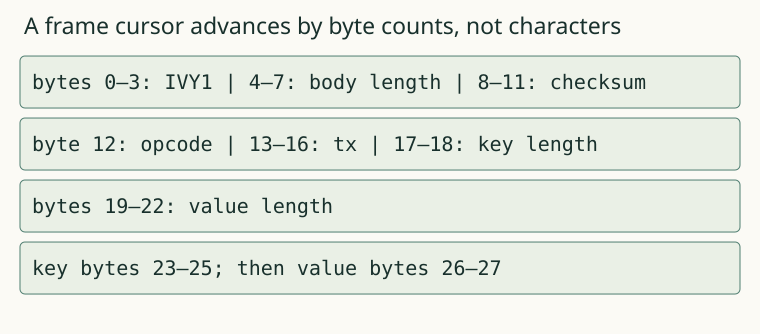

# 01. Binary records

A saved string needs a boundary: the next reader must know where it ends and whether its bytes are intact. Build an encoder and decoder for one explicit binary record format.

## Before the worked result

This case uses the terms and interface in contracts.md. Read the input in `node lab.mjs question 01a`, then save your answer with `node lab.mjs predict project 01a YOUR_ANSWER --help-used none` before reading the worked result below. This is practice, not a mastery claim. If you need the unit's terms first, study them and label the answer assisted rather than an unaided prediction.

A record is one typed log entry. A frame is the byte envelope around it: magic, body length, checksum and body. Magic identifies this format. Length states how many body bytes the writer declared; available fixed field lengths must agree with it. The checksum detects selected accidental changes; it does not authenticate an attacker-controlled file.

Read contracts.md for the exact big-endian layout. All byte lengths refer to UTF-8 bytes, not JavaScript string length. A key with an accented character can occupy more bytes than its apparent character count. The supplied validator defines key, value and transaction-id bounds; you own placing those fields into bytes and reading them back.

The reduced example runner encodes one original put record and prints its header, field sizes and decoded record. Before revealing it, predict whether a missing last body byte is a valid smaller record, incomplete input or corruption. The declared outer length is what separates those cases.

Implement encodeRecord and decodeRecord in your solution module. Decode at the supplied offset and return the number of bytes consumed, so the next caller can read an adjacent frame. Return null for a consistent incomplete final frame. Once all 11 fixed body bytes are available, check that 11 plus key and value byte lengths equals the outer body length. A contradiction is malformed even if that outer length points past EOF. Do not read fixed fields that are not all present. Reject complete frames with a wrong magic, impossible lengths, invalid UTF-8 or a mismatched checksum. Never skip garbage looking for a later magic string.

Run stage 01. If round-trip succeeds but the field-layout case fails, your encoder and decoder may agree on the same wrong format. Compare the explicit header fields with the contract. The checker also changes one payload byte and tries every incomplete prefix of a valid frame. Explain why those experiments test different requirements. The length-prefix case also contrasts a genuine short suffix with an already detectable contradiction at both zero and nonzero offsets. The checksum covers the body only: a plausible damaged header may still look like an incomplete frame, so do not promise detection of every changed byte.

Your first build is a record inspector. It can encode a bounded operation, show byte lengths and reject a changed complete frame. It does not yet provide durable writes, an index or transaction atomicity.

For transfer, choose a non-ASCII key and an empty value. Predict key bytes and value bytes separately, encode the record and explain any difference from string length. Then place it after another frame and decode only from its actual offset. Keep the inputs and observed header in report.md so a later recovery investigation can rely on a format you checked.

## Representation

The adjacent text and worked output state the same relation. The figure uses supplied sibling data, not the answer to your pending capstone.

## Worked procedure

Run `node examples.mjs 01`. The header occupies offsets 0–11. The fixed body occupies the next 11 bytes; read its opcode, tx, key length and value length before advancing a cursor into the text bytes. For the supplied bé/ok sibling, use the recorded key-byte and value-byte lengths to calculate the end of the key and end of the frame. Validate the outer size and checksum before decoding either text field. A leading U+FEFF in a field is data, not a file signature to consume. Completion: leave the value empty and calculate which length and endpoint change; then attempt case 01b. This cursor walkthrough does not supply your encoder or decoder.

## Complete a changed case

Run `node lab.mjs question 01b` and commit the answer with `node lab.mjs predict project 01b YOUR_ANSWER --help-used none`. These are applications after instruction; they are not counted as predictions before explanation or as mastery evidence.

## Commit, build, check

For the cumulative build, create `project` once with `node lab.mjs start project`. Edit project/solution.mjs and run `node lab.mjs check project 01 --help-used none`. The check saves your code, report, original question and help before execution.

If an earlier layer blocks this unit, use a NEW directory: `node lab.mjs start-for unit01 01 --use-prior`. This explicitly supplies earlier layers, leaves this unit's target unfinished and records the assistance in PROJECT.json and every receipt. It never replaces your existing project. Use `node lab.mjs check unit01 01 --help-used supplied-prior` for that assisted route. A supplied earlier layer is not your own implementation; keep your cumulative project to build the full tool yourself.

## Help and limits

When a case fails, locate its named boundary, reduce the actual input to a minimal failing program or byte prefix, then compare one intermediate state with the sibling example from `node examples.mjs 01`. Write what help you used. The capstone investigation has a rubric rather than a worked answer. These short project chapters target roughly 2–3 minutes of prose and 30–60 minutes of building per unit; those are design estimates, not learner timing evidence.
