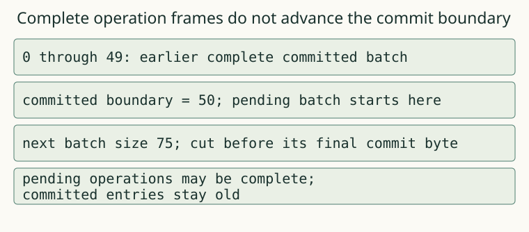

# 04. Atomic batches

Two related updates should become visible together. Add a commit boundary so recovery does not expose only the first half of a batch.

## Before the worked result

This case uses the terms and interface in contracts.md. Read the input in `node lab.mjs question 04a`, then save your answer with `node lab.mjs predict project 04a YOUR_ANSWER --help-used none` before reading the worked result below. This is practice, not a mastery claim. If you need the unit's terms first, study them and label the answer assisted rather than an unaided prediction.

A batch is a finite ordered list of puts and deletes that share one transaction id. Its physical records end with a commit record using that same id. In this model batches are contiguous and transaction ids increase. There are no concurrent writers or interleaved transactions to resolve.

Recovery accumulates a batch's operations without publishing them to the committed index. Only its complete commit applies them. A complete put without a later commit is not visible after reopen. A commit can acknowledge an empty batch. Repeated updates within a batch retain their order, so the last operation for a key wins.

The sibling example contains a committed earlier value and a later uncommitted replacement. Predict which value a reopened store may return before revealing the result. A complete operation frame answers whether the record is intact; a commit answers whether the group is visible. Those are different boundaries.

Implement encodeBatch and the committed part of recover. Build every record before starting the append, so invalid input fails without writing a half-validated transaction. Check transaction-id continuity while scanning. Interleaving or reuse is corruption under this format, rather than a request to merge operations heuristically.

Run stage 04. The final-byte truncation case is designed to leave earlier operations physically present while the commit is incomplete. If those operations enter the recovered index, the implementation confused record completeness with transaction completeness. Name that rule in report.md and record the before/after entries.

Your intermediate build can write related local changes as one logical update. The append function acknowledges only after writing the whole encoded batch and synchronizing it. A crash before acknowledgement may still leave a complete batch; recovery is allowed to show the whole batch or none of it according to the bytes that remain. It must never show only a subset.

For transfer, design a batch that deletes an old key and creates a replacement key. Test truncation before each record and just before commit. Explain why a report that checks only successful writes cannot establish atomicity. Keep both the acknowledged history and the byte prefix in the evidence; the set of allowed outcomes depends on both.

## Representation

The adjacent text and worked output state the same relation. The figure uses supplied sibling data, not the answer to your pending capstone.

## Worked procedure

Run `node examples.mjs 04`. Start with committed q=old. Read operations from the next tx into a pending list, leaving the committed map unchanged. Advance the committed byte boundary only when that tx's complete commit is read. The sibling stops one byte before commit completion, so its pending changes cannot become visible. Completion: place a commit before the interruption and state which boundary and entries change. You still implement the batch encoder and committed scan.

## Complete a changed case

Run `node lab.mjs question 04b` and commit the answer with `node lab.mjs predict project 04b YOUR_ANSWER --help-used none`. These are applications after instruction; they are not counted as predictions before explanation or as mastery evidence.

## Commit, build, check

For the cumulative build, create `project` once with `node lab.mjs start project`. Edit project/solution.mjs and run `node lab.mjs check project 04 --help-used none`. The check saves your code, report, original question and help before execution.

If an earlier layer blocks this unit, use a NEW directory: `node lab.mjs start-for unit04 04 --use-prior`. This explicitly supplies earlier layers, leaves this unit's target unfinished and records the assistance in PROJECT.json and every receipt. It never replaces your existing project. Use `node lab.mjs check unit04 04 --help-used supplied-prior` for that assisted route. A supplied earlier layer is not your own implementation; keep your cumulative project to build the full tool yourself.

## Help and limits

When a case fails, locate its named boundary, reduce the actual input to a minimal failing program or byte prefix, then compare one intermediate state with the sibling example from `node examples.mjs 04`. Write what help you used. The capstone investigation has a rubric rather than a worked answer. These short project chapters target roughly 2–3 minutes of prose and 30–60 minutes of building per unit; those are design estimates, not learner timing evidence.
