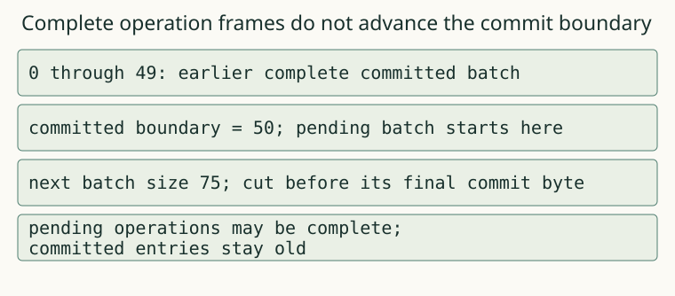

# 05. Recover a truncated write

A stopped writer leaves bytes that the next writer must interpret safely. Finish recovery and repair the tail before accepting another append.

## Before the worked result

This case uses the terms and interface in contracts.md. Read the input in `node lab.mjs question 05a`, then save your answer with `node lab.mjs predict project 05a YOUR_ANSWER --help-used none` before reading the worked result below. This is practice, not a mastery claim. If you need the unit's terms first, study them and label the answer assisted rather than an unaided prediction.

The committed boundary is the byte offset immediately after the last complete commit. It can be earlier than the last complete operation frame. recover returns that boundary, the committed entries, the number of discarded bytes and the last committed transaction id.

A reduced example appends a prefix of a new batch to a valid log. The example runner examines each cut position. Before revealing it, predict why appending a new transaction directly after the torn bytes would be unsafe. The old partial frame could consume bytes from the new transaction or hide it from the scanner.

When openStore reads a log, first run recovery without modifying the file. If a complete record is corrupt, or present fixed lengths already contradict its header, fail closed and preserve the bytes for diagnosis. A claimed end past EOF does not override an available length contradiction. If the suffix is merely incomplete or uncommitted, truncate to the committed boundary and synchronize that repair before appending a new transaction. An orphan temporary compaction file is not part of the active log.

Run stage 05. The every-cut case repeats the same recovery rule across every prefix of the second batch. It is a bounded exhaustive experiment over that batch's bytes, not a proof about all possible logs. The repair-then-append case checks a different property: the store must remain usable after the first recovery.

Your intermediate product is now a recoverable log reader and writer. Retain the original damaged bytes in a separate experiment copy, report the recovered boundary, reopen the working copy, add a new key and reopen again. Do not repair the only copy of data you wanted to inspect as evidence.

For a second practice case, leave several complete uncommitted records at the end rather than an incomplete frame. Confirm that they are still discarded. Then flip a byte inside a complete earlier record and verify an explicit corruption error. Truncating at the first bad checksum would silently erase a stronger kind of failure and is outside this contract.

For transfer, build an empty log, a log ending exactly at commit and a log containing only an uncommitted operation. Explain their different discarded-byte counts. Your report should distinguish what the bytes establish from what you assume about the environment. These tests model process interruption and known byte corruption; they do not reproduce power removal from the Mac.

## Representation

The adjacent text and worked output state the same relation. The figure uses supplied sibling data, not the answer to your pending capstone.

## Worked procedure

Run `node examples.mjs 05`. Track cursor, pending tx, last committed boundary and committed entries as separate columns. A complete operation advances cursor but not the commit boundary. A consistent incomplete frame ends this scan; a known fixed-length contradiction or complete checksum failure throws. On reopen, truncate only an incomplete/uncommitted suffix to the committed boundary, sync that repair, then allow another append. Completion: use a complete uncommitted operation instead of a partial frame and decide which boundary is retained.

## Complete a changed case

Run `node lab.mjs question 05b` and commit the answer with `node lab.mjs predict project 05b YOUR_ANSWER --help-used none`. These are applications after instruction; they are not counted as predictions before explanation or as mastery evidence.

## Commit, build, check

For the cumulative build, create `project` once with `node lab.mjs start project`. Edit project/solution.mjs and run `node lab.mjs check project 05 --help-used none`. The check saves your code, report, original question and help before execution.

If an earlier layer blocks this unit, use a NEW directory: `node lab.mjs start-for unit05 05 --use-prior`. This explicitly supplies earlier layers, leaves this unit's target unfinished and records the assistance in PROJECT.json and every receipt. It never replaces your existing project. Use `node lab.mjs check unit05 05 --help-used supplied-prior` for that assisted route. A supplied earlier layer is not your own implementation; keep your cumulative project to build the full tool yourself.

## Help and limits

When a case fails, locate its named boundary, reduce the actual input to a minimal failing program or byte prefix, then compare one intermediate state with the sibling example from `node examples.mjs 05`. Write what help you used. The capstone investigation has a rubric rather than a worked answer. These short project chapters target roughly 2–3 minutes of prose and 30–60 minutes of building per unit; those are design estimates, not learner timing evidence.
