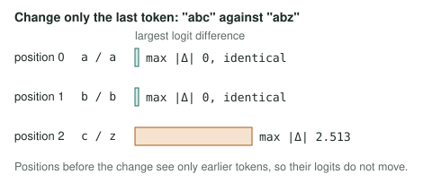

# 04 · Attend to the prefix

A token may use earlier tokens, but it must not use a future token. Implement the full-prefix path first so cached decoding later has a clear numerical comparison.

Goal: implement causal attention, positional rotations and complete full-prefix logits. Depends on modules 01–03.

## Attention mechanism and worked example

A query is the current position's comparison vector. A key is a stored comparison vector for one accessible position. A value is that position's information vector. **Attention** computes dot(query,key)/sqrt(headWidth), applies softmax across accessible positions, then returns the probability-weighted sum of value vectors. The number of keys is the prefix length, not the head width.

For query [1,1], keys [[1,0],[0,1]] have equal scores, so both probabilities are one half. Values [[2,4],[8,-2]] therefore produce [5,1]. Divide every query–key dot product by sqrt(headWidth). The nonuniform attention check uses unequal scores to detect a missing divisor.

At zero-based position p, causal attention sees positions 0 through p inclusive. Exclude later positions before normalizing. A prefix's logits must stay unchanged when only the later suffix changes.

{{practice:r04-causal}}

## Position and head layout

The eight projected coordinates split into two adjacent heads of four coordinates. Within each head, rotate adjacent pairs [0,1] and [2,3]. For pair starting at local coordinate j, angle=position/(ropeBase^(j/headWidth)). Replace [a,b] by [a*cos(angle)-b*sin(angle), a*sin(angle)+b*cos(angle)]. The base is 10000. Apply this rotation to queries and keys, never values. These exact pair and frequency conventions belong to this teaching architecture.

At position zero every angle is zero. At a later position, a pair's norm is preserved but its orientation changes. The rotary-position check executes two pairs at position three and distinguishes using the whole model width in the frequency denominator from the required head width.

A cache stores each block's rotated keys and unrotated values for the tokens already processed in the prefix.

{{practice:r04-position}}

The new token follows the already processed prefix; its zero-based position equals the old cache length.

## Full block execution order

For each block, RMS-normalize the input using attnNorm. Project the normalized vector through wq, wk and wv to get the query, key and value. Rotate each query and key at its sequence position, then run causal attention separately in each head. Concatenate the head outputs, project the result through wo and add the original block input. Then RMS-normalize that residual with ffnNorm, run the gated MLP, and add its output to the residual. Repeat for both blocks. Finally apply finalNorm and lmHead to produce 32 logits per position.

Return {logits,cache} from forward(model,tokens). logits contains one vector per input position. cache has format pocket-cache-v1, model fingerprint, position equal to token count, and one {keys,values} object per block. Each row has model width eight after the two heads are concatenated. Keys are already rotated. forward produces this cache from the full computation; later steps must not change its earlier rows.

## Build, repair and changed problem

Start from the worked example above: probabilities [0.5,0.5] applied to values [[2,4],[8,-2]] give [5,1]. Then implement rotary, attention and forward. Run module 04. Full-prefix logits are compared with a separate scalar-loop implementation, with tolerance 1e-10 on the original fixture. Future-suffix independence is tested separately.

Hints: inspect one head; inspect one position's accessible keys; compare after each residual addition. Construct a suffix change that would influence an unmasked implementation but cannot influence a causal prefix. Keep its observed logits for module 05's cache-parity investigation.
