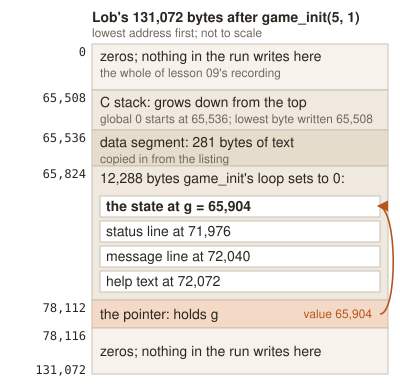

# 08 · A machine worth debugging

Part one's machine had 7 instructions and 8 memory cells, so its hardest bug could be found by reading the program. Lob, the artillery game this part debugs, is 2,806 instructions in 25 functions over 131,072 bytes of memory, and one game frame of it, one call to `game_tick` with no shell in the air, runs 827 of them. By the end of this lesson your `machine.mjs` will run Lob and a second game, Lob II, one instruction at a time and agree with Node's own WebAssembly engine after every call, and you will have measured what part one's debugger costs on it.

Part two assumes part one's ideas: a tick is one instruction, a trace is a list of events, a checkpoint is a saved state you can replay from, running the program again from that moment. If you skipped part one, read its lessons 01 to 06, which build its debugger (it's a separate course, not part of this copy). You can use the supplied `fallback/part-one-debugger.mjs` wherever this course asks for your part-one debugger.

## Start

Run these commands from this course's directory, with Node 22 or later. No packages
or network access are needed. First borrow the finished interpreter for one minute:

```sh
node examples/step-getter.mjs
```

It executes the real game's `r_px` getter one instruction at a time. The game has
not been initialized: its pointer and the bytes read through that pointer are zero.
This is a probe of the interpreter, not a moving shell yet.

<!-- code-example {"file":"examples/getter-output.txt","language":"text","title":"Four instructions through cold memory"} -->
```text {"file":"examples/getter-output.txt","title":"Four instructions through cold memory"}
begin: tick=0, running=true
1 i32.const stack=[0]
2 i32.load stack=[0]
3 f32.load stack=[0]
4 end stack=[]
returned=0; this is cold memory, before game_init
```
<!-- /code-example -->

Notice that `begin` leaves the tick at zero. The final `end` is an instruction too;
it returns the value and empties the stack. You will build those boundaries below,
then use the same interpreter to run the whole game.

**Code scope:** walk through six marked changes, about 125 lines including blank
lines, in `project/machine.mjs`. The roughly 650-line end checkpoint supplies the remaining
opcode cases, program loading and format/opcode checks; you will tour those parts where their
behavior matters. It implements this unit's Machine only, not the later recorder,
debugger, query engine or capstone answers.

**Time:** allow about 25–35 minutes to read and 2–4 hours to implement, diagnose and
try the new application. These are planning estimates, not measured learner times.
You can stop after any section; save the file and keep the same project next time.

Choose a route. Each command below refuses an existing path, including an empty
folder; use a new name if you already have `project/`.

- **Type in the important parts:** `node examples/start-chapter.mjs project write`.
  This copies `starter/machine-build.mjs`, with six deliberate holes and the
  supporting implementation supplied. Type or paste each located listing below.
- **Start with working code:** `node examples/start-chapter.mjs project supplied`.
  This copies `examples/machine-checkpoint.mjs`. Follow each trace and inspect each
  marked region instead of transcribing it, then do the failure/repair and new
  application. This is supplied implementation, not your own from-scratch work.
- **Use AI for the changes:** start with the type-in route (`write`). Give it `API.md`, this
  lesson and your file, one region at a time. Ask it to explain each state change;
  test and inspect what it writes. Record the actual assistance you used.

On the type-in route every hole is filled from a listing printed in full in the
lesson. The code you design yourself is each unit's new application (in this
unit, the budgeted runner near the end) and, in unit 13, the investigations of
builds 2 to 6.

Prefer a completely blank implementation? The original `node lab.mjs start project`
route remains available. It creates method stubs without the supporting opcode
implementation; filling those from the API is extra work beyond this walkthrough.

Run the initial check with the description matching your starting code:

```sh
# Type-in route (write), including AI users before requesting changes:
node lab.mjs check project 08 --help-used "chapter write starter; six regions unfinished"
# Supplied route:
node lab.mjs check project 08 --help-used "supplied Machine checkpoint; initial baseline"
```

The helper records the initial `write` or `supplied` route in `PROJECT.json`.
That describes where you began, not who wrote your current code. Keep using
`--help-used` to record the actual assistance for each attempt.

The type-in route initially fails all checks with `not written yet`. The supplied
route should pass them. Either result is a baseline, not evidence of understanding.
The lab retains this attempt and your code under `project/attempts/`.

Edit only your project. Keep the `// region: NAME` and `// endregion: NAME`
markers. A listing replaces **everything between its matching pair**, including
any unfinished method there; it does not add a second copy of the method. The
six replacements are `initial-state`, `call-entry`, `step-start`, `return-frame`,
`branch` and `memory`, in that order. The listings omit those marker lines.
`API.md` remains the complete Machine contract.

To recover later without losing edits, create `project-recovery` with the supplied
route and compare its file with yours. Do not copy a checkpoint over your attempt.

## What you are given

Lob was written in C and compiled to WebAssembly, a machine code that runs in browsers and in Node. You get the compiled file, `targets/lob.wasm`, and the same file decoded into a JSON listing, `programs/lob.json`. Decoding is taught in the Sightline course. Here you start from the listing. `API.md` ends with a table of all 62 instructions Lob and Lob II use.

The game is played through calls from outside: `game_init(seed, mode)` starts it, `game_key(code)` presses a key, and each call to `game_tick()` is one **game frame**, 1/60 of a second. The mode adds up the game's defences, switches worth 1, 2, 4 and 8 that `API.md` describes under "public/sessions.mjs", and mode 0 has none. Between calls, exported functions called **getters**, such as `r_px` below, each return one value of the game.



Address 78,112 holds a pointer, `g`, the address of the game's state, which sits with the three texts in a stretch `game_init` clears to zero. The **C stack**, below 65,536, is where compiled C keeps some variables of its own, and the **data segment** is text the listing gives the machine to copy in before anything runs. The addresses of `g` and the texts depend on the seed.

The game shows three pieces of text, each in a buffer of its own: the **status line** (angle, power, wind and score), the **message line** (ROUND 1, HIT!, SHORT BY 10) and the **help text**. The help text says the angle runs from 5 to 85, the power from 10 to 100, a shell landing within 12 paces of the flag scores, and the N key starts a new **round**, with a new flag position and new wind.

Lob II, the second game, was written separately and compiled the same way. Its file is `targets/lob2.wasm`, and its listing `programs/lob2.json`. It takes the same calls and keys and keeps the same three texts in memory, and its help text gives the same rules. Its eight getters, `g0` to `g7`, are deliberately named so they don't say what they hold, because Sightline asks its learners to work that out, and none of them returns the help text's address. Your machine runs both games, and one build in lesson 13 is a build of Lob II.

The listing has one entry per function. Here is the whole of function 14, the getter `r_px`, which returns the shell's horizontal position:

```text {"title":"WebAssembly instructions and stack trace"}
0  ["i32.const", 0]
1  ["i32.load", 2, 78112]
2  ["f32.load", 2, 40]
3  ["end"]
```

Each instruction is a name followed by its immediates, the numbers written into the code. A load's two immediates are an alignment hint, which you can ignore, and an offset.

WebAssembly is a **stack machine**. Instructions take their operands from the top of a value stack and push their results back on it. Trace `r_px` by hand, writing the stack after each instruction, top on the right:

```text {"title":"WebAssembly instructions and stack trace"}
0  i32.const 0           [0]
1  i32.load offset 78112 [g]          reads 4 bytes at 0 + 78112
2  f32.load offset 40    [px]         reads 4 bytes at g + 40
3  end                   the function returns px
```

`i32.load` pops an address, adds its offset, and pushes the 32-bit integer stored there: the pointer `g` from the figure. `f32.load` pops that pointer, adds 40 and pushes the 32-bit float stored there, the shell's position. At `end` the function returns what is left on the stack.

Function 12, `r_target_x`, returns the flag's position. The game keeps that position combined by exclusive or (`i32.xor`, below) with a key at `g + 92`, and the key is 0 unless mode 4 is on. It has one local variable, local 0:

```text {"title":"WebAssembly instructions and stack trace"}
0  ["i32.const", 0]
1  ["i32.load", 2, 78112]
2  ["local.tee", 0]
3  ["i32.load", 2, 92]
4  ["local.get", 0]
5  ["i32.load", 2, 16]
6  ["i32.xor"]
7  ["f32.reinterpret_i32"]
8  ["end"]
```

`local.get 0` pushes local 0's value. `local.tee 0` stores the top of the stack in local 0 and leaves it on the stack. `i32.xor` pops two integers and pushes their bitwise exclusive or.

Question 08a: how many values are on the stack after instruction 4 of `r_target_x` has run? Commit your answer before reading on:

```sh
node lab.mjs predict project 08a YOUR_ANSWER
```

## One plain object

Your machine keeps everything it knows in one object, `machine.state`: the memory, the globals (the program's global variables, which start at values the listing gives), the value stack, the frames, the tick count and the count of calls begun. A **frame** is one function call in progress. It holds which function is running, `func`, the index of its next instruction in that function's code, `at`, its locals and whatever your machine needs to return from it.

Everything has to be in that one object, because every later lesson copies or compares the machine's state. Lesson 09 hashes it, lesson 10 saves pieces of it and restores them, and the last section of this lesson runs part one's debugger on it unchanged. `structuredClone(machine.state)` has to make a complete copy, and `machine.state = copy` has to put the machine back at that exact moment. State kept anywhere else, in a closure or a field outside `state`, is state those copies miss.

What isn't state stays outside: the program, and anything you compute once from it, such as where each block (next section) ends.

A run starts with `begin(name, args)`, which pushes the first frame and runs nothing. `step()` runs exactly one instruction and returns its event, `{ tick, func, at, op, writes }`, which holds its tick, which instruction ran, that instruction's name and the writes it made, as part one's events did. `invoke(name, args)` begins a call and steps until the call returns. Checks `08.memory-starts` and `08.one-step` look at a new machine and at its first step.

### Allocate the state you will later restore

In `project/machine.mjs`, replace the `initial-state` region inside the constructor:

<!-- code-example {"file":"examples/machine-checkpoint.mjs","region":"initial-state","language":"js","title":"Initialize mutable state","change":"Replace initial-state inside the constructor."} -->
```js {"file":"examples/machine-checkpoint.mjs","region":"initial-state","title":"Initialize mutable state","change":"Replace initial-state inside the constructor."}
    const memory = new Uint8Array(this.program.memory.min * PAGE);
    for (const d of this.program.data) memory.set(d.bytes, d.offset);
    this.state = {
      memory,
      globals: this.program.globals.map((g) => g.init),
      stack: [],
      frames: [],
      tick: 0,
      calls: 0,
      result: undefined,
    };
```
<!-- /code-example -->

A new typed array starts filled with zero. The data segments then install the
compiled program's text at exact byte addresses. Globals copy their initial values;
the stacks and counters start empty. The constructor's supplied prefix loads the
program, matches each block with its end and binds imports. Those facts do not
change while the guest runs, so they sit outside `state`.

### Separate starting a call from executing it

Replace the whole `call-entry` region. It contains the `running` getter and three
methods, not just `begin`:

<!-- code-example {"file":"examples/machine-checkpoint.mjs","region":"call-entry","language":"js","title":"Start, enter and finish a call","change":"Replace the complete call-entry region."} -->
```js {"file":"examples/machine-checkpoint.mjs","region":"call-entry","title":"Start, enter and finish a call","change":"Replace the complete call-entry region."}
  get running() {
    return this.state.frames.length > 0;
  }

  // Start a call to an export. Nothing runs until step().
  begin(name, args = []) {
    if (this.running)
      throw Error(`Machine: ${name} called while another call is unfinished`);
    const e = this.program.exports.find(
      (x) => x.name === name && x.kind === 'func',
    );
    if (!e) throw Error(`Machine: no exported function named ${name}`);
    const type = this.program.typeOf(e.index);
    if (args.length !== type.params.length)
      throw Error(
        `Machine: ${name} takes ${type.params.length} arguments, got ${args.length}`,
      );
    this.state.calls++;
    this.state.result = undefined;
    this.enter(
      e.index,
      args.map((a, i) => coerce(type.params[i], a)),
    );
  }

  // Run a whole export call and return its result.
  invoke(name, args = []) {
    this.begin(name, args);
    while (this.running) this.step();
    return this.state.result;
  }

  enter(index, args) {
    const fn = this.prepared.get(index);
    const locals = [...args, ...fn.locals.map(zeroOf)];
    this.state.frames.push({
      func: index,
      at: 0,
      locals,
      base: this.state.stack.length,
      labels: [],
    });
  }
```
<!-- /code-example -->

`begin` checks the export and argument count before entering the call. `enter` appends a frame whose
`base` remembers the caller's stack height. Arguments lead the locals; declared
locals follow, initialized to zero. No instruction has executed yet. `invoke` is
only a convenience loop over the same `step` that the debugger will use.

Trace `begin('r_px')`: one frame is added, its next instruction is zero, `calls`
increases once and `tick` stays unchanged. A nested guest `call` uses `enter`, not
`begin`: it must not look like a new call from outside.

### Execute exactly one instruction

Replace the `step-start` region at the opening of `step`. The supplied `switch`
starts immediately after its closing region marker; leave it in place.

<!-- code-example {"file":"examples/machine-checkpoint.mjs","region":"step-start","language":"js","title":"Capture an instruction boundary","change":"Replace step-start; retain the following switch.","focus":[2,3]} -->
```js {"file":"examples/machine-checkpoint.mjs","region":"step-start","title":"Capture an instruction boundary","change":"Replace step-start; retain the following switch.","focus":[2,3]}
  step() {
    const s = this.state;
    const frame = s.frames[s.frames.length - 1];
    if (!frame)
      throw Error('Machine: no call in progress; use begin(name, args) first');
    const fn = this.prepared.get(frame.func);
    const at = frame.at;
    const ins = fn.code[at];
    const op = fn.ops[at];
    const event = {
      tick: s.tick + 1,
      func: frame.func,
      at,
      op: ins[0],
      writes: [],
    };
    const st = s.stack;
    frame.at = at + 1;
```
<!-- /code-example -->

The event identifies the instruction **before** it executes. Advance `frame.at`
before dispatch: an ordinary instruction then falls through to its successor,
and a branch can replace that next position. The supplied tail of `step`, after
the switch, increments `s.tick` and returns this event. A trapped instruction
throws before that tail and is not counted as completed.

Tour the supplied switch now: `i32.const` pushes its immediate, `local.get` reads
the current frame and `end` either closes a label or calls `leave`. Every access
uses the `s` or `frame` fetched during this step. Holding a frame from an earlier
call to `step` would break restoration when a debugger replaces the whole state.

Replace `return-frame`, the `leave` method below `branch`:

<!-- code-example {"file":"examples/machine-checkpoint.mjs","region":"return-frame","language":"js","title":"Return to the caller","change":"Replace return-frame with this leave method."} -->
```js {"file":"examples/machine-checkpoint.mjs","region":"return-frame","title":"Return to the caller","change":"Replace return-frame with this leave method."}
  leave(frame) {
    const s = this.state;
    const type = this.program.typeOf(frame.func);
    const results = type.results.length
      ? s.stack.slice(s.stack.length - type.results.length)
      : [];
    s.stack.length = frame.base;
    s.frames.pop();
    if (s.frames.length) s.stack.push(...results);
    else s.result = results[0];
  }
```
<!-- /code-example -->

Save the result before cutting the stack back to `frame.base`. A nested call puts
its result on the caller's stack; the outermost call puts it in `state.result`.
On `r_px`'s last instruction the stack holds its one result. That value survives
the cut, the last frame disappears and `running` becomes false.

At this point the type-in route still cannot run the getter: `memory` is unfinished,
and full-game checks also reach the unfinished `branch` region. A check now should
retain those expected failures rather than suggest you broke the call boundary:

```sh
node lab.mjs check project 08 --help-used "followed state and call listings"
```

## Blocks, loops and branches

WebAssembly has no jump to an arbitrary position. Code is nested in blocks, and a branch names a block by its **depth**, where 0 is the innermost block around the branch and 1 the one around that.

- `block` opens a block. A branch to it goes forward to just after its `end`.
- `loop` opens a loop. A branch to it goes backward to just after the `loop` instruction, so the loop runs again.
- `br N` always branches to the block N levels out. `br_if N` pops an integer and branches only if it isn't zero.
- `end` closes the innermost block. The last `end` of a function returns from it, and so does `return`.

Your machine needs, for each frame, a stack of open blocks: for each one, where a branch to it goes and how tall the value stack was when it opened. A branch cuts the value stack back to that height. A block that leaves a value, written `["block", "i32"]`, keeps its top value across the cut. Lob's blocks never do, but the checks test it, so here is one traced, top of the stack on the right:

```text {"title":"WebAssembly instructions and stack trace"}
0  i32.const 7           [7]
1  block i32             [7]        the block opens at height 1
2  i32.const 1           [7, 1]
3  i32.const 2           [7, 1, 2]
4  br 0                  [7, 2]     keep the top value, cut to height 1, push it back
5  i32.const 9                      skipped: the branch went past the block's end
6  end                              skipped too
7  ...                   [7, 2]     the block left 2
```

The branch kept one value because the block leaves one. A plain `block` keeps none, and a branch to a `loop` keeps none either.

Here is the loop that starts `game_init`, function 4, shortened. It clears 12,288 bytes of memory, 8 bytes each time round:

```text {"title":"WebAssembly instructions and stack trace"}
0   ["i32.const", -12288]
1   ["local.set", 2]
2   ["loop", null]
3   ["local.get", 2]
4   ["i32.const", 78112]
5   ["i32.add"]
6   ["i32.const", 0]
7   ["i32.store8", 0, 0]
    ... the same five instructions for the next 7 bytes ...
43  ["local.get", 2]
44  ["i32.const", 8]
45  ["i32.add"]
46  ["local.tee", 2]
47  ["br_if", 0]
48  ["end"]
```

Local 2 starts at -12,288 and goes up by 8 each time round. `br_if 0` branches back to instruction 3 while local 2 isn't zero, so the loop ends when local 2 reaches 0.

Question 08b: how many times does `br_if 0` branch back to instruction 3? Commit before reading on:

```sh
node lab.mjs predict project 08b YOUR_ANSWER
```

This loop is why `game_init` alone runs more than 70,000 instructions before the game draws anything. Check `08.control` runs small programs with nested blocks, loops, branches out of several levels and blocks that leave a value.

### Implement the branch destination

Replace `branch` in `project/machine.mjs`:

<!-- code-example {"file":"examples/machine-checkpoint.mjs","region":"branch","language":"js","title":"Jump without losing the enclosing state","change":"Replace the branch region."} -->
```js {"file":"examples/machine-checkpoint.mjs","region":"branch","title":"Jump without losing the enclosing state","change":"Replace the branch region."}
  branch(frame, depth) {
    const st = this.state.stack;
    // A branch past every open block targets the function body itself: it returns.
    if (depth === frame.labels.length) {
      this.leave(frame);
      return;
    }
    const label = frame.labels[frame.labels.length - 1 - depth];
    const kept = label.arity ? st.slice(st.length - label.arity) : [];
    st.length = label.height;
    st.push(...kept);
    if (label.loop) {
      frame.labels.length -= depth; // keep the loop's own label
      frame.at = label.end + 1; // back to the first instruction inside the loop
    } else {
      frame.labels.length -= depth + 1;
      frame.at = label.end + 1; // just past the block's end
    }
  }
```
<!-- /code-example -->

The label records both the instruction destination and the stack height to
restore. Save a result before shortening the stack, as you did when returning.
A loop keeps its own label so the next iteration can branch to it again; a block
removes its label because execution has left it. Branching beyond all open labels
returns from the function body itself.

Tour `prepare` near the bottom of the supplied file. It pairs each opening
`block` or `loop` with an `end` using a temporary stack. The dispatch cases install
that precomputed position in a runtime label. Preparation handles code nesting;
`frame.labels` handles the particular nesting active during execution.

## Memory: widths, order and writes

Memory is a `Uint8Array` of 131,072 bytes, because the listing's `memory.min` is 2 pages of 65,536. It starts as zeros, with each data segment copied in at its offset: Lob's one segment, 281 bytes, at 65,536.

A load or store adds its offset to an address popped from the stack. The address is unsigned. The 32 bits of `-4` mean 4,294,967,292, far outside memory, and an access that reaches past the last byte is a **trap**. A trap stops the program. Throw an `Error` whose message starts with `trap:`.

Values are stored **little-endian**, lowest byte first. `i32.store` of 300 writes the bytes `2C 01 00 00`, because 300 is `0x0000012C`. Use a `DataView` with its little-endian flag set rather than shifting bytes by hand, and make it from `state.memory` when you use it. A view made once in the constructor keeps writing to the old memory after `machine.state = copy`. Lob uses these widths:

- `i32.load` and `i32.store`, 4 bytes
- `f32.load` and `f32.store`, 4 bytes as a float
- `i32.load8_u`, 1 byte read as 0 to 255
- `i32.store8` and `i32.store16`, the low 1 or 2 bytes of an integer
- `i64.store`, 8 bytes of an `i64.const` value, which `loadProgram` (supplied in `public/program.mjs`) gives you as a BigInt.

Every store reports a write in its event, `{ address, size, before, after }`, with `before` and `after` as arrays of byte values. Read `before` from memory before you store. Lesson 10 builds watchpoints, which stop when a watched byte changes, and "who last wrote this address" on these writes, so a store that writes the same value it found still reports a write.

Question 08c: an `i32.store` with offset 0 pops the value 1,000 and then the address 70,000. What is the byte at address 70,001 afterwards? Commit:

```sh
node lab.mjs predict project 08c YOUR_ANSWER
```

Check `08.memory` runs loads and stores of every width, offsets, byte order and out-of-bounds traps. `08.writes` checks that every store in a run of Lob reports the bytes it wrote, and that nothing else reports a write.

### Read the current memory, then report the write

Replace `memory`, containing both `view` and `store`:

<!-- code-example {"file":"examples/machine-checkpoint.mjs","region":"memory","language":"js","title":"Address the restored memory","change":"Replace the complete memory region.","focus":[3,6]} -->
```js {"file":"examples/machine-checkpoint.mjs","region":"memory","title":"Address the restored memory","change":"Replace the complete memory region.","focus":[3,6]}
  view(base, offset, size) {
    const address = (base >>> 0) + offset;
    const memory = this.state.memory;
    if (address + size > memory.length)
      throw trap(`out of bounds memory access at ${address}`);
    return new DataView(memory.buffer, memory.byteOffset + address, size);
  }

  store(event, base, offset, size, write) {
    const view = this.view(base, offset, size);
    const address = view.byteOffset - this.state.memory.byteOffset;
    const before = Array.from(
      this.state.memory.subarray(address, address + size),
    );
    write(view);
    event.writes.push({
      address,
      size,
      before,
      after: Array.from(this.state.memory.subarray(address, address + size)),
    });
  }
```
<!-- /code-example -->

`base >>> 0` changes the reading of its 32 bits, then ordinary addition includes
the offset. Do not wrap that sum back to 32 bits: a huge address must trap, not
wrap to the beginning of memory. `memory.byteOffset` matters if the byte array is
a view into a larger buffer. The event's address stays relative to the guest's
memory, so `store` subtracts that host-buffer offset again.

`before` and `after` are copied arrays, not live views. A later guest write must
not rewrite an earlier event's evidence. `write(view)` is supplied by each opcode
case: for example, `i32.store` pops the value, pops the address, and passes a
function that calls `setInt32` with the little-endian flag.

All six holes are now filled. Run your file through the same probe as the first
win, then the unit's real checks:

```sh
node examples/step-getter.mjs project/machine.mjs
# After filling the type-in route's starter from the listings:
node lab.mjs check project 08 --help-used "filled six regions from chapter listings; supplied opcode cases"
# After following the supplied route:
node lab.mjs check project 08 --help-used "supplied Machine checkpoint; followed traces and code tour"
```

Choose the check command matching your route and revise its description to match
what you actually did. For AI-assisted changes, identify that assistance rather
than claiming you filled the regions from the listings yourself.

The probe should print the earlier four-step trace. All 11 unit checks should
pass, including the actual games. If not, follow the named check's first mismatch
back to its section; preserve the failure and your explanation before editing.
The next sections explain the supplied number and import cases you just exercised.

What each of the unit's checks runs, and what it compares:

- `08.memory-starts` looks at a new machine that has run nothing, and `08.one-step` begins `game_init` and compares its first steps with the listing.
- `08.frames` follows the calls `game_init` makes and compares the frames after each call instruction.
- `08.control`, `08.memory` and `08.numbers` run small programs and compare results, loads, stores and traps with Node's engine.
- `08.writes` runs Lob and compares the writes every store reports with Node's memory.
- `08.lob-agrees` and `08.lob2-agrees` run whole sessions of Lob and Lob II from the start, and after every call compare the result, every getter and all of memory with Node's engine.
- `08.plain-state` copies your machine's state in the middle of a call and between calls, puts the copy back with `machine.state = copy`, on the same machine and on a new one, and compares what runs next with what ran the first time.
- `08.speed` times a long run of Lob and compares its memory at the end with Node's engine.

Only `08.plain-state` assigns `machine.state`. Every other check runs each machine on from its constructor without replacing its state.

### Break a restoration boundary, then repair it

In your project only, make `view` reuse a memory reference captured during
construction. Inside the `initial-state` region, after the `this.state = { ... };`
statement and before the `// endregion: initial-state` line, add
`this.cachedMemory = this.state.memory;`. In `view`, change
`const memory = this.state.memory;` to `const memory = this.cachedMemory;`.
Leave `store` as it is.

Question 08f: with this change, how many of unit 08's 11 checks fail? Write in
`project/report.md` which ones you expect to fail and why, then commit the number
before you run the check with `--help-used` describing this prescribed change:

```sh
node lab.mjs predict project 08f YOUR_ANSWER
node lab.mjs check project 08 --help-used "prescribed change: view reads memory cached in the constructor"
```

Keep the resulting attempt, and compare the checks that failed with what the lab
said after your prediction.

Compare the cached array and `machine.state.memory` after assigning a
`structuredClone` of the state. They contain equal bytes initially, but are they
the same object? Explain why an interpreter can agree with the native engine on
an ordinary run yet fail after restoration. Remove the cache, restore the memory
lookup and rerun. The repair must preserve the checks, not special-case them.
This mutation is guided practice; the new application below asks you to design
behavior the walkthrough has not implemented.

## Integers and floats

An `i32` is 32 bits. JavaScript numbers are 64-bit floats, so keep every `i32` result in range yourself. `(a + b) | 0` wraps the way the machine does, and `Math.imul(a, b)` multiplies with wrapping. Some instructions read the same 32 bits as unsigned: `i32.lt_u`, `i32.gt_u`, `i32.div_u`, `i32.rem_u` and `i32.shr_u`. In JavaScript `x >>> 0` gives the unsigned reading of `x`. Division by zero traps, and so does `i32.div_s` of -2,147,483,648 by -1, whose answer doesn't fit. Shift counts use only their low 5 bits, so shifting by 33 shifts by 1.

An `f32` is a 32-bit float. JavaScript computes in 64 bits, so round every `f32` result with `Math.fround`. `f32.add` of 0.1 and 0.2 is `Math.fround(Math.fround(0.1) + Math.fround(0.2))`. Rounding once after each operation gives exactly the 32-bit answer for add, subtract, multiply, divide and square root.

Lob uses 64-bit floats only on the way to and from `sin` and `cos`. `f64.promote_f32` turns an f32 into an f64, which in JavaScript is the same number, and `f32.demote_f64` rounds an f64 back with `Math.fround`.

These conversions are easy to get wrong:

- `f32.convert_i32_u` reads the integer as unsigned before converting.
- `i32.trunc_sat_f32_s` drops the fraction, turns NaN into 0, and clamps anything beyond the `i32` range to its largest or smallest value instead of trapping.
- `i32.reinterpret_f32` and `f32.reinterpret_i32` keep the 32 bits and change only how they are read. Lob stores some floats as integers this way.

Question 08d: what number does `f32.convert_i32_u` push when it pops -1? Commit:

```sh
node lab.mjs predict project 08d YOUR_ANSWER
```

Check `08.numbers` runs these instructions on the cases most likely to go wrong.

## Calls and the outside world

`call N` calls function N. Imports come first in the numbering, so Lob's functions 0 to 3 are `server_round`, `cos`, `sin` and `server_wind`, and its own functions start at 4. A call to a defined function pops its arguments, which become the first locals of a new frame. Its other locals start at 0. The caller's frame now names, as its `at`, the instruction after the call, which is where it carries on. When the callee returns, its result is pushed on the caller's stack. Check `08.frames` follows the calls `game_init` makes.

A call to an import pops the arguments, calls the JavaScript function your machine was given for that name, and pushes the result, rounded with `Math.fround` when the import returns an `f32`. Lob asks `cos` and `sin` when a shot is fired. With the server defences on (mode 1, where the game gets its wind from a server, so its exact value never enters memory) it asks `server_round` at each new round and `server_wind` on every game frame a shell is in the air. Those answers come from outside the program, and lesson 09 is about them.

The C stack in the memory figure is that stack of its own, beside your machine's frames. A C variable whose address is taken, such as a small array, can't live in a WebAssembly local, so the compiled code keeps it there. Global 0, which starts at 65,536, is the pointer to its top. Function 6, which writes the status line, keeps the digits of a number there while it prints them, so every game frame writes a few bytes just below 65,536. Lesson 10 counts on this.

## The answer key

There is no list of expected values for Lob. The answer key is Node's own WebAssembly engine, running `targets/lob.wasm` beside your machine with the same calls and the same answers, the values the game's imports return. Each gets its answers from its own copy of one world, `makeWorld(seed)` in `public/world.mjs`, whose `sin` and `cos` are JavaScript's and whose two server functions answer from a seed of its own, not the game's (lesson 09 covers worlds). After every call the checks compare the call's result, every getter's value and a hash of all 131,072 bytes of memory. Try it yourself:

```sh
node lab.mjs agree project
node lab.mjs agree project --game lob2 --mode 7
```

A difference names the first call after which the two disagree. Checks `08.lob-agrees` and `08.lob2-agrees` run several seeds and modes. `08.plain-state` copies and restores your state in the middle of a call, and `08.speed` times a run of about 900,000 instructions.

## Keep the host responsive

Your debugger must eventually let a person pause a guest that takes too long or
never returns. Add a **budgeted runner** in `project/run-slice.mjs`, which both
chapter routes created as a stub. If you chose the original blank-start command,
copy `starter/run-slice.mjs` to that new file first, preserving any file you already
wrote. This is required new application: the Machine
listings above do not contain the runner, and no finished runner is supplied.

Export `runSlice(machine, budget)`. It is synchronous and does not start a call;
the caller already used `machine.begin`. Its contract is:

- Accept only a positive safe integer budget. Reject any other value before
  changing the machine, even when it is idle.
- Execute at most that many calls to `machine.step()`. Never use `invoke`, call
  `begin` again or replace the state to resume.
- Return `{ executed, stopped }`. `executed` counts instructions completed by
  this invocation. `stopped` is `'returned'` if the machine has finished, including
  when its final instruction exactly exhausts the budget; otherwise it is `'budget'`.
  An already idle machine returns zero executed and `'returned'`.
- Let a guest trap remain an exception. A trap is not a successful pause.

Before coding, sketch the order of validation, the idle test, stepping and the
final status decision in `project/report.md`. Work out the exact-boundary case:
if the last permitted instruction is `end`, which status tells the truth?
Keep that initial reasoning. Run the unfinished file once, then implement and
run again; describe assistance honestly for each attempt:

```sh
node examples/check-slice.mjs project --help-used "initial attempt; no runner written"
node examples/check-slice.mjs project --help-used "describe what helped your implementation"
```

This command snapshots **both** `machine.mjs` and `run-slice.mjs`, plus your
`report.md` when present, before checking.
It tests idle and invalid input, resumption, an endless guest loop, a trap and
`game_init` split into many small slices. The chunked game's final state must
match an uninterrupted run. Each receipt is stored beside its exact code under
`project/attempts/`; a failure does not replace the previous attempt.
`node lab.mjs status project` lists each runner attempt under "New-application
attempts", after the unit checks. For the details, open
`project/attempts/*-slice/slice-receipt.json` and the code, report, lesson and
checker saved beside it.

Inspect the endless-loop listing in `examples/check-slice.mjs`. Explain how the
runner can return to its caller while the guest is still running. Then choose a
different budget for your own Lob initialization experiment. Report how many
slices ran and show that their completed instruction counts add up to the final
tick. A pass alone is not your explanation.

This budget bounds guest **instructions**, not elapsed time or hostile code. An
import is ordinary JavaScript and may itself block; the runner cannot interrupt
it. A real interface would schedule the next slice after letting its event loop
process input. As a stretch, build a terminal or browser Run/Pause control around
your runner, then measure responsiveness at several budgets while initializing
Lob. Keep that scheduling outside Machine so instruction semantics stay unchanged.

## The wall

Now run part one's debugger on your machine and measure its wall, the point where copying the whole state on every step stops working. `node lab.mjs wall project` copies `public/part-one-vm.mjs` next to a part-one debugger as its `vm.mjs`. That file offers part one's interface on top of your machine. A state is your whole `machine.state`, and `execute(program, state)` copies the state with `structuredClone` and runs one instruction on the copy, exactly as part one's machine copied its 8 memory cells on every step.

Question 08e: the lab's run is 1,043,331 instructions, and each step copies all 131,072 bytes of memory. How many gigabytes, 10^9 bytes, does one pass over the run copy? Round to a whole number, and commit before you run the lab:

```sh
node lab.mjs predict project 08e YOUR_ANSWER
node lab.mjs wall project
# Optional: only if you have your own part-one debugger at this path
node lab.mjs wall project --part-one ../time-travel-debugger/project/solution.mjs
```

The first `wall` uses the supplied fallback debugger. The second is optional: it needs your own part-one debugger, the file that exports its `Debugger`, at that path, and without one it has nothing to run, so skip it. The lab plays three shots of Lob and measures how long your machine alone takes, how long part one's debugger takes per step, and how long one of part one's reverse searches takes, a search for the latest earlier tick at which a byte held a given value. It writes the numbers to `project/wall.json`.

Read them as a ratio. The times vary from computer to computer, and with how busy yours is, so use the ones the lab prints for you; the lab's slowdown, how many times slower a step is than your machine alone, changes much less. The course's README gives the range the course measured: a step 100 to 800 times slower. Copying the whole state turns a step that took a small fraction of a microsecond into one that takes many microseconds, and part one's `reverseFind` makes it worse, because for each earlier tick it tries, it replays from the nearest checkpoint. A question asked at the end of the run whose answer lies 1,000 ticks back means a thousand replays of nearly a million steps each, if part one's debugger keeps no checkpoint after tick 0, as the fallback does unless you add one. The lab prints that estimate in hours.

Write your measured numbers and that estimate in `project/report.md`. Lessons 09 and 10 remove both costs by recording the run once and replaying it from its recording, keeping snapshots that copy only the parts of memory that changed, and answering a backward question by replaying a few thousand instructions instead of the whole run.

## Optional: your own decoder

If you took Sightline and wrote its `wasm.mjs`, check it against the supplied listings. This needs that file at that path; without Sightline, skip this section:

```sh
# Optional: only if you have Sightline's wasm.mjs at this path
node lab.mjs decoder ../sightline/work/wasm.mjs
```

It compares every instruction of both games, name, immediates and file position, and prints the first difference. When they agree, your decoder produces exactly the listing this course gives you.
