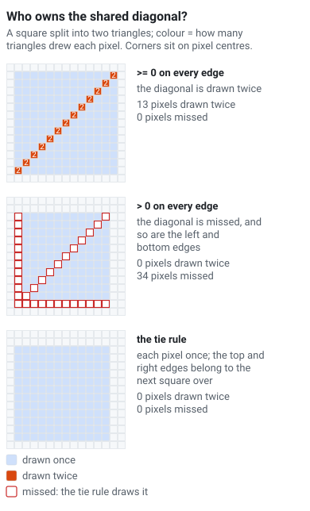

# 1 · Edge functions and the fill rule

This lesson builds the part of a GPU that decides which pixels a triangle covers, down to the pixel whose centre lies exactly on an edge two triangles share.

Before it, your GPU has an empty framebuffer. After it, it draws flat-coloured triangles, and a mesh of 98 triangles covers every pixel inside it exactly once, with no pixel drawn twice or missed along a shared edge.

**Code scope:** you type 31 code lines in `project/gpu/raster.mjs`, the bodies of `edge` (1 line), `owns` (3) and `rasterize` (27). `SUB`, `snap2` and `fullRect` are supplied in the same file and shown below. The lesson tours `drawTriangle` in `pipeline.mjs`, which calls your `rasterize`. The new application at the end is about 8 lines of your own in a new file.
**Time:** about 7 minutes to read and 30 to 60 minutes to build, here and in each of lessons 2 to 8. Neither is measured with learners yet.

## Make your project and pick a route

Run every command from the course folder. `node lab.mjs start project` makes `project/gpu/`, where each function you will write throws "not written yet". Then choose a route for this unit:

- **Type it:** `node lab.mjs next project 1 write`. Type the three bodies as the listings show them.
- **Start from working code:** `node lab.mjs next project 1 supplied`. The lab fills in the three functions. Read the listings, then do the break and the new application.
- **Brief an agent:** `node lab.mjs next project 1 ai`. See the last section.

On the untouched starter the checks wait:

<!-- code-example {"file":"examples/check-1-start.txt","language":"text","title":"node lab.mjs check 1, on the starter (first lines)"} -->
```text {"file":"examples/check-1-start.txt","title":"node lab.mjs check 1, on the starter (first lines)"}
Unit 1: Edge functions and the fill rule
  WAIT 1.edge-values: edge: not written yet
  WAIT 1.owns-directions: owns: not written yet
  WAIT 1.zero-area: rasterize: not written yet
0 of 14 checks pass in unit 1; 14 wait for functions not written yet.
```
<!-- /code-example -->

## Pixels and their centres

The framebuffer is a grid of pixels, 64 by 64 in this unit's scenes. Positions on it are **window coordinates**, as WebGL defines them. The origin is the bottom-left corner, x grows to the right and y grows upward, one unit per pixel. Pixel (4, 3) is the square from x 4 to 5 and y 3 to 4, and its **centre** is (4.5, 3.5). A triangle covers a pixel when the pixel's centre is inside it.

Corners are stored as integers in units of 1/16 pixel, a **subpixel** grid. The centre of pixel (4, 3) is [72, 56], which is 4.5 × 16 and 3.5 × 16. With integers, every test below is exact, and no rounding can make two triangles disagree about a pixel. The course uses 1/16 because WebGL promises at least that fineness: a GPU reports at least 4 subpixel bits, and 2⁴ = 16. Supplied:

<!-- code-example {"file":"examples/raster.txt","region":"snap2","language":"js","title":"snap2, in project/gpu/raster.mjs","change":"Study: supplied, with SUB = 16 and fullRect above it."} -->
```js {"file":"examples/raster.txt","region":"snap2","title":"snap2, in project/gpu/raster.mjs","change":"Study: supplied, with SUB = 16 and fullRect above it."}
// Pixel-unit [x, y] points to integer subpixel points.
export function snap2(tri) {
  const snap = (v) => Math.round(v * SUB);
  return tri.map(([x, y]) => [snap(x), snap(y)]);
}
```
<!-- /code-example -->

## The edge function

Walking along an edge from corner a to corner b, a point p is on your left, on the line, or on your right. The **edge function** tells which, with integers only:

<!-- code-example {"file":"examples/raster.txt","region":"edge","language":"js","title":"edge, in project/gpu/raster.mjs","change":"Write route: replace the throw line with this body."} -->
```js {"file":"examples/raster.txt","region":"edge","title":"edge, in project/gpu/raster.mjs","change":"Write route: replace the throw line with this body."}
// Twice the signed area of triangle a, b, p: positive when p is to
// the left of the line a -> b (y up), zero on the line.
export function edge(a, b, p) {
  return (b[0] - a[0]) * (p[1] - a[1]) - (b[1] - a[1]) * (p[0] - a[0]);
}
```
<!-- /code-example -->

Its sign gives the side: positive when p is left of a → b, 0 on the line and negative on the right (y up). Take the triangle with corners v0 at pixel position (1, 1), v1 at (11, 3) and v2 at (4, 9), in subpixels [16, 16], [176, 48] and [64, 144]. For the centre of pixel (4, 3):

    edge(v0, v1, p) = (176 − 16)(56 − 16) − (48 − 16)(72 − 16)
                    = 160 × 40 − 32 × 56 = 4,608

Positive, so the centre is left of v0 → v1. The corners go round **counter-clockwise** when the interior is on the left of every edge, which is when `edge(v0, v1, v2)` is positive. A centre is then inside when all three edge values are positive. `rasterize` names each one after the corner it faces, so `w0 = edge(v1, v2, p)`, `w1 = edge(v2, v0, p)` and `w2 = edge(v0, v1, p)`.


Once your `edge` is written, `node examples/edge-values.mjs` runs it on this triangle:

<!-- code-example {"file":"examples/edge-values.txt","language":"text","title":"node examples/edge-values.mjs"} -->
```text {"file":"examples/edge-values.txt","title":"node examples/edge-values.mjs"}
pixel (4, 3), centre [72,56]: w = 9088, 5248, 4608
pixel (3, 1), centre [56,24]: w = 14208, 4736, 0
twice the area: 18944
edge v0 -> v1 owns its ties: false
```
<!-- /code-example -->

The three values at pixel (4, 3) add up to twice the triangle's area, 18,944. Lesson 3 divides by it to turn the three values into weights. Until you write `owns`, in "The tie rule" below, the last line reads `owns: not written yet` instead.

Each question ends with a `predict` command for your answer. In the terminal, `node lab.mjs lesson` prints the answer's format under each question, and `node lab.mjs question ID` shows any question again with its format.

Question 1a. With a at [16, 16] and b at [176, 16], what is `edge(a, b, p)` for the centre of pixel (5, 0)? Work it out, then commit:

```sh
node lab.mjs predict project 1a YOUR_ANSWER
```

## Walking the bounding box

`rasterize` tests only the pixels in the triangle's **bounding box**, the smallest rectangle of whole pixels that can hold a covered centre. With x in subpixels, columns run from `floor(min x / 16)` up to, but not including, `ceil(max x / 16)`, and rows the same way in y. For the triangle above, that is columns 1 to 10 and rows 1 to 8. The maximum rounds up because a corner at x 30.75 sits right of the centre of column 30, at 30.5, so column 30 may hold a covered centre, and `floor` would leave it out. The box is also clamped to `rect`, the part of the framebuffer being drawn. Visit its rows from the bottom up, each from left to right, as the listing below does: the check compares that order, and unit 7 counts cache misses in it.

Question 1b. A triangle's corners have x at 3.5, 20.625 and 12.5 pixels. How many columns does its bounding box visit?

```sh
node lab.mjs predict project 1b YOUR_ANSWER
```

## The tie rule

A centre exactly on an edge has an edge value of 0, so the inside test needs a rule for 0. Take the square with corners at (8.5, 7.5) and (56.5, 55.5), cut along its diagonal from (8.5, 55.5) to (56.5, 7.5) into two triangles that share that edge.

Question 1c. Suppose every edge counted a centre on it as inside (`w >= 0` on every edge). How many pixels would both triangles draw?

```sh
node lab.mjs predict project 1c YOUR_ANSWER
```



The figure uses a smaller square. On the square above, with `>=` on every edge the 49 centres on the diagonal are drawn by both triangles. With `>` on every edge they are drawn by neither, and so are the centres on the square's outer edges.

The fix gives each tie to exactly one triangle by a rule both triangles apply the same way. Move the centre right by a tiny amount ε and up by an even tinier ε², and see which triangle it lands in. The ε² part decides only when the edge is horizontal. So an edge **owns** its ties when the triangle's interior lies towards +x from it, to the right on the screen, or, for a horizontal edge, above it. Both WebGL backends this course measured, the software or GPU that carries out a browser's WebGL drawing, use exactly this rule: SwiftShader, which renders in software, and an Apple M5 GPU through Metal. Graphics texts call it the top-left rule. Direct3D, Microsoft's graphics interface on Windows, documents the same formula in its own coordinates, where y counts downward, so there it hands ties to top and left edges. In WebGL's coordinates y counts upward, so on the screen the same formula hands ties to left and bottom edges.

For an edge a → b of a counter-clockwise triangle, the interior is on its left. With `gx = -(b.y - a.y)` and `gy = b.x - a.x`, the pair (gx, gy) points from the edge into the interior. The nudge moves inside when gx is positive, or when gx is 0 and gy is positive:

<!-- code-example {"file":"examples/raster.txt","region":"owns","language":"js","title":"owns, in project/gpu/raster.mjs","change":"Write route: replace the throw line with this body."} -->
```js {"file":"examples/raster.txt","region":"owns","title":"owns, in project/gpu/raster.mjs","change":"Write route: replace the throw line with this body."}
// A centre exactly on edge a -> b of a counter-clockwise triangle
// belongs to the triangle if nudging it right by a tiny e and up by
// e * e moves it inside: the edge's inward normal points right, or
// straight up when the edge is horizontal.
export function owns(a, b) {
  const gx = -(b[1] - a[1]);
  const gy = b[0] - a[0];
  return gx > 0 || (gx === 0 && gy > 0);
}
```
<!-- /code-example -->

In the grid figure under "The edge function", edge v0 → v1 runs right and a little up. Its interior is above and to the left, gx is −32, so it doesn't own its ties. The ringed centre at pixel (3, 1) belongs to whatever triangle lies below that edge.

Question 1d. Each of these is an edge a → b of a counter-clockwise triangle. Which own their ties? (a) a → b runs straight down, (b) straight up, (c) straight right, (d) straight left.

```sh
node lab.mjs predict project 1d YOUR_ANSWER
```

## Winding order

Scenes don't promise counter-clockwise corners. `rasterize` checks the sign of `edge(v0, v1, v2)`. A value of 0 means a triangle with no area, which covers nothing. A negative value means clockwise, so it swaps v1 and v2 and works counter-clockwise. `rasterize` calls `emit` with each covered pixel and its three edge values, and those must still belong to the corners in the caller's order, so after a swap it passes w0, w2, w1. Lesson 3 blends colours with these weights, and a swapped pair would put green where blue belongs.

<!-- code-example {"file":"examples/raster.txt","region":"rasterize","language":"js","title":"rasterize, in project/gpu/raster.mjs","change":"Write route: replace the throw line with this body."} -->
```js {"file":"examples/raster.txt","region":"rasterize","title":"rasterize, in project/gpu/raster.mjs","change":"Write route: replace the throw line with this body."}
export function rasterize(tri, rect, emit) {
  let [v0, v1, v2] = tri;
  const area = edge(v0, v1, v2);
  if (area === 0) return 0;
  // Work counter-clockwise; remember to hand weights back unswapped.
  const swapped = area < 0;
  if (swapped) [v1, v2] = [v2, v1];

  const xs = [v0[0], v1[0], v2[0]];
  const ys = [v0[1], v1[1], v2[1]];
  const x0 = Math.max(rect.x0, Math.floor(Math.min(...xs) / SUB));
  const x1 = Math.min(rect.x1, Math.ceil(Math.max(...xs) / SUB));
  const y0 = Math.max(rect.y0, Math.floor(Math.min(...ys) / SUB));
  const y1 = Math.min(rect.y1, Math.ceil(Math.max(...ys) / SUB));

  const own = [owns(v1, v2), owns(v2, v0), owns(v0, v1)];
  const inside = (w, k) => w > 0 || (w === 0 && own[k]);
  let count = 0;
  for (let y = y0; y < y1; y++) {
    for (let x = x0; x < x1; x++) {
      const p = [x * SUB + SUB / 2, y * SUB + SUB / 2];
      const w0 = edge(v1, v2, p);
      const w1 = edge(v2, v0, p);
      const w2 = edge(v0, v1, p);
      if (!inside(w0, 0) || !inside(w1, 1) || !inside(w2, 2)) continue;
      if (swapped) emit(x, y, w0, w2, w1);
      else emit(x, y, w0, w1, w2);
      count++;
    }
  }
  return count;
}
```
<!-- /code-example -->

The supplied `drawTriangle` in `pipeline.mjs` is the caller. It hands `rasterize` an `emit` that records each covered pixel as a **fragment**, one triangle's claim on one pixel, and in this unit every fragment takes the colour of the triangle's first corner, v0. Now check, and draw this unit's scenes:

```sh
node lab.mjs check 1
node lab.mjs view 1
```

<!-- code-example {"file":"examples/view-1.txt","language":"text","title":"node lab.mjs view 1 (first two of five scenes)"} -->
```text {"file":"examples/view-1.txt","title":"node lab.mjs view 1 (first two of five scenes)"}
Wrote project/out/u1-tieScenes-one-triangle.png: one-triangle, 64 × 64
       pixels, each drawn 5 × 5.
  counted: fragments 1,330, shaded 1,330, warps 0, issues 0
Wrote project/out/u1-tieScenes-shared-diagonal.png: shared-diagonal, 64
       × 64 pixels, each drawn 5 × 5.
  counted: fragments 2,304, shaded 2,304, warps 0, issues 0
```
<!-- /code-example -->

## Watertight meshes

A mesh is **watertight** when neighbouring triangles share their corners exactly. The tie rule then makes every centre inside the mesh belong to exactly one triangle, because the two triangles on a shared edge see it from opposite sides. One owns its ties and the other doesn't. The check builds five seeded meshes of 98 triangles with jittered corners and requires each of their 3,600 inside pixels to be drawn exactly once.

## Snapping to the subpixel grid

Corners off the grid are rounded to the nearest 1/16 pixel before any edge value is computed, by `snap2`. The GPU behind WebGL snaps corners too, to at least 1/16 pixel. An edge that the scene puts at x 20.52 lands at 20.5, exactly on the centres of column 20, and the tie rule decides those centres. If the edge is computed in floating point without the snap, it misses the centres of column 20, and in the check's off-grid scene 73 pixels change owner.

Question 1e. A corner sits at x 5.28 pixels. Where does `snap2` put it, in pixels?

```sh
node lab.mjs predict project 1e YOUR_ANSWER
```

## Break it, see it, repair it

In your `owns`, replace the body with `return true;`, so every edge owns its ties, which is `>=` on every edge. Then run `node lab.mjs check 1`:

<!-- code-example {"file":"examples/check-1-break.txt","language":"text","title":"node lab.mjs check 1, with owns returning true (the seam case and the count)"} -->
```text {"file":"examples/check-1-break.txt","title":"node lab.mjs check 1, with owns returning true (the seam case and the count)"}
  FAIL 1.seam-once: Two triangles sharing an edge must not both draw a
       pixel whose centre lies on that edge. On "shared-diagonal" (a
       square cut along its diagonal) 49 pixels were drawn twice, first
       at (56, 7): both edges claimed the tie.
       Reread lesson 1, "The tie rule".
7 of 14 checks pass in unit 1.
```
<!-- /code-example -->

The diagonal is drawn twice, as in question 1c, and six other cases fail with it. Put your body back and check again until all 14 pass. Each run is saved in `project/attempts/`.

## A vertex shared by six triangles

The centre of pixel (32, 32), at (32.5, 32.5), is a corner of six triangles. Going round counter-clockwise, their outer corners are r0 (52.5, 32.5), r1 (42.5, 50.5), r2 (22.5, 50.5), r3 (12.5, 32.5), r4 (22.5, 14.5) and r5 (42.5, 14.5). Triangle k has the centre, rk and the next corner round as its corners (r0 comes after r5).

Question 1t. Which triangle owns pixel (32, 32)? Answer with its number k.

```sh
node lab.mjs predict project 1t YOUR_ANSWER
```

Create `project/transfer/1.mjs` and in it export `vertexOwner(c, ring)`. `c` is the shared corner, on a pixel centre, and `ring` the outer corners in counter-clockwise order, all as `[x, y]` in subpixels. It returns the number k of the one triangle (c, ring[k], ring[k + 1]) that owns the pixel whose centre is c. You may import `owns` from `'../gpu/raster.mjs'`. Don't rasterize. Decide from the corners. `node lab.mjs check 1` now ends with the new application's own lines, which test six rings of triangles around a shared corner, this one among them:

```sh
node lab.mjs check 1
```

<!-- code-example {"file":"examples/transfer-1.txt","language":"text","title":"node lab.mjs check 1, the new application's lines, before the file exists"} -->
```text {"file":"examples/transfer-1.txt","title":"node lab.mjs check 1, the new application's lines, before the file exists"}
New application: A vertex shared by six triangles
  WAIT t1.vertex-owner: vertexOwner: not written yet (make
       transfer/1.mjs in your project folder, as lesson 1 asks)
0 of 1 pass; 1 wait for files not made yet.
```
<!-- /code-example -->

## Brief an agent

On the AI route, `node lab.mjs next project 1 ai` writes `project/briefs/01.md` with headings to fill in your own words. They cover the goal, the interface of the three functions, the constraints (integer subpixels, the tie rule, no packages, nothing else changes), the check command and what to hand back. `node lab.mjs brief 1` checks that it names the interface, the constraints and the check command, without grading the writing. Then run `node lab.mjs check 1 --help-used "agent: NAME"`, read the agent's code, and do the break and the new application yourself.

Lesson 2 brings the courtyard, a 3D scene, to these window coordinates, with a camera, a cut at the near plane and the snap you met here.
